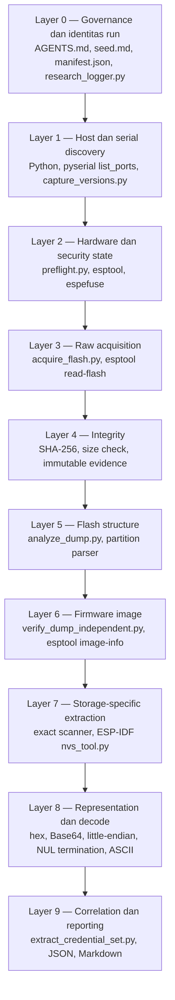
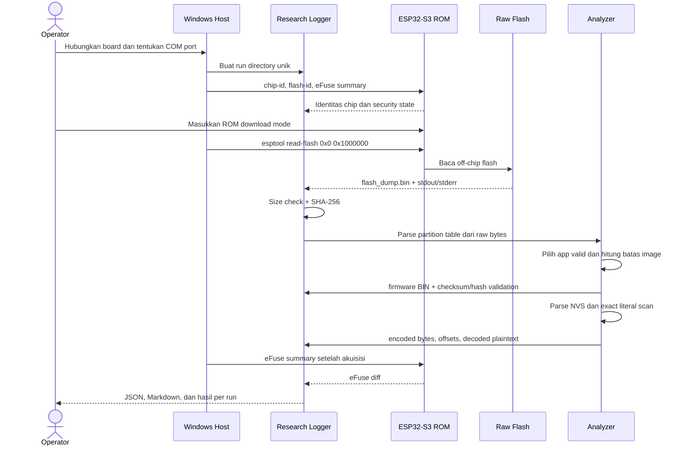
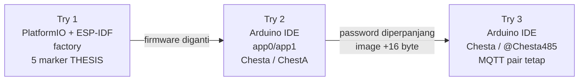

# Skenario 1 — Laporan Teknis Akuisisi Firmware dan Ekstraksi Credential, Try 1–3

> **Klasifikasi:** laporan evidence lokal. Dokumen ini memuat plaintext credential sintetis/terkontrol dari perangkat penelitian. Lakukan redaksi sebelum publikasi.

## 1. Ruang lingkup dan status metodologis

Dokumen ini menggabungkan tiga percobaan pada ESP32-S3 `board01` dalam keadaan keamanan hardware yang teramati sama:

```text
Flash Encryption = OFF
Secure Boot V2   = OFF
ROM download     = accessible
```

Ketiganya disebut **Try 1–3** dalam laporan ini, tetapi mempunyai kedudukan metodologis berbeda:

| Try | Firmware/workflow | Kedudukan penelitian |
|---|---|---|
| Try 1 | PlatformIO + ESP-IDF, source dan marker sesuai `seed.md` | `A_BASELINE` terkontrol dan valid |
| Try 2 | Firmware berbeda, diunggah melalui Arduino IDE | validasi ekstraksi lintas toolchain; `CONFIG_MISMATCH` disengaja |
| Try 3 | Firmware Arduino IDE baru dengan perubahan credential | validasi perubahan firmware/credential; `CONFIG_MISMATCH` disengaja |

Try 2 dan Try 3 bukan replikasi formal Try 1 karena source, toolchain, layout partisi, serta nilai aplikasinya berbeda. Keduanya tetap berguna untuk menjawab pertanyaan teknis berikut:

> Apakah pipeline yang sama tetap dapat memperoleh raw flash, membentuk file firmware BIN tanpa BIN asli, memetakan penyimpanan credential, dan memulihkan plaintext ketika firmware serta nilainya berubah?

## 2. Ringkasan hasil

Ketiga akuisisi berhasil membaca tepat 16 MiB. Setiap dump mempunyai hash berbeda dan setiap image aplikasi dapat diidentifikasi serta divalidasi secara struktural.

| Properti | Try 1 | Try 2 | Try 3 |
|---|---|---|---|
| Run ID | `46879abd4c3e` | `0ee84814b6b1` | `e7f40a98b830` |
| Port | `COM5` | `COM5` | `COM5` |
| Chip | ESP32-S3 rev v0.2 | ESP32-S3 rev v0.2 | ESP32-S3 rev v0.2 |
| Flash | 16 MiB | 16 MiB | 16 MiB |
| Workflow firmware | PlatformIO + ESP-IDF | Arduino IDE | Arduino IDE |
| Layout aplikasi | `factory` | OTA `app0/app1` | OTA `app0/app1` |
| App aktif | `factory` | `app0` | `app0` |
| Ukuran image | 773.728 byte | 871.008 byte | 871.024 byte |
| Status acquisition | `SUCCESS` | `SUCCESS` | `SUCCESS` |
| Durasi acquisition | 410,788 s | 410,690 s | 409,518 s |
| Secure Boot | OFF | OFF | OFF |
| Flash Encryption | OFF | OFF | OFF |
| Runtime boot evidence | terkonfirmasi | tidak dicapture pada run | tidak dicapture pada run |

SHA-256 utama:

| Artefak | Try 1 | Try 2 | Try 3 |
|---|---|---|---|
| Raw dump | `1c1cfa61d87269ad196e330515ac5e3319e11f1626359fd0d27f00c203770d20` | `aa66b8dc56ebc401e78b277dbbad5b2c65567f5feeba9ecdac400fddd6ee1b23` | `a6ff65bacdd20f97e78a23fa7e1016775d6c307ca0e6ff154ee29795cf68b867` |
| App image | `5ef5be740464ce9a8a7c66b4af10265a1fc112caec21de0fdfb2a139d63f7f70` | `37d76a0c9c3bcb3b3b83d3996f6966e1f75770d1949fef3cc2e7d2f411537d6f` | `312ca06acc5f6a3fd2a08a7a297f1ae49a5510e843a602774d39b2c274c9ff80` |

### 2.1 Konvensi timestamp dan delta time

Metrik waktu dikompilasi pada `2026-10-10T13:55:46.895+07:00` dari `events.jsonl`, `acquisition.json`, dan setiap `host/commands/*/command.json`. Semua timestamp memakai ISO-8601 dengan offset zona waktu eksplisit `+07:00`.

Definisi yang digunakan:

```text
delta time = ended_at - started_at
```

| Metrik | Definisi |
|---|---|
| Command duration | durasi monotonic yang dicatat `ResearchRun.command()` untuk satu proses eksternal |
| Event envelope | selisih antara event awal dan event selesai suatu fase, termasuk overhead wrapper |
| Core run wall time | `RUN_CREATED` sampai event `RUN_COMPLETED` pertama |
| Full evidence window | `RUN_CREATED` sampai timestamp evidence terakhir, termasuk analisis retrospektif dan jeda operator |
| Active logged command time | jumlah durasi semua command yang tercatat; dapat overlap dan tidak sama dengan wall time |
| `null`/`NOT_CAPTURED` | timestamp memang tidak tersedia; tidak diganti dengan estimasi |

Durasi fase tidak boleh dijumlahkan untuk memperoleh total karena beberapa fase overlap. Pada Try 2 dan Try 3, raw analysis dan capture eFuse sesudah acquisition berjalan pada rentang waktu yang bertumpang-tindih. Event envelope juga dapat mencakup pemeriksaan hash, pembuatan metadata, dan overhead proses selain command utama.

### 2.2 Ringkasan waktu per Try

| Metrik | Try 1 | Try 2 | Try 3 |
|---|---:|---:|---:|
| `RUN_CREATED` | `2026-09-26T13:07:28.903+07:00` | `2026-10-10T12:26:24.862+07:00` | `2026-10-10T12:55:13.675+07:00` |
| First `RUN_COMPLETED` | `2026-09-26T13:26:12.424+07:00` | `2026-10-10T12:40:10.013+07:00` | `2026-10-10T13:08:59.528+07:00` |
| Core run wall time | 1.123,521 s / `00:18:43.521` | 825,151 s / `00:13:45.151` | 825,853 s / `00:13:45.853` |
| Last observed evidence | `2026-09-26T14:48:37.267+07:00` | `2026-10-10T13:17:42.327+07:00` | `2026-10-10T13:08:59.528+07:00` |
| Full evidence window | 6.068,364 s / `01:41:08.364` | 3.077,465 s / `00:51:17.465` | 825,853 s / `00:13:45.853` |
| Active logged commands | 478,323 s / `00:07:58.323` | 428,569 s / `00:07:08.569` | 425,780 s / `00:07:05.780` |
| Logged command count | 33 | 30 | 29 |

Try 1 dan Try 2 mempunyai full evidence window yang lebih panjang daripada core run karena analisis lanjutan dilakukan setelah event `RUN_COMPLETED` pertama. Selisih tersebut adalah wall-clock evidence window, bukan tambahan waktu komputasi kontinu.

### 2.3 Metrik acquisition yang dapat dibandingkan

| Metrik | Try 1 | Try 2 | Try 3 |
|---|---:|---:|---:|
| Acquisition envelope start | `2026-09-26T13:17:29.436+07:00` | `2026-10-10T12:26:50.294+07:00` | `2026-10-10T12:55:33.814+07:00` |
| Acquisition envelope end | `2026-09-26T13:24:22.649+07:00` | `2026-10-10T12:33:43.425+07:00` | `2026-10-10T13:02:25.795+07:00` |
| Envelope delta | 413,213 s | 413,131 s | 411,981 s |
| `flash_read` start | `2026-09-26T13:17:31.823+07:00` | `2026-10-10T12:26:52.702+07:00` | `2026-10-10T12:55:36.248+07:00` |
| `flash_read` end | `2026-09-26T13:24:22.611+07:00` | `2026-10-10T12:33:43.392+07:00` | `2026-10-10T13:02:25.766+07:00` |
| Command delta | 410,788 s | 410,690 s | 409,518 s |
| Approx. wrapper overhead | 2,425 s | 2,441 s | 2,463 s |
| Bytes acquired | 16.777.216 | 16.777.216 | 16.777.216 |
| Throughput | 0,038950 MiB/s | 0,038959 MiB/s | 0,039070 MiB/s |

Throughput dihitung sebagai `actual_size / 1.048.576 / flash_read_seconds`. Approximate wrapper overhead adalah event-envelope wall time dikurangi monotonic command duration; nilainya mencakup help/syntax resolution, flash-ID check, Git capture, hashing, dan penulisan metadata. Nilai acquisition yang hampir sama pada tiga run mendukung konsistensi operasional melalui koneksi dan baud yang sama.

Metrik mesin tersedia pada:

- [`results/skenario_1_timing_metrics.json`](results/skenario_1_timing_metrics.json) — seluruh event, command, phase, timestamp, dan delta.
- [`results/skenario_1_timing_metrics.csv`](results/skenario_1_timing_metrics.csv) — format tabular untuk spreadsheet/statistik.

### 2.4 Statistik deskriptif acquisition

Untuk tiga command full-flash read dengan ukuran identik 16 MiB:

| Statistik | Nilai |
|---|---:|
| Jumlah observasi | 3 |
| Mean duration | 410,332 s |
| Median duration | 410,690 s |
| Minimum | 409,518 s |
| Maximum | 410,788 s |
| Range | 1,270 s |
| Population standard deviation | 0,577 s |
| Coefficient of variation | 0,141% |
| Mean throughput | 0,038993 MiB/s |

Variasi durasi command sangat kecil pada tiga snapshot. Statistik ini menggambarkan repeatability operasional koneksi/acquisition yang diamati. Dengan satu board dan hanya tiga observasi, tabel tidak digunakan untuk klaim statistik populasi perangkat ESP32-S3.

## 3. Arsitektur berlapis

Pipeline dipisahkan menjadi beberapa layer agar setiap klaim mempunyai sumber evidence yang jelas.



### 3.1 Tool pada setiap layer

Tool dibagi menjadi empat kelas agar asal dan otoritasnya tidak tercampur:

| Kelas | Peran metodologis |
|---|---|
| Vendor-authoritative | berkomunikasi dengan chip atau memahami format vendor: ESP-IDF, esptool, espefuse, espsecure, `nvs_tool.py` |
| Standard infrastructure | menyediakan build host, serial enumeration, hashing, version control, dan shell: PlatformIO, Python, pySerial, Git, PowerShell |
| Research orchestration | script lokal untuk logging, immutability, pengikatan identitas run, dan urutan eksperimen |
| Independent/cross-check analysis | parser kecil dan exact scanner lokal yang hasilnya diperiksa kembali dengan tool vendor serta hash |

Prinsip pemilihannya adalah **existing official tool first** untuk protokol chip dan format vendor. Script buatan penelitian tidak menggantikan `esptool`, `espefuse`, `espsecure`, atau parser NVS ESP-IDF. Script lokal mengorkestrasi tool tersebut dan menambahkan evidence semantics yang tidak disediakan oleh CLI vendor sebagai satu workflow eksperimen.

### 3.2 Tool eksternal: fungsi, sumber, dan justifikasi

| Layer | Tool | Asal/provenance | Fungsi dalam penelitian | Justifikasi pemilihan |
|---|---|---|---|---|
| Editor | [Visual Studio Code](https://code.visualstudio.com/docs) | Microsoft; editor resmi lintas platform | membuka repository, terminal, source, dan konfigurasi PlatformIO | sesuai host Windows dan tidak menjadi sumber measurement; hasil tidak bergantung pada state GUI |
| Host shell | [PowerShell](https://learn.microsoft.com/en-us/powershell/) | Microsoft; tersedia pada Windows | menjalankan command dan manual operator steps | Windows-first, tersedia native, dan command tetap direkam oleh logger Python |
| Runtime analisis | [Python](https://docs.python.org/3/) 3.14 | Python Software Foundation; `C:\Python314\python.exe` pada run | menjalankan logger, wrapper, parser, hashing, JSON/CSV, dan tests | standard library kuat, portable, byte-safe, mudah diaudit, dan tidak memerlukan WSL/Docker |
| Serial discovery | [pySerial `serial.tools.list_ports`](https://pyserial.readthedocs.io/en/latest/tools.html) | proyek pySerial dari environment Python | menampilkan COM port, description, VID:PID, serial, dan USB location pada Windows | API memang menyediakan metadata USB Windows; mengurangi salah pilih port dibanding menebak `COMx` |
| Build orchestrator | [PlatformIO Core](https://docs.platformio.org/en/latest/core/index.html) 6.2.0 | PlatformIO; dijalankan sebagai `py -3.12 -m platformio` | top-level build/upload workflow dan package resolution | memenuhi desain Windows/VS Code; menyediakan environment terpisah serta command CLI yang dapat dilog |
| Framework integration | [PlatformIO ESP-IDF framework support](https://docs.platformio.org/en/latest/frameworks/espidf.html) | PlatformIO integration untuk framework resmi Espressif | menghubungkan environment PlatformIO dengan CMake, `sdkconfig.defaults`, dan ESP-IDF | mempertahankan PlatformIO sebagai workflow sambil menjadikan ESP-IDF otoritas security configuration |
| Board starting manifest | [PlatformIO ESP32-S3-DevKitC-1](https://docs.platformio.org/en/latest/boards/espressif32/esp32-s3-devkitc-1.html) | PlatformIO board registry | starting board definition | hanya bootstrap; tidak dipakai sebagai bukti N16R8 sehingga flash/PSRAM tetap diverifikasi pada perangkat |
| Firmware framework | [ESP-IDF](https://docs.espressif.com/projects/esp-idf/en/latest/esp32s3/) | Espressif, didistribusikan melalui package `framework-espidf` PlatformIO | API firmware, partition semantics, NVS, Secure Boot, dan Flash Encryption | framework resmi vendor dan sumber kebenaran untuk security configuration ESP32-S3 |
| Chip/flash transport | [esptool](https://docs.espressif.com/projects/esptool/en/latest/esp32s3/) 5.4.0 | Espressif; Python module pada environment host | chip identification, flash ID, read/write flash, dan image metadata | implementasi resmi protokol ROM/stub Espressif; menghindari reimplementasi transport low-level |
| Acquisition command | [`esptool read-flash`](https://docs.espressif.com/projects/esptool/en/latest/esp32s3/esptool/basic-commands.html) | bagian dari esptool | membaca byte `0x00000000–0x00FFFFFF` menjadi raw dump | command resmi untuk readback flash; stdout, stderr, exit code, size, dan durasi dipertahankan |
| Image cross-check | `esptool image-info` | bagian dari esptool | memeriksa target chip, segment, checksum, appended hash, dan metadata aplikasi pada carved BIN | validasi konvergen: boundary dihitung parser lokal, lalu hasil carve diterima tool resmi yang independen dari perhitungan boundary tersebut |
| eFuse state | [espefuse](https://docs.espressif.com/projects/esptool/en/latest/esp32s3/espefuse/) 5.4.0 dan [`summary`](https://docs.espressif.com/projects/esptool/en/latest/esp32s3/espefuse/summary-cmd.html) | Espressif; terpasang bersama esptool | membaca eFuse text dan JSON sebelum/sesudah run | output resmi mencakup raw value serta read/write protection; mode yang dipakai read-only dan tidak membakar eFuse |
| Security artifacts | [espsecure](https://docs.espressif.com/projects/esptool/en/latest/esp32s3/espsecure/) 5.4.0 | Espressif; terpasang bersama esptool | signing/verifying Secure Boot dan manipulasi data Flash Encryption untuk fase keamanan | tool vendor yang tepat untuk skenario B–D; pada Try 1–3 hanya versi/help dicapture dan tidak ada operasi security provisioning |
| NVS semantics | [ESP-IDF NVS](https://docs.espressif.com/projects/esp-idf/en/latest/esp32s3/api-reference/storage/nvs_flash.html) dan `components/nvs_flash/nvs_partition_tool/nvs_tool.py` | utility yang dikirim dalam package resmi ESP-IDF di `D:\IoT\.platformio-core\packages\framework-espidf` | membaca namespace, key, state, span, blob, dan metadata record NVS | lebih kuat daripada `strings` karena dapat membedakan record `Written`, cache, dan residu record lama; path dan command parser diarsipkan per run |
| Integrity | [Python `hashlib`](https://docs.python.org/3/library/hashlib.html) SHA-256 | Python standard library; SHA-256 termasuk algoritme yang dijamin tersedia | menghitung hash dump, carved partition, firmware, dan artifact | deterministic, portable, streaming, dan tidak bergantung pada instalasi tool eksternal |
| Byte representation | [Python `base64`](https://docs.python.org/3/library/base64.html), `bytes.hex()`, `int.from_bytes()` | Python standard library | Base64 decode/encode, hex display, dan little-endian length parsing | transformasi eksplisit dan reversible; Base64 tidak salah dilaporkan sebagai enkripsi |
| Source provenance | [Git](https://git-scm.com/docs/git-rev-parse) | Git dari host `PATH` | `git rev-parse HEAD` dan `git status --short` | mengikat evidence ke revisi source serta mencatat dirty state; Git bukan alat acquisition |
| Optional key utility | OpenSSL | executable host eksternal yang dicari saat version capture | key/signing utility tambahan jika diperlukan | tidak tersedia pada ketiga run (`FileNotFoundError`) dan tidak dipakai menghasilkan hasil Skenario 1; ketidaktersediaannya tetap dicatat |

Versi yang teramati pada ketiga run adalah PlatformIO Core 6.2.0 dan esptool/espefuse/espsecure 5.4.0. `nvs_tool.py` berasal dari package ESP-IDF yang sama dengan environment PlatformIO, bukan parser NVS acak dari pihak ketiga. Karena sintaks CLI dapat berubah antarversi, wrapper memeriksa help/subcommand tool terpasang dan menyimpan command aktual.

### 3.3 Tool lokal: fungsi dan alasan harus dibuat

| Tool lokal | Fungsi spesifik | Mengapa existing tool belum cukup | Cara hasilnya divalidasi |
|---|---|---|---|
| [`research_logger.py`](scripts/lib/research_logger.py) | membuat run ID, ISO timestamp, JSONL event/audit, command record, stdout/stderr, dan create-new writes | esptool/PIO hanya menjalankan operasi; tidak membuat schema evidence lintas-tool atau immutable run directory | unit test overwrite protection dan manifest; seluruh file dapat diperiksa manual |
| [`capture_versions.py`](scripts/capture_versions.py) | menangkap Python, PIO, package, Espressif tools, Git, OpenSSL, dan host info | setiap CLI hanya mengetahui versinya sendiri | raw stdout/exit code disimpan untuk setiap command |
| [`preflight.py`](scripts/preflight.py) | menggabungkan port, chip, flash ID, flash capacity, PSRAM, dan observed security state | tidak ada satu command vendor yang menghasilkan seluruh board identity sesuai schema penelitian | nilai berasal dari raw esptool/espefuse output dan parsed JSON tersimpan bersama |
| [`capture_efuse.py`](scripts/capture_efuse.py) | membuat capture `before`/`after` yang tidak tertimpa dan diff terstruktur | `espefuse summary` membaca satu snapshot, tetapi tidak mengelola pairing run dan diff | raw text + official JSON dipertahankan; diff dapat direproduksi |
| [`build_evidence.py`](scripts/build_evidence.py) | mengarsipkan resolved `sdkconfig`, ELF/BIN/map, Git commit, dan semua hash | PlatformIO menghasilkan build files, tetapi tidak membentuk evidence manifest immutable per experiment | hash artifact dibandingkan dengan file yang diarsipkan |
| [`flash_baseline.py`](scripts/flash_baseline.py) | mencatat build/upload command dan artifact relationship | manual Upload GUI tidak memberikan structured command evidence yang konsisten | exit code, logs, dan boot capture dipertahankan |
| [`capture_serial.py`](scripts/capture_serial.py) | memisahkan boot log dan runtime log serta memeriksa secret exposure | terminal serial interaktif mudah hilang dan sulit diproses ulang | log disimpan sebagai artifact; exact secret scan menghasilkan event terpisah |
| [`acquire_flash.py`](scripts/acquire_flash.py) | memvalidasi flash size, memanggil official `read-flash`, mempertahankan partial dump, dan menghitung hash | esptool dapat membaca flash, tetapi tidak memberi taxonomy run, overwrite protection, manifest update, atau partial-evidence policy | command esptool utuh, exit code, size, hash, stdout, dan stderr semuanya tersedia |
| [`analyze_dump.py`](scripts/analyze_dump.py) | file characterization, exact marker scan, partition-table parse, image candidate detection, entropy/FF/00 summary | esptool tidak menghasilkan satu report forensic JSON dengan marker dan partition evidence; generic strings tidak memahami struktur | parser bekerja pada raw bytes; image kemudian diverifikasi dengan esptool; host tests memakai fixtures sintetis |
| [`verify_dump_independent.py`](scripts/verify_dump_independent.py) | menghitung batas image dari header/segments/footer dan membuat BIN tanpa build asli | `image-info` memerlukan sebuah file image; ia tidak memilih boundary image dari full raw partition untuk workflow ini | checksum dan appended hash dihitung, lalu carved BIN diperiksa ulang oleh official `esptool image-info` |
| [`extract_firmware_secrets.py`](scripts/extract_firmware_secrets.py) | exact scan marker Try 1 serta image/flash offset dan representasi hex/Base64 | `strings` dapat menampilkan teks tetapi tidak memberikan rule exact marker, count, address type, dan JSON schema penelitian | Try 1 dibandingkan byte-for-byte dengan archived build firmware; SHA-256 identik |
| [`extract_wifi_credentials.py`](scripts/extract_wifi_credentials.py) | carve NVS, menjalankan official parser, memilih active `sta.ssid`/`sta.pswd`, menghitung alamat fisik, dan decode blob | official parser menghasilkan record, tetapi tidak menghubungkannya ke raw dump hash, run ID, active credential report, atau exact flash addresses | parser minimal/full, raw NVS bytes, key state, decoded payload, dan offsets dikorelasikan |
| [`extract_credential_set.py`](scripts/extract_credential_set.py) | menyatukan Wi-Fi NVS dengan literal MQTT app image serta memisahkan byte confidence dari semantic-role confidence | data berada pada dua storage layer dan tidak ada tool vendor yang membuat korelasi empat-variable thesis schema | firmware/NVS harus berasal dari dump hash yang sama; exact byte occurrence dan segment address dihitung |
| [`compile_timing_metrics.py`](scripts/compile_timing_metrics.py) | menurunkan start/end/delta, active command time, wall window, throughput, dan retry dari event/command evidence | tool vendor mencatat durasi operasinya sendiri, tetapi tidak menyatukan chronology lintas proses atau membedakan operator gap | ISO timestamp dihitung timezone-aware; command duration tetap memakai monotonic record; JSON/CSV dan unit test tersedia |
| [`compare_results.py`](scripts/compare_results.py) | menghasilkan summary JSON/CSV antar-run dengan unknown tetap `null` | hasil tool per-operasi tidak otomatis membentuk comparison matrix A–D | hanya membaca structured evidence; tidak mengisi expected result sebagai observed result |
| [`provisioning_plan.py`](scripts/provisioning_plan.py) | membuat dry-run/security plan dengan destructive-operation gate | Espressif menyediakan burn commands, tetapi research contract memerlukan stop-before-burn default | tests memastikan gate selalu menolak irreversible execution pada implementasi awal |

Script lokal sengaja kecil dan menggunakan Python standard library bila memungkinkan. Source-nya berada di repository dan dapat direview, di-hash, diuji dengan fixture sintetis, atau diganti oleh implementasi independen selama schema serta interpretation rules tetap sama.

### 3.4 Mengapa tidak hanya memakai satu existing forensic tool?

Existing tools tetap dipakai, tetapi cakupannya bersifat **point tool**:

```text
esptool    → komunikasi chip, flash read, image metadata
espefuse   → eFuse state
espsecure  → secure-boot/flash-encryption artifacts
nvs_tool   → record NVS
PlatformIO → build/package orchestration
```

Tidak satu pun dari tool tersebut sendiri mengikat:

```text
Git commit
→ resolved build config
→ board/eFuse state
→ exact acquisition command
→ immutable raw dump + hash
→ partition/app/NVS structure
→ exact credential offsets
→ decoded value
→ timestamp/delta
→ comparison result
```

Karena itu, membuat orchestration layer bukan duplikasi fungsi vendor. Ia menghubungkan output resmi menjadi satu instrumen penelitian yang reproducible dan auditable.

Alternatif umum tetap mempunyai tempat, tetapi tidak dipilih sebagai sumber hasil utama:

| Alternatif | Status | Alasan metodologis |
|---|---|---|
| `strings`/Sysinternals Strings | supplemental | menemukan printable text, tetapi tidak membuktikan record aktif, storage type, image boundary, atau semantic key |
| Hex editor GUI | supplemental | baik untuk inspeksi visual, tetapi langkah klik sulit direproduksi dan hasilnya bukan structured evidence |
| binwalk | optional | bermanfaat untuk signature exploration, tetapi core pipeline harus Windows-native dan tidak boleh bergantung pada instalasi opsional; validasi ESP/NVS lebih tepat memakai tool vendor |
| Arduino IDE GUI | source/upload workflow Try 2–3 | bukan evidence engine; tidak menyimpan seluruh stdout/stderr, eFuse snapshot, raw acquisition, dan immutable run schema |
| Manual invocation esptool/espefuse | tetap digunakan melalui wrapper | command manual mudah kehilangan versi, cwd, timestamp, failure, dan hubungan dengan manifest; wrapper merekamnya tanpa mengubah fungsi tool resmi |
| Screenshot-only documentation | tidak dijadikan evidence primer | tidak machine-readable, sulit di-hash/aggregate, dan tidak cukup untuk mengulang analisis |

### 3.5 Pembelaan validitas ilmiah metode

Kekuatan metode tidak berasal dari banyaknya script buatan sendiri. Kekuatan berasal dari pemisahan measurement, provenance, dan cross-validation berikut:

| Aspek validitas | Implementasi dalam penelitian | Dampak |
|---|---|---|
| Construct validity | Secure Boot diukur sebagai authenticity/boot authorization; Flash Encryption sebagai confidentiality | mencegah salah tafsir plaintext pada Secure Boot-only sebagai kegagalan kontrol |
| Measurement validity | recovery hanya positif jika exact bytes ditemukan dengan count dan offset | hasil tidak bergantung pada intuisi visual atau entropy saja |
| Convergent validation | parser lokal menentukan boundary; esptool memvalidasi image; official NVS parser memberi key/state; raw scanner mengonfirmasi bytes | satu bug/tool tidak menjadi satu-satunya dasar klaim |
| Internal validity | Try 1 memakai source/marker/config terkontrol; Try 2–3 diberi label `CONFIG_MISMATCH` | perubahan toolchain tidak disamarkan sebagai replikasi eksperimen utama |
| Reproducibility | command, cwd, version, timestamps, stdout/stderr, config, hash, dan run IDs disimpan | peneliti lain dapat mengulang atau mengaudit urutan yang sama |
| Repeatability | tiga acquisition 16 MiB dibandingkan dengan metrik identik | kestabilan operasional dapat dinilai secara kuantitatif |
| Falsifiability | failure, partial, incomplete attempt, `null`, dan mismatch tetap dipertahankan | pipeline tidak memaksa hasil sesuai ekspektasi |
| Evidence integrity | create-new output, raw dump tidak diedit, SHA-256 di setiap boundary penting | perubahan artifact dapat dideteksi |
| Transparency | custom parser berukuran kecil, version-controlled, dan diuji dengan fixture | asumsi dapat diperiksa lebih mudah daripada proses GUI tertutup |
| External-validity control | klaim dibatasi pada satu board, kondisi keamanan, dan threat model yang diuji | mencegah generalisasi berlebihan |

Triangulasi paling kuat pada Skenario 1 adalah:

1. Try 1 carved firmware mempunyai SHA-256 yang sama dengan archived build firmware.
2. Try 2/3 tidak memiliki BIN asli, tetapi header, segment bounds, checksum, appended hash, dan `esptool image-info` semuanya valid.
3. Wi-Fi value tidak dipilih dari string semata; official NVS parser mengikatnya ke namespace, key, state `Written`, dan physical record.
4. MQTT byte recovery mempunyai exact count/address, sementara keterbatasan semantic-role mapping tetap dinyatakan.
5. Semua raw dump di-hash sebelum analisis dan source acquisition tidak diubah.

### 3.6 Research gap dan novelty yang dapat dipertahankan

Research gap proyek ini bersifat metodologis dan eksperimental. Dokumentasi vendor menyediakan tool untuk build, flash, readback, eFuse, image, dan security provisioning secara terpisah. Dokumentasi tersebut tidak dengan sendirinya menyediakan rancangan eksperimen A–D yang:

- menjaga application source identik lintas konfigurasi keamanan;
- memisahkan confidentiality dari authenticity/integrity;
- menghubungkan build config, eFuse, acquisition, raw hash, structure, marker, dan result aggregation;
- mempertahankan failed/partial attempts sebagai hasil;
- membandingkan firmware-resident literal dengan active NVS record;
- menghasilkan timestamp/delta lintas-tool yang siap dianalisis;
- tetap dapat dijalankan Windows-first tanpa bergantung pada binwalk/WSL/Docker.

Kontribusi baru yang defensible pada tingkat proyek/skripsi adalah:

1. **Evidence-first experimental pipeline** untuk ESP32-S3 yang menyatukan tool resmi ke schema run immutable.
2. **Layer-aware secret recovery**, yaitu membedakan app literal, raw-flash offset, virtual address, NVS record, parser representation, decoded payload, dan semantic role.
3. **Build-independent firmware reconstruction** dari raw dump yang divalidasi silang dengan struktur image resmi.
4. **Cross-toolchain consistency evaluation** antara PlatformIO/ESP-IDF `factory` dan Arduino IDE OTA `app0/app1` tanpa mengubah acquisition principle.
5. **Failure-aware and time-aware metrics**, termasuk retry, missing timestamp, operator gap, command duration, event envelope, dan throughput.
6. **Security-property isolation** melalui matriks A–D yang tidak menyamakan Secure Boot dengan confidentiality.

Novelty tersebut adalah novelty integrasi metode, evidence architecture, dan desain eksperimen. Penelitian ini tidak mengklaim algoritme kriptografi baru, exploit baru, atau “tool pertama di dunia”. Klaim kebaruan terhadap literatur global harus difinalkan setelah systematic literature review; laporan ini hanya menyatakan gap yang dapat dibuktikan dari scope tool resmi dan kebutuhan measurement penelitian.

### 3.7 Jawaban ringkas untuk pertanyaan penguji

**Mengapa membuat tool sendiri padahal esptool sudah ada?**  
`esptool` tetap melakukan seluruh komunikasi chip dan raw read. Script lokal memastikan command, versi, board, waktu, failure, partial output, hash, dan run identity tidak hilang.

**Mengapa hasil parser lokal dapat dipercaya?**  
Parser lokal tidak berdiri sendiri. Image diperiksa ulang oleh `esptool image-info`; NVS diparse dengan utility ESP-IDF; Try 1 dibandingkan dengan BIN build; seluruh offsets dapat dicek langsung pada raw bytes.

**Mengapa tidak memakai binwalk atau strings saja?**  
Keduanya dapat menjadi alat bantu, tetapi tidak menentukan eFuse state atau active NVS record. Core claim memerlukan struktur vendor dan provenance, bukan hanya printable strings/signature heuristics.

**Apa novelty-nya jika tool dasar sudah tersedia?**  
Novelty terletak pada desain eksperimen dan integrasi evidence: satu rantai terukur dari source/config/device state sampai exact recovered value dan timing metrics, dengan pemisahan security property serta preservation of failure.

**Apakah custom script membuat hasil subjektif?**  
Tidak jika asumsi dinyatakan, source dapat diaudit, input di-hash, output deterministic, tests tersedia, dan hasil diverifikasi dengan tool independen/vendor. Batas inference—seperti MQTT semantic role—tetap dicatat dan tidak dinaikkan menjadi observasi.

## 4. Alur metodologi end-to-end



Urutan fisik mode board adalah:

1. **Normal boot mode** digunakan jika serial boot/runtime akan dicapture.
2. **ROM download mode** digunakan untuk preflight yang memerlukan bootloader ROM, capture eFuse, dan `read-flash`.
3. Board tidak di-flash ulang dan eFuse tidak dibakar selama proses acquisition/analysis.

Try 1 mempunyai bukti boot runtime. Try 2 dan Try 3 berfokus pada acquisition dan tidak memiliki `serial_boot_success` teramati; field tersebut tetap `null`.

## 5. Proses per proses

### 5.1 Membuat evidence run

Setiap try memiliki direktori berbeda:

```text
evidence/A_BASELINE/<timestamp>_<board_id>_<run_id>/
```

Direktori berisi `host/`, `build/`, `device/`, `runtime/`, `acquisition/`, dan `analysis/`. File baru ditulis dengan mekanisme create-new sehingga artefak lama tidak tertimpa.

### 5.2 Menemukan port

Perintah awal:

```powershell
python -m serial.tools.list_ports -v
```

Koneksi yang digunakan:

```text
COM5
USB-Enhanced-SERIAL CH343
VID:PID = 1A86:55D3
USB serial = 5B8F073164
```

Kesamaan identitas USB dan informasi operator mendukung bahwa board/koneksi yang sama digunakan. Marking fisik PCB belum diverifikasi, sehingga laporan tidak memakai nama board PlatformIO sebagai bukti kapasitas hardware.

### 5.3 Preflight hardware

`preflight.py` menjalankan tool Espressif untuk:

- mengidentifikasi ESP32-S3 dan revision;
- membaca flash ID;
- menentukan kapasitas flash aktual;
- membaca informasi PSRAM bila disediakan tool;
- membuktikan ROM downloader dapat diakses.

Kapasitas acquisition 16 MiB diturunkan dari hasil deteksi, bukan diasumsikan dari label N16R8.

### 5.4 Capture eFuse

`capture_efuse.py` menyimpan raw text dan JSON eFuse sebelum dan sesudah acquisition. Ketiga try menunjukkan Secure Boot OFF dan `SPI_BOOT_CRYPT_CNT=0`, yang berarti Flash Encryption tidak aktif. Tidak ada perbedaan eFuse akibat acquisition.

### 5.5 Akuisisi flash

Command efektif pada ketiga run:

```powershell
python -m esptool --chip esp32s3 --port COM5 --baud 460800 `
  --after no-reset read-flash 0x0 0x1000000 <run>\acquisition\flash_dump.bin
```

Wrapper mencatat:

- offset dan requested size;
- actual size;
- start/end timestamp dan durasi;
- exit code;
- stdout/stderr;
- SHA-256;
- status `SUCCESS`, `PARTIAL`, atau failure taxonomy lain.

Ketiga try menghasilkan `actual_size = requested_size = 16.777.216` byte dengan exit code `0`.

### 5.6 Mapping flash

Analyzer mencari entry magic tabel partisi dan memvalidasi entry langsung dari dump. Hasilnya:

**Try 1 — PlatformIO/ESP-IDF:**

| Partisi | Offset | Size |
|---|---:|---:|
| `nvs` | `0x00009000` | `0x00006000` |
| `phy_init` | `0x0000F000` | `0x00001000` |
| `factory` | `0x00010000` | `0x00300000` |

**Try 2 dan Try 3 — Arduino IDE:**

| Partisi | Offset | Size |
|---|---:|---:|
| `nvs` | `0x00009000` | `0x00005000` |
| `otadata` | `0x0000E000` | `0x00002000` |
| `app0` | `0x00010000` | `0x00140000` |
| `app1` | `0x00150000` | `0x00140000` |
| `spiffs` | `0x00290000` | `0x00160000` |
| `coredump` | `0x003F0000` | `0x00010000` |

Tooling tidak mengunci nama partisi `factory`. Setiap partisi bertipe aplikasi diuji dan hanya image yang lolos validasi struktur yang dipilih.

### 5.7 Mendapatkan file firmware BIN

`verify_dump_independent.py` tidak membutuhkan BIN asli. Prosesnya:

```text
partisi aplikasi
→ cek magic image 0xE9
→ baca segment count
→ parse setiap segment header dan panjang data
→ tentukan checksum offset dan padding
→ validasi XOR checksum
→ validasi appended SHA-256 bila tersedia
→ potong byte tepat sampai akhir image
→ jalankan esptool image-info
```

Hasil:

| Try | Partisi | Firmware BIN | Size | Footer checksum | Appended hash |
|---|---|---|---:|---|---|
| 1 | `factory` | `firmware_independent_final.bin` | 773.728 | `0x06`, valid | valid |
| 2 | `app0` | `firmware_app0_20261010.bin` | 871.008 | `0xA3`, valid | valid |
| 3 | `app0` | `firmware_try3.bin` | 871.024 | `0xE1`, valid | valid |

Pada Try 1, carved image juga sama byte-for-byte dengan firmware build yang diarsipkan. Pada Try 2 dan Try 3, validasi tidak bergantung pada BIN asli Arduino IDE.

### 5.8 Ekstraksi credential

Ada dua jalur ekstraksi:

1. **Literal aplikasi** — mencari exact byte sequence di carved firmware BIN.
2. **NVS aktif** — memotong partisi NVS, menjalankan `nvs_tool.py`, dan memilih key berstatus `Written`.

Pencarian string mentah saja tidak cukup untuk menentukan konfigurasi aktif karena NVS bersifat log-structured. Byte lama atau record terhapus dapat tetap berada di flash. Key, namespace, state, dan alamat record dipakai untuk memilih credential Wi-Fi aktif.

### 5.9 Timeline proses Try 1

| Proses | Start | End | Delta | Status/sumber |
|---|---|---|---:|---|
| Tool-version capture | `2026-09-26T13:07:28.904+07:00` | `2026-09-26T13:07:32.289+07:00` | 3,385 s | command envelope |
| Hardware preflight | `2026-09-26T13:08:23.571+07:00` | `2026-09-26T13:08:27.646+07:00` | 4,075 s | `PREFLIGHT_STARTED` → `DEVICE_IDENTIFIED` |
| eFuse before | `2026-09-26T13:10:14.836+07:00` | `2026-09-26T13:10:17.412+07:00` | 2,576 s | text + JSON command envelope |
| PlatformIO build | `2026-09-26T13:11:50.996+07:00` | `2026-09-26T13:12:08.527+07:00` | 17,531 s | event envelope; `pio` command 17,037 s |
| PlatformIO flash | `2026-09-26T13:12:26.253+07:00` | `2026-09-26T13:12:59.314+07:00` | 33,061 s | event envelope; `pio` command 33,056 s |
| Flash selesai → boot confirmed | `2026-09-26T13:12:59.314+07:00` | `2026-09-26T13:14:44.063+07:00` | 104,749 s | observable boundary; bukan pure MCU boot time |
| Acquisition envelope | `2026-09-26T13:17:29.436+07:00` | `2026-09-26T13:24:22.649+07:00` | 413,213 s | completed |
| `esptool flash_read` | `2026-09-26T13:17:31.823+07:00` | `2026-09-26T13:24:22.611+07:00` | 410,788 s | exit `0` |
| Raw dump analysis | `2026-09-26T13:25:53.259+07:00` | `2026-09-26T13:25:54.419+07:00` | 1,160 s | completed |
| Result aggregation | `2026-09-26T13:26:12.415+07:00` | — | — | point event |
| First `RUN_COMPLETED` | `2026-09-26T13:26:12.424+07:00` | — | — | core run boundary |
| eFuse after | `2026-09-26T13:35:40.134+07:00` | `2026-09-26T13:35:42.764+07:00` | 2,630 s | dilakukan setelah first `RUN_COMPLETED` |
| Firmware-secret extraction | `2026-09-26T14:08:40.361+07:00` | `2026-09-26T14:08:40.741+07:00` | 0,380 s | completed |
| Independent image attempt 1 | `2026-09-26T14:18:05.406+07:00` | tidak tercatat | `null` | incomplete; image-info command exit `1` |
| Independent image attempt 2 | `2026-09-26T14:19:49.407+07:00` | tidak tercatat | `null` | incomplete; image-info command exit `2` |
| Independent image attempt 3 | `2026-09-26T14:21:31.939+07:00` | `2026-09-26T14:21:32.614+07:00` | 0,675 s | completed |
| Independent image final | `2026-09-26T14:48:36.197+07:00` | `2026-09-26T14:48:37.267+07:00` | 1,070 s | completed; artefak final yang dirujuk laporan |

Try 1 menunjukkan mengapa failed/incomplete attempts harus dipertahankan. Dua invocation awal tidak menghasilkan completion event yang valid; keberhasilan baru dicatat pada attempt berikutnya. Full evidence window berakhir pada independent image final, bukan pada `RUN_COMPLETED` pertama.

### 5.10 Timeline proses Try 2

| Proses | Start | End | Delta | Status/sumber |
|---|---|---|---:|---|
| Tool-version capture | `2026-10-10T12:26:24.863+07:00` | `2026-10-10T12:26:29.848+07:00` | 4,985 s | command envelope |
| Hardware preflight | `2026-10-10T12:26:32.637+07:00` | `2026-10-10T12:26:36.715+07:00` | 4,078 s | completed |
| eFuse before | `2026-10-10T12:26:39.216+07:00` | `2026-10-10T12:26:41.817+07:00` | 2,601 s | completed |
| Build pada host penelitian | tidak dicapture | tidak dicapture | `null` | firmware telah diunggah melalui Arduino IDE |
| Flash pada host penelitian | tidak dicapture | tidak dicapture | `null` | tidak menjadi bagian run evidence |
| Runtime boot confirmation | tidak dicapture | tidak dicapture | `null` | manifest tetap `null` |
| Acquisition envelope | `2026-10-10T12:26:50.294+07:00` | `2026-10-10T12:33:43.425+07:00` | 413,131 s | completed |
| `esptool flash_read` | `2026-10-10T12:26:52.702+07:00` | `2026-10-10T12:33:43.392+07:00` | 410,690 s | exit `0` |
| eFuse after | `2026-10-10T12:33:54.866+07:00` | `2026-10-10T12:33:57.456+07:00` | 2,590 s | overlap dengan raw analysis |
| Raw dump analysis | `2026-10-10T12:33:54.870+07:00` | `2026-10-10T12:33:56.038+07:00` | 1,168 s | completed; overlap dengan eFuse after |
| Independent image attempt 1 | `2026-10-10T12:34:00.658+07:00` | tidak tercatat | `null` | incomplete attempt |
| Independent image attempt 2 | `2026-10-10T12:34:37.796+07:00` | `2026-10-10T12:34:38.500+07:00` | 0,704 s | completed |
| Wi-Fi extraction attempt 1 | `2026-10-10T12:36:35.666+07:00` | `2026-10-10T12:36:35.814+07:00` | 0,148 s | completed |
| Wi-Fi extraction attempt 2 | `2026-10-10T12:37:35.255+07:00` | `2026-10-10T12:37:35.405+07:00` | 0,150 s | completed |
| Wi-Fi extraction verified | `2026-10-10T12:38:39.612+07:00` | `2026-10-10T12:38:39.893+07:00` | 0,281 s | completed; parser minimal + full |
| First `RUN_COMPLETED` | `2026-10-10T12:40:10.013+07:00` | — | — | core run boundary |
| Tooling classification | `2026-10-10T12:45:32.332+07:00` | — | — | point event |
| Classification corrected | `2026-10-10T12:45:38.154+07:00` | — | — | point event |
| Consistency report completed | `2026-10-10T12:47:56.553+07:00` | — | — | point event |
| Four-credential correlation | `2026-10-10T13:17:42.301+07:00` | `2026-10-10T13:17:42.315+07:00` | 0,014 s | inner event span; logged Python command 0,144 s |
| Last command evidence | `2026-10-10T13:17:42.183+07:00` | `2026-10-10T13:17:42.327+07:00` | 0,144 s | end full evidence window |

Try 2 memiliki jeda sekitar 37 menit antara first `RUN_COMPLETED` dan analisis retrospektif empat credential. Jeda tersebut masuk full evidence window, tetapi tidak masuk active command duration selain invocation 0,144 detik.

### 5.11 Timeline proses Try 3

| Proses | Start | End | Delta | Status/sumber |
|---|---|---|---:|---|
| Tool-version capture | `2026-10-10T12:55:13.676+07:00` | `2026-10-10T12:55:17.172+07:00` | 3,496 s | command envelope |
| Hardware preflight | `2026-10-10T12:55:20.688+07:00` | `2026-10-10T12:55:24.758+07:00` | 4,070 s | completed |
| eFuse before | `2026-10-10T12:55:27.872+07:00` | `2026-10-10T12:55:30.424+07:00` | 2,552 s | completed |
| Build pada host penelitian | tidak dicapture | tidak dicapture | `null` | firmware telah diunggah melalui Arduino IDE |
| Flash pada host penelitian | tidak dicapture | tidak dicapture | `null` | tidak menjadi bagian run evidence |
| Runtime boot confirmation | tidak dicapture | tidak dicapture | `null` | manifest tetap `null` |
| Acquisition envelope | `2026-10-10T12:55:33.814+07:00` | `2026-10-10T13:02:25.795+07:00` | 411,981 s | completed |
| `esptool flash_read` | `2026-10-10T12:55:36.248+07:00` | `2026-10-10T13:02:25.766+07:00` | 409,518 s | exit `0` |
| eFuse after | `2026-10-10T13:02:32.025+07:00` | `2026-10-10T13:02:34.605+07:00` | 2,580 s | overlap dengan raw analysis |
| Raw dump analysis | `2026-10-10T13:02:32.025+07:00` | `2026-10-10T13:02:33.163+07:00` | 1,138 s | completed; overlap dengan eFuse after |
| Independent image verification | `2026-10-10T13:02:38.170+07:00` | `2026-10-10T13:02:38.895+07:00` | 0,725 s | completed |
| Wi-Fi credential extraction | `2026-10-10T13:02:42.364+07:00` | `2026-10-10T13:02:42.643+07:00` | 0,279 s | completed |
| Four-credential correlation attempt 1 | `2026-10-10T13:06:24.356+07:00` | `2026-10-10T13:06:24.374+07:00` | 0,018 s | completed; command 0,146 s |
| Four-credential correlation final | `2026-10-10T13:06:49.405+07:00` | `2026-10-10T13:06:49.410+07:00` | 0,005 s | completed; command 0,129 s; artefak v2 |
| `RUN_COMPLETED` | `2026-10-10T13:08:59.528+07:00` | — | — | core dan full evidence boundary |

Try 3 tidak mempunyai analisis retrospektif setelah `RUN_COMPLETED`, sehingga core run wall time sama dengan full evidence window.

## 6. Model encoded, decoded, dan plaintext

Istilah pada laporan ini dipakai sebagai berikut:

| Istilah | Arti |
|---|---|
| Stored bytes | byte yang benar-benar ditemukan pada evidence, biasanya ASCII langsung atau blob NVS |
| Hex | representasi tekstual setiap stored byte, misalnya byte `0x43` ditulis `43` |
| Base64 | representasi reversibel untuk membawa byte di JSON/teks; bukan enkripsi |
| Decoded payload | byte data setelah metadata panjang atau padding NUL dihapus |
| Plaintext | interpretasi ASCII/UTF-8 dari decoded payload |

Untuk literal aplikasi:

```text
stored bytes ASCII
→ tampilkan sebagai hex
→ opsional representasikan sebagai Base64
→ decode ASCII menghasilkan plaintext yang sama
```

Untuk SSID NVS Arduino:

```text
Base64 parser JSON
→ Base64 decode menjadi blob
→ 4 byte pertama = panjang little-endian
→ ambil payload sesuai panjang
→ ASCII decode
```

Untuk password NVS Arduino:

```text
Base64 parser JSON
→ Base64 decode menjadi blob 65 byte
→ ambil byte sampai NUL pertama
→ ASCII decode
```

Base64 pada output `nvs_tool.py` adalah cara parser JSON menyajikan blob biner. Raw flash menyimpan blob bytes, bukan teks Base64 tersebut.

## 7. Hasil Try 1 — Baseline terkontrol PlatformIO/ESP-IDF

Try 1 menggunakan marker sintetis dari `seed.md`. Semua marker ditemukan tepat satu kali dalam image aplikasi. Beberapa marker juga muncul di area NVS.

Catatan waktu Try 1:

```text
Raw dump acquired : 2026-09-26T13:17:31.823+07:00
                    → 2026-09-26T13:24:22.611+07:00 (410,788 s)
Raw analysis      : 2026-09-26T13:25:53.259+07:00
                    → 2026-09-26T13:25:54.419+07:00 (1,160 s)
Secret extraction : 2026-09-26T14:08:40.361+07:00
                    → 2026-09-26T14:08:40.741+07:00 (0,380 s)
Final BIN verify  : 2026-09-26T14:48:36.197+07:00
                    → 2026-09-26T14:48:37.267+07:00 (1,070 s)
```

Secret extraction dilakukan setelah core run selesai. Timestamp final BIN verification menjadi batas akhir evidence Try 1 yang digunakan laporan ini.

| Variable | Stored hex | Base64 turunan | Plaintext | App flash offset | Extraction recorded at |
|---|---|---|---|---:|---|
| `WIFI_SSID` | `5448455349535f494f545f4c41425f3236` | `VEhFU0lTX0lPVF9MQUJfMjY=` | `THESIS_IOT_LAB_26` | `0x000103CC` | `2026-09-26T14:08:40.741+07:00` |
| `WIFI_PASSWORD` | `5448455349535f574946495f50575f3958374b324d` | `VEhFU0lTX1dJRklfUFdfOVg3SzJN` | `THESIS_WIFI_PW_9X7K2M` | `0x000103E0` | `2026-09-26T14:08:40.741+07:00` |
| `API_KEY` | `5448455349535f4150495f4b45595f41383146393343373245` | `VEhFU0lTX0FQSV9LRVlfQTgxRjkzQzcyRQ==` | `THESIS_API_KEY_A81F93C72E` | `0x0001C49C` | `2026-09-26T14:08:40.741+07:00` |
| `STATIC_SECRET` | `5448455349535f5354415449435f5345435245545f455350333253335f32303236` | `VEhFU0lTX1NUQVRJQ19TRUNSRVRfRVNQMzJTM18yMDI2` | `THESIS_STATIC_SECRET_ESP32S3_2026` | `0x0001C478` | `2026-09-26T14:08:40.741+07:00` |
| `NVS_SECRET` | `5448455349535f4e56535f5345435245545f344632394237` | `VEhFU0lTX05WU19TRUNSRVRfNEYyOUI3` | `THESIS_NVS_SECRET_4F29B7` | `0x0001027C` | `2026-09-26T14:08:40.741+07:00` |

Lokasi tambahan di luar image:

| Marker | Raw flash offsets tambahan |
|---|---|
| `WIFI_SSID` | `0x0000A064`, `0x0000DEA4` |
| `WIFI_PASSWORD` | `0x0000A084`, `0x0000DF20` |
| `NVS_SECRET` | `0x0000DE40` |

Offset tambahan membuktikan exact bytes berada di luar app image, termasuk area partisi NVS. Try 1 belum menggunakan parser NVS penuh untuk mengikat setiap offset tambahan ke key/state tertentu, sehingga tabel tidak menyebut semua salinan sebagai record aktif.

Contoh decode SSID Try 1:

```text
54 48 45 53 49 53 5F 49 4F 54 5F 4C 41 42 5F 32 36
 T  H  E  S  I  S  _  I  O  T  _  L  A  B  _  2  6

Plaintext = THESIS_IOT_LAB_26
```

## 8. Hasil Try 2 — Arduino IDE pertama

Try 2 memperkenalkan layout OTA dan credential Wi-Fi aktif pada namespace `nvs.net80211`. Analisis retrospektif menggunakan extractor yang sama dengan Try 3 juga menemukan dua literal MQTT.

Catatan waktu Try 2:

```text
Raw dump acquired      : 2026-10-10T12:26:52.702+07:00
                         → 2026-10-10T12:33:43.392+07:00 (410,690 s)
Raw analysis           : 2026-10-10T12:33:54.870+07:00
                         → 2026-10-10T12:33:56.038+07:00 (1,168 s)
Final BIN verification : 2026-10-10T12:34:37.796+07:00
                         → 2026-10-10T12:34:38.500+07:00 (0,704 s)
Verified NVS extraction: 2026-10-10T12:38:39.612+07:00
                         → 2026-10-10T12:38:39.893+07:00 (0,281 s)
Four-value correlation : 2026-10-10T13:17:42.301+07:00
                         → 2026-10-10T13:17:42.315+07:00 (0,014 s inner event)
```

Korelasi empat nilai dilakukan secara retrospektif setelah core run dan memakai raw dump serta carved image yang hash-nya tetap sama.

### 8.1 Ringkasan empat nilai

| Variable | Payload hex | Base64 payload | Plaintext | Lokasi utama | Recovery recorded at |
|---|---|---|---|---|---|
| `WIFI_SSID` | `436865737461` | `Q2hlc3Rh` | `Chesta` | NVS value `0x0000CAE0`; app `0x0001017E` | `2026-10-10T12:38:39.893+07:00` |
| `WIFI_PASSWORD` | `436865737441` | `Q2hlc3RB` | `ChestA` | NVS value `0x0000CB60`; app `0x00010177` | `2026-10-10T12:38:39.893+07:00` |
| `MQTT_USERNAME` | `6465766963655f61` | `ZGV2aWNlX2E=` | `device_a` | app `0x0001016E` | `2026-10-10T13:17:42.315+07:00` |
| `MQTT_PASSWORD` | `4d5154545f54657374313233` | `TVFUVF9UZXN0MTIz` | `MQTT_Test123` | app `0x00010161` | `2026-10-10T13:17:42.315+07:00` |

### 8.2 Decode SSID aktif

Key dan alamat:

```text
namespace     = nvs.net80211
key           = sta.ssid
entry address = 0x0000CAC0
key address   = 0x0000CAC8
value address = 0x0000CAE0
```

Representasi Base64 dari parser:

```text
BgAAAENoZXN0YQAAAAAAAAAAAAAAAAAAAAAAAAAAAAAAAAAA
```

Setelah Base64 decode:

```text
06 00 00 00 43 68 65 73 74 61 00 00 ...
```

`06 00 00 00` adalah integer little-endian bernilai 6. Enam byte payload berikutnya adalah `43 68 65 73 74 61`, sehingga plaintext-nya `Chesta`.

### 8.3 Decode password aktif

Key dan alamat:

```text
namespace     = nvs.net80211
key           = sta.pswd
entry address = 0x0000CB40
key address   = 0x0000CB48
value address = 0x0000CB60
```

Representasi Base64 dari parser:

```text
Q2hlc3RBAAAAAAAAAAAAAAAAAAAAAAAAAAAAAAAAAAAAAAAAAAAAAAAAAAAAAAAAAAAAAAAAAAAAAAAAAAAAAAA=
```

Awal blob setelah decode:

```text
43 68 65 73 74 41 00 00 ...
```

Byte sebelum NUL pertama membentuk `ChestA`.

## 9. Hasil Try 3 — Arduino IDE dengan perubahan nilai

Image Try 3 bertambah 16 byte dan hash-nya berubah. SSID dan literal MQTT tetap sama, sedangkan password Wi-Fi berubah dari `ChestA` menjadi `@Chesta485`.

Catatan waktu Try 3:

```text
Raw dump acquired      : 2026-10-10T12:55:36.248+07:00
                         → 2026-10-10T13:02:25.766+07:00 (409,518 s)
Raw analysis           : 2026-10-10T13:02:32.025+07:00
                         → 2026-10-10T13:02:33.163+07:00 (1,138 s)
BIN verification       : 2026-10-10T13:02:38.170+07:00
                         → 2026-10-10T13:02:38.895+07:00 (0,725 s)
NVS extraction         : 2026-10-10T13:02:42.364+07:00
                         → 2026-10-10T13:02:42.643+07:00 (0,279 s)
Final correlation      : 2026-10-10T13:06:49.405+07:00
                         → 2026-10-10T13:06:49.410+07:00 (0,005 s inner event)
Run completed          : 2026-10-10T13:08:59.528+07:00
```

Semua tahap analisis Try 3 selesai sebelum `RUN_COMPLETED`; tidak ada post-run analysis pada evidence window ini.

### 9.1 Ringkasan empat nilai

| Variable | Payload hex | Base64 payload | Plaintext | Lokasi utama | Recovery recorded at |
|---|---|---|---|---|---|
| `WIFI_SSID` | `436865737461` | `Q2hlc3Rh` | `Chesta` | NVS value `0x0000CAE0`; app standalone `0x00010182` | `2026-10-10T13:02:42.643+07:00` |
| `WIFI_PASSWORD` | `40436865737461343835` | `QENoZXN0YTQ4NQ==` | `@Chesta485` | NVS value `0x0000D180`; app `0x00010177` | `2026-10-10T13:02:42.643+07:00` |
| `MQTT_USERNAME` | `6465766963655f61` | `ZGV2aWNlX2E=` | `device_a` | app `0x0001016E` | `2026-10-10T13:06:49.410+07:00` |
| `MQTT_PASSWORD` | `4d5154545f54657374313233` | `TVFUVF9UZXN0MTIz` | `MQTT_Test123` | app `0x00010161` | `2026-10-10T13:06:49.410+07:00` |

### 9.2 Decode SSID aktif

```text
namespace     = nvs.net80211
key           = sta.ssid
entry address = 0x0000CAC0
key address   = 0x0000CAC8
value address = 0x0000CAE0
parser Base64 = BgAAAENoZXN0YQAAAAAAAAAAAAAAAAAAAAAAAAAAAAAAAAAA
```

Decode:

```text
06 00 00 00 → panjang 6
43 68 65 73 74 61 → Chesta
```

Exact scanner menemukan `Chesta` dua kali dalam image. Offset `0x00010178` adalah substring di dalam `@Chesta485`; literal standalone berada di `0x00010182`. Record NVS `sta.ssid` menghilangkan ambiguitas ini.

### 9.3 Decode password aktif

```text
namespace     = nvs.net80211
key           = sta.pswd
entry address = 0x0000D160
key address   = 0x0000D168
value address = 0x0000D180
parser Base64 = QENoZXN0YTQ4NQAAAAAAAAAAAAAAAAAAAAAAAAAAAAAAAAAAAAAAAAAAAAAAAAAAAAAAAAAAAAAAAAAAAAAAAAA=
```

Awal blob:

```text
40 43 68 65 73 74 61 34 38 35 00 ...
```

Decode ASCII sampai NUL pertama:

```text
40=@ 43=C 68=h 65=e 73=s 74=t 61=a 34=4 38=8 35=5

Plaintext = @Chesta485
```

### 9.4 Literal MQTT dan alamatnya

| Variable | Image offset | Flash offset | Virtual DROM | Count |
|---|---:|---:|---:|---:|
| `MQTT_PASSWORD` | `0x00000161` | `0x00010161` | `0x3C0A0161` | 1 |
| `MQTT_USERNAME` | `0x0000016E` | `0x0001016E` | `0x3C0A016E` | 1 |

Susunan literal Try 3:

```text
0x00000161  MQTT_Test123  00
0x0000016E  device_a      00
0x00000177  @Chesta485    00
0x00000182  Chesta        00
```

## 10. Perbandingan perubahan Try 1–3



| Observasi | Try 1 → Try 2 | Try 2 → Try 3 |
|---|---|---|
| Toolchain | PlatformIO/ESP-IDF berubah menjadi Arduino IDE | tetap Arduino IDE |
| Partition layout | `factory` berubah menjadi OTA `app0/app1` | tetap OTA |
| Image hash | berubah | berubah |
| Image size | 773.728 → 871.008 | 871.008 → 871.024 |
| SSID aktif | marker THESIS → `Chesta` | tetap `Chesta` |
| Wi-Fi password | marker THESIS → `ChestA` | berubah menjadi `@Chesta485` |
| MQTT literals | tidak menjadi target Try 1 | `device_a` dan `MQTT_Test123` | tetap sama |
| NVS value address | layout berbeda | password berpindah `0xCB60` → `0xD180` |

Perpindahan alamat NVS tidak menunjukkan error. NVS ESP32 menggunakan struktur log dan record baru dapat ditulis di slot berbeda. Karena itu extractor memilih key aktif berstatus `Written`, bukan alamat yang di-hard-code.

Perubahan panjang password Try 3 menggeser literal SSID standalone dari app flash `0x0001017E` menjadi `0x00010182`. Literal MQTT tetap pada alamat yang sama. Pola ini konsisten dengan perubahan data di awal segment DROM.

## 11. Traceability setiap hasil

Rantai bukti yang dipertahankan adalah:

```text
board dan port
→ tool versions
→ chip/flash/eFuse state
→ acquisition command + stdout/stderr
→ raw dump + SHA-256
→ parsed partition table
→ carved app image + SHA-256
→ checksum dan validation hash
→ NVS key atau exact literal bytes
→ image/flash/NVS address
→ hex/Base64 representation
→ decoded plaintext
→ JSON evidence
→ laporan
```

Jenis alamat dibedakan:

- **image offset**: posisi di dalam carved firmware BIN;
- **flash offset**: posisi di dalam raw flash dump;
- **virtual address**: alamat segment setelah dipetakan ke address space CPU;
- **NVS record address**: posisi entry/key/value pada partisi konfigurasi.

Alamat yang diketahui dari build hanya dipakai sebagai referensi. Klaim partition parseable dan app identifiable berasal dari struktur yang ditemukan pada acquired bytes.

## 12. Confidence dan batas interpretasi

### 12.1 Temuan dengan confidence tinggi

- Ketiga raw dump berukuran 16 MiB dan mempunyai SHA-256 tercatat.
- Ketiga partition table dapat diparse langsung dari dump.
- Ketiga app image lolos validasi checksum dan appended hash.
- Marker Try 1 cocok eksak dengan marker sintetis yang diketahui.
- SSID/password Try 2 dan Try 3 cocok dengan active NVS key `sta.ssid`/`sta.pswd` berstatus `Written`.
- Semua nilai hex, Base64, dan plaintext dapat dikonversi ulang secara deterministik.
- Byte MQTT Try 2/3 ada tepat satu kali pada alamat yang dicatat.

### 12.2 Batas confidence MQTT

Keberadaan nilai `device_a` dan `MQTT_Test123` pada image terbukti secara eksak. Namun, image Arduino yang telah di-strip tidak menyediakan nama variabel source. Pemetaan:

```text
device_a     → MQTT_USERNAME
MQTT_Test123 → MQTT_PASSWORD
```

didukung oleh bentuk nilai dan informasi operator bahwa terdapat pasangan MQTT username/password, tetapi tetap dicatat sebagai **semantic mapping confidence MEDIUM**. Confidence role dapat dinaikkan dengan source sketch, ELF/map bersimbol, xref data-flow yang tidak ambigu, atau autentikasi terhadap broker MQTT terkontrol.

### 12.3 Batas eksperimen

1. Hanya satu board fisik digunakan; marking PCB belum diverifikasi.
2. Try 2 dan Try 3 bukan controlled `A_BASELINE` replication.
3. Runtime boot tidak dicapture pada Try 2 dan Try 3.
4. Credential recovery tidak membuktikan access point atau broker masih menerima credential.
5. Seluruh hasil berada pada kondisi Flash Encryption OFF.
6. Hasil tidak boleh digeneralisasi ke NVS encryption, Flash Encryption aktif, atau ROM download yang dibatasi.
7. Entropy hanya dipakai sebagai statistik pendukung dan bukan bukti enkripsi.

## 13. Evidence utama

### Try 1

- [Manifest Try 1](evidence/A_BASELINE/20260926T130728889848+0700_board01_46879abd4c3e/manifest.json)
- [Acquisition Try 1](evidence/A_BASELINE/20260926T130728889848+0700_board01_46879abd4c3e/acquisition/acquisition.json)
- [Independent firmware verification Try 1](evidence/A_BASELINE/20260926T130728889848+0700_board01_46879abd4c3e/analysis/firmware_independent_final.json)
- [Secret extraction Try 1](evidence/A_BASELINE/20260926T130728889848+0700_board01_46879abd4c3e/analysis/firmware_secret_extraction.json)

### Try 2

- [Manifest Try 2](evidence/A_BASELINE/20261010T122624853378+0700_board01_0ee84814b6b1/manifest.json)
- [Acquisition Try 2](evidence/A_BASELINE/20261010T122624853378+0700_board01_0ee84814b6b1/acquisition/acquisition.json)
- [Independent firmware verification Try 2](evidence/A_BASELINE/20261010T122624853378+0700_board01_0ee84814b6b1/analysis/firmware_app0_20261010.json)
- [Wi-Fi NVS extraction Try 2](evidence/A_BASELINE/20261010T122624853378+0700_board01_0ee84814b6b1/analysis/wifi_credentials_verified.json)
- [Four-credential correlation Try 2](evidence/A_BASELINE/20261010T122624853378+0700_board01_0ee84814b6b1/analysis/try2_four_credentials.json)

### Try 3

- [Manifest Try 3](evidence/A_BASELINE/20261010T125513666000+0700_board01_e7f40a98b830/manifest.json)
- [Acquisition Try 3](evidence/A_BASELINE/20261010T125513666000+0700_board01_e7f40a98b830/acquisition/acquisition.json)
- [Independent firmware verification Try 3](evidence/A_BASELINE/20261010T125513666000+0700_board01_e7f40a98b830/analysis/firmware_try3.json)
- [Wi-Fi NVS extraction Try 3](evidence/A_BASELINE/20261010T125513666000+0700_board01_e7f40a98b830/analysis/try3_wifi.json)
- [Four-credential correlation Try 3](evidence/A_BASELINE/20261010T125513666000+0700_board01_e7f40a98b830/analysis/try3_four_credentials_v2.json)
- [Detailed Try 3 report](evidence/A_BASELINE/20261010T125513666000+0700_board01_e7f40a98b830/analysis/REPORT_TRY3_FOUR_CREDENTIALS_20261010.md)

## 14. Kesimpulan teknis

Try 1 membuktikan pipeline baseline terkontrol: firmware dapat dibangun, di-flash, dijalankan, dibaca kembali, dibentuk menjadi BIN, dan seluruh marker sintetis dapat dipulihkan ketika Flash Encryption serta Secure Boot tidak aktif.

Try 2 membuktikan pipeline dapat beradaptasi dari partisi `factory` PlatformIO/ESP-IDF ke layout OTA `app0/app1` Arduino IDE. Firmware BIN dapat dibentuk tanpa BIN asli, sedangkan credential aktif dapat ditentukan dari NVS menggunakan parser resmi ESP-IDF.

Try 3 membuktikan perubahan nilai tidak mematahkan metode. Image hash dan ukuran berubah, password baru dipulihkan, alamat record NVS baru dipilih, dan nilai MQTT tetap ditemukan pada app image. Tooling tidak bergantung pada satu hash, satu alamat credential, satu nama partisi aplikasi, atau satu IDE.

Dari sisi waktu, tiga full-flash read 16 MiB menghasilkan mean 410,332 detik dengan population standard deviation 0,577 detik dan coefficient of variation 0,141%. Metrik ini menunjukkan acquisition pipeline beroperasi secara stabil pada tiga try tersebut. Durasi analysis jauh lebih kecil daripada acquisition; sebagian besar active command time berasal dari transfer raw flash.

Hasil ketiga try konsisten dengan tujuan Skenario 1: ketika Flash Encryption OFF dan ROM download dapat diakses, raw flash serta plaintext firmware-resident dapat diperoleh dalam threat model physical access yang diotorisasi. Hasil ini menunjukkan exposure baseline; hasil tersebut belum membuat klaim mengenai efektivitas Flash Encryption atau Secure Boot sampai skenario keamanan yang sesuai dijalankan dan diamati.
