# SKENARIO_2 — Secure Boot V2 (B_SECURE_BOOT)

**Status:** `COMPLETE — ONE TRY OBSERVED (board02); board01 INCIDENT RETAINED`

**Tanggal laporan:** 2026-10-23 (Asia/Jakarta)  
**Scenario ID:** `B_SECURE_BOOT`  
**Security layer:** Secure Boot V2 aktif; Flash Encryption tetap OFF  
**Firmware source:** source PlatformIO + ESP-IDF yang sama dengan skenario 1, bukan firmware Arduino Try 2/3.

> Laporan ini memisahkan hasil observed board02 dari incident board01. Skenario B ditetapkan satu try; seluruh eFuse burn dilakukan operator secara interaktif dan tercatat.

## 1. Tujuan dan pertanyaan penelitian

Skenario ini mengisolasi fungsi Secure Boot V2. Pertanyaan yang diuji adalah apakah bootloader hanya menerima image yang autentik dan tidak berubah, serta apakah raw flash masih dapat dibaca ketika Flash Encryption OFF.

Hipotesis teknis: Secure Boot V2 melindungi authenticity, integrity, dan boot authorization. Ia bukan kontrol confidentiality. Karena itu marker firmware yang sama masih diharapkan dapat ditemukan dari raw flash apabila acquisition berhasil.

## 2. Mengapa skenario 2 setelah baseline

Baseline A memberikan kontrol tanpa security layer: board state, wiring, baud, acquisition command, hashing, parser, dan marker scanner sudah diketahui. Dengan source aplikasi dan prosedur yang sama, perubahan pada B dibatasi pada konfigurasi Secure Boot dan state eFuse. Perbedaan hasil dapat diatribusikan pada security layer, bukan perubahan firmware atau metode.

Urutan ini juga menjaga traceability:

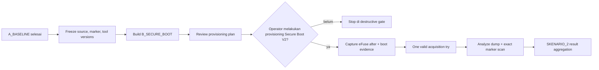

## 3. Batas keamanan dan gate

Konfigurasi `config/secure_boot/sdkconfig.defaults` menyetel `CONFIG_SECURE_BOOT=y` dan `CONFIG_SECURE_BOOT_V2_ENABLED=y`, serta tidak menyetel Flash Encryption. `scripts/provisioning_plan.py` hanya membuat rencana reviewable; script tersebut tidak mempunyai jalur eFuse write.

Provisioning Secure Boot V2 memerlukan signing key/digest dan perubahan eFuse yang irreversibel. Langkah itu harus dilakukan operator pada board riset khusus setelah:

1. identitas board, chip revision, flash ID/size, PSRAM, dan eFuse before tersimpan;
2. build artifacts dan hash tersimpan;
3. signing-key procedure cocok dengan ESP-IDF terpasang;
4. operator meninjau rencana dan memahami bahwa board tidak lagi berada pada state baseline yang sama.

`--confirm-destructive` pada planner tidak mengeksekusi burn; planner tetap berhenti sebelum operasi nyata.

## 4. Layer tooling dan justifikasi

| Layer | Tool | Fungsi | Asal dan justifikasi |
|---|---|---|---|
| Workflow/build | VS Code + PlatformIO Core | environment, build, upload, monitor, environment separation | workflow Windows-first yang diminta; PlatformIO menjadi top-level workflow |
| Security authority | ESP-IDF 6.1.0 melalui PlatformIO | sdkconfig, Secure Boot V2, bootloader signing, image format | konfigurasi security resmi Espressif; bukan logika aplikasi per-skenario |
| Device identity | `scripts/preflight.py`, `esptool` | chip, revision, port, flash ID/size, PSRAM bila tersedia | wrapper reproducible atas tooling resmi Espressif |
| eFuse evidence | `scripts/capture_efuse.py`, `espefuse` | raw dan parsed eFuse before/after | observasi state; tidak menulis eFuse |
| Provisioning review | `scripts/provisioning_plan.py`, `espsecure`/OpenSSL bila diperlukan | rencana key/signing dan intended changes | memisahkan preparation dari irreversible operator action |
| Acquisition | `scripts/acquire_flash.py`, `esptool` | raw flash read, stdout/stderr, partial dump, hash | command resmi dan Windows-compatible wrapper |
| Binary analysis | `scripts/analyze_dump.py`, Python stdlib | SHA-256, entropy pendukung, 0xFF/0x00 summary, exact marker search, partition/image structure | deterministic, auditable, tidak bergantung binwalk |
| Correlation | `scripts/compare_results.py` | structured run result dan aggregate CSV/JSON | hasil berasal dari evidence, bukan expected values |
| Evidence | `scripts/lib/research_logger.py` | manifest, events/audit JSONL, immutable run directory, timestamps | seluruh eksperimen dapat direkonstruksi |
| Validation | `tests/test_host.py` + synthetic fixtures | scanner, hash, entropy, manifest, overwrite gate, partial handling, aggregation, destructive gate | pengujian host tanpa memalsukan hardware result |

Tool custom bukan pengganti tool resmi. Custom layer hanya mengikat command resmi ke schema evidence, timestamp, error handling, dan marker research yang spesifik. Ini adalah celah metodologis: tool umum dapat membaca flash, tetapi tidak otomatis menjaga traceability source → config → eFuse → acquisition → hash → analysis → summary.

## 5. Artefak build yang wajib

Untuk B, simpan resolved `sdkconfig.secure_boot`, ELF/BIN aplikasi, bootloader BIN, partition-table BIN, map file jika tersedia, build log, manifest build, SHA-256, Git commit, dan versi tool. Source aplikasi harus sama dengan A; hanya security configuration dan device state yang berubah.

Build check awal sempat dihentikan karena ESP-IDF mendeteksi path cache Windows yang mengandung whitespace. Ini masalah host environment, bukan hasil penelitian. Gunakan PlatformIO core/cache pada path tanpa spasi (misalnya `D:\\pio-core`) atau konfigurasi Python/PlatformIO yang ekuivalen, lalu simpan command dan resolved configuration ke evidence.

## 6. Prosedur perangkat untuk acquisition try

Setiap try memakai run directory baru dan board ID yang sama hanya jika board fisiknya sama. Sebelum setiap acquisition:

1. capture eFuse/security state dan serial boot evidence;
2. boot normal untuk memastikan firmware hidup;
3. pindahkan board ke ROM download mode;
4. jalankan acquisition dengan ukuran flash hasil preflight;
5. kembalikan ke boot normal dan capture boot confirmation;
6. analisis dump dan simpan raw/partial dump tanpa overwrite.

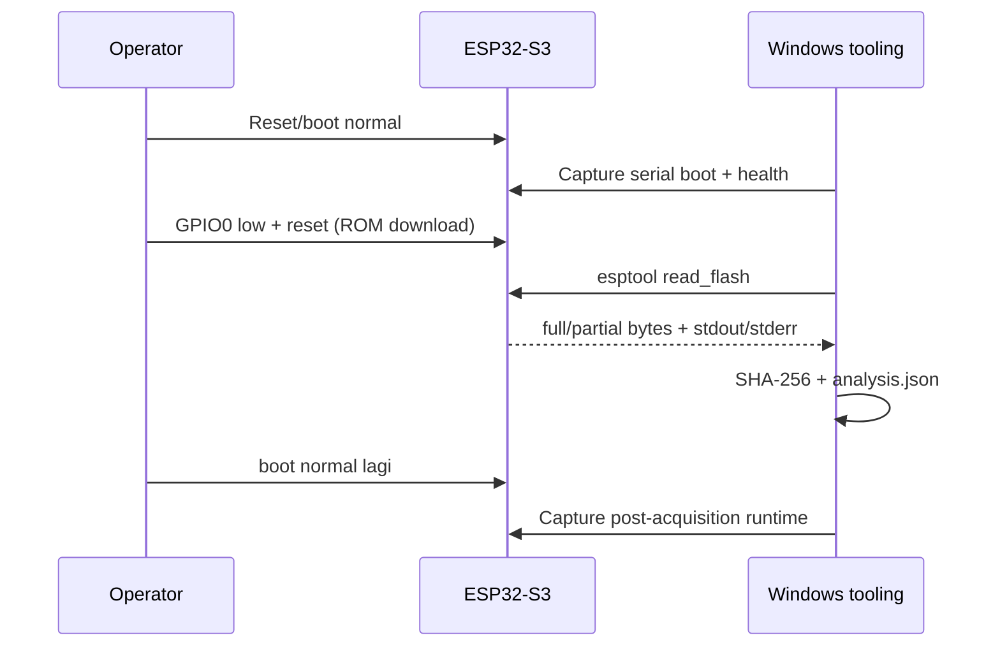

## 7. Hasil observasi final

Skenario B menggunakan satu try pada board02. Incident board01 dicatat terpisah dan bukan hasil B.

| Try | Evidence run | Flash read | Dump/hash | Marker result | Status |
|---|---|---|---|---|---|
| 1 | `ed05ab80d36e` | success | 16 MiB; `66f100eccbadbe1d36c5e2dc005e3f4c7fc1c5da0b90c5614ad1879b6c559901` | all exact markers recovered | COMPLETE |

Observed B menunjukkan Secure Boot V2 aktif, Flash Encryption tetap OFF, signed boot verification berhasil, raw flash terbaca, dan marker plaintext ditemukan. Ini konsisten dengan Secure Boot sebagai authenticity/integrity control, bukan confidentiality.

## 8. Schema hasil per try

Setiap run harus menghasilkan `manifest.json`, `events.jsonl`, `audit.jsonl`, `tool_versions`, preflight/eFuse raw+JSON, serial logs, `acquisition.json`, dump atau partial dump, SHA-256, `analysis.json`, dan `analysis.txt`. `compare_results.py` mengisi minimal:

`scenario_id`, `board_id`, `run_id`, `secure_boot_state`, `flash_encryption_state`, `rom_download_accessible`, `flash_read_success`, `dump_size`, `dump_sha256`, `partition_table_parseable`, `app_image_identifiable`, `wifi_ssid_found`, `wifi_password_found`, `api_key_found`, `static_secret_found`, `nvs_secret_found`.

Unknown tetap `null`/unknown; expected result tidak ditulis sebagai observation.

## 9. Execution checklist yang direkam (sudah selesai)

Command sequence final untuk board02/COM7:

```cmd
python scripts/capture_versions.py --scenario B_SECURE_BOOT --board-id board02 --experiment-id EXP_B_SECURE_BOOT_BOARD02
python scripts/preflight.py --run <RUN> --port COM7 --board-marking same-class-N16R8-marking-not-recorded --wiring "USB-C CH343 COM7"
python scripts/capture_efuse.py --run <RUN> --port COM7 --phase before
python scripts/build_evidence.py --run <RUN>
python scripts/flash_secure_no_reset.py --run <RUN> --port COM7 --build-dir <RUN>\build\.pio\build\secure_boot
python scripts/prepare_secure_boot.py --run <RUN>
python scripts/capture_efuse.py --run <RUN> --port COM7 --phase after
python scripts/capture_security_info.py --run <RUN>
python scripts/capture_serial.py --run <RUN> --port COM7 --seconds 35
python scripts/acquire_flash.py --run <RUN> --port COM7 --baud 460800
python scripts/analyze_dump.py --run <RUN>
python scripts/compare_results.py
```

Provisioning digest dan `SECURE_BOOT_EN` dilakukan operator secara interaktif; preview dan output `BURN` disimpan melalui command transcript dan screenshot. Run final adalah `ed05ab80d36e` dengan satu acquisition try.

## 10. Keputusan operator (sudah diselesaikan)

Board B ditetapkan pada board02/COM7 dan memakai build PlatformIO signed dari source yang sama. Skenario ini selesai dengan satu acquisition try; board01 dipertahankan sebagai incident. Board lain disiapkan untuk C.

## 11. Catatan rencana historis (superseded)

Pada tahap perencanaan awal operator mengonfirmasi hanya tersedia satu board, yaitu `board01` pada `COM5`. Catatan ini dipertahankan untuk menjelaskan keputusan dan incident awal, tetapi **sudah superseded** oleh penggunaan board02/COM7 sebagai run B final. Konsekuensi historisnya:

- eFuse Secure Boot V2 akan mengubah state board secara permanen; board ini tidak lagi menjadi kontrol A baseline setelah provisioning;
- semua evidence A yang sudah ada harus dipertahankan sebagai kontrol historis sebelum provisioning;
- sebelum burn, wajib dibuat salinan lengkap `efuse_before`, build hash, dan provisioning plan;
- tidak boleh menganggap hasil B sebagai perbandingan paralel dengan board baseline fisik yang sama.

Rencana firmware yang dikonfirmasi:

- **Try 1/2:** rencana build PlatformIO dan Arduino IDE pernah dipertimbangkan;
- **Try final:** setelah board01 masuk incident, skenario B ditetapkan satu acquisition try yang valid pada board02/COM7.

Firmware Arduino yang tidak ditandatangani Secure Boot dapat gagal boot atau ditolak bootloader. Jika Try 2 tetap memakai image Arduino unsigned, hasil yang sah adalah evidence boot rejection/authenticity, bukan marker-recovery comparison. Agar Try 2 tetap menjadi pengujian marker recovery yang sebanding, image Arduino harus melewati signing flow Secure Boot yang kompatibel dan key yang sama; jangan upload image unsigned lalu menyebut kegagalan marker sebagai confidentiality result.

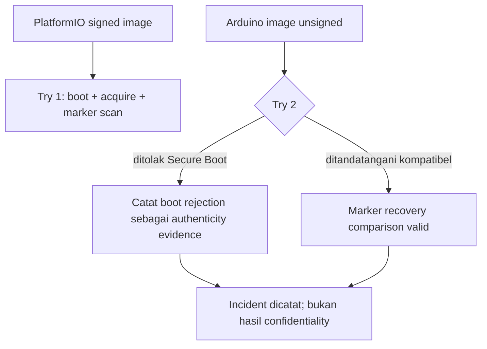


## 12. Jumlah try yang ditetapkan (revisi final)

Skenario 2 menggunakan **satu acquisition try yang valid**, yaitu board02/COM7 (`ed05ab80d36e`). Run board01/COM5 tetap dicatat sebagai incident provisioning dan tidak dihitung sebagai try marker-recovery yang valid. Skenario 3 akan memakai board terpisah sesuai rencana berikutnya.


## 13. Preflight/build awal board01 — incident yang dipertahankan (2026-10-23)

Run evidence yang dibuat:

`evidence/B_SECURE_BOOT/20261023T125211517231+0700_board01_5e34d746bc3c`

Observed dari perangkat sebelum provisioning:

- port: `COM5` melalui USB-Enhanced-SERIAL CH343;
- chip: ESP32-S3 revision `v0.2`;
- flash terdeteksi dan tervalidasi: `16,777,216` bytes (16 MiB);
- PSRAM terdeteksi: `8 MiB (AP_3v3)`;
- `SECURE_BOOT_EN=false`;
- `SPI_BOOT_CRYPT_CNT=0`, Flash Encryption disabled;
- ROM download accessible;
- preflight, eFuse raw/JSON, command output, dan timestamps tersimpan di run directory.

Build B berhasil pada 2026-10-23 setelah menggunakan Python `C:\\Python314\\python.exe` dan PlatformIO cache `D:\\pio-core` untuk menghindari whitespace path Windows. Resolved build menghasilkan Secure Boot V2 signed artifacts:

| Artifact | Size | SHA-256 |
|---|---:|---|
| `firmware-signed.bin` | 790,528 | `9b2ab700d286b51c13af9ea7d23160208e81c8dff07e74f7fcb36d0a03285e51` |
| `bootloader-signed.bin` | 28,672 | `86660a31589a195c09cc7092391cc36136100c2b7836d69d4f7f4153428b9bb5` |
| `partitions-signed.bin` | 8,192 | `a22003bf1c3f4b0e36c38d821bc57f3d9e17de64635d330104f06cb323f2eb62` |

Build manifest lengkap berada di `build/build_manifest.json`; resolved sdkconfig hash adalah `a8cbb03c794dac514639ec11913cd207c76941d2f91a98434f215c6e744bc3b0`. Signing key RSA-3072 dibuat dengan `espsecure` v5.4.0 dan metadata/hash disimpan di `build/signing_key_metadata.json`. Private key tidak disalin ke evidence atau Git.

Satu build attempt awal gagal karena path Python Windows mengandung whitespace dan signing key belum tersedia; kegagalan tersebut menjadi catatan host/build, bukan device result. Build ulang berhasil setelah cache/Python path diperbaiki dan key dibuat.

## 14. Status final

Provisioning board02, capture eFuse after, signed boot verification, satu acquisition, analisis marker, dan result aggregation sudah selesai. Board01 incident tetap menjadi evidence terpisah. Tidak ada langkah B yang masih pending.

## 3A. Apa itu eFuse?

eFuse (*electrically programmable fuse*) adalah bit konfigurasi satu kali program di dalam chip ESP32-S3. Bit ini menyimpan identitas, konfigurasi boot, status keamanan, serta material atau digest kunci tertentu. Saat bit berubah dari `0` ke `1`, perubahan tersebut umumnya tidak dapat dibalik melalui software atau proses erase flash biasa.

Hal penting untuk penelitian ini:

- eFuse berada di dalam chip, bukan di file firmware dan bukan di flash eksternal;
- menghapus atau mengganti `firmware.bin` tidak mengembalikan eFuse;
- `espefuse summary` hanya membaca dan merekam state;
- operasi `burn_*`, pengaktifan Secure Boot, perubahan Flash Encryption, disable UART download, disable JTAG, dan revoke key dapat bersifat irreversible;
- karena itu `efuse_before` adalah kontrol eksperimen, sedangkan `efuse_after` membuktikan state keamanan setelah provisioning.

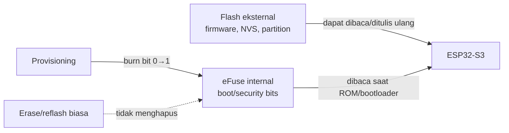

Dalam skenario ini, field utama yang diamati adalah:

| Field | Makna | State before yang tercatat |
|---|---|---|
| `SECURE_BOOT_EN` | Secure Boot sudah diaktifkan di chip | `false` |
| `SPI_BOOT_CRYPT_CNT` | counter konfigurasi Flash Encryption | `0`, disabled |
| `DIS_DOWNLOAD_MODE` dan field download terkait | akses ROM/UART download | tidak disabled pada capture before |
| `SECURE_BOOT_KEY_REVOKE0..2` | pencabutan slot key Secure Boot | seluruhnya belum revoke pada capture before |
| key blocks/digest fields | material/digest keamanan internal | dicapture sebagai raw+parsed evidence |

`efuse_before.json` dan `efuse_before_raw.txt` pada run ini adalah snapshot sebelum perubahan. Setelah operator melakukan provisioning Secure Boot V2, `efuse_after.json`, `efuse_after_raw.txt`, dan diff harus dibuat pada run yang sama tanpa menimpa snapshot awal. Perbedaan yang diamati harus dipisahkan dari expected configuration; field yang tidak berubah tetap merupakan evidence.

Secure Boot V2 menggunakan eFuse untuk mengikat kepercayaan boot pada digest/public key yang diprogram. Flash Encryption menggunakan eFuse untuk status counter dan konfigurasi kunci enkripsi. Keduanya berbeda: Secure Boot terutama authenticity/integrity, sedangkan Flash Encryption terutama confidentiality.

Definisi ringkas dan snapshot eFuse lengkap juga tersedia di [docs/efuse.md](docs/efuse.md).

### Klarifikasi enable/disable Secure Boot

`CONFIG_SECURE_BOOT_V2_ENABLED=y` pada build hanya menyiapkan signed image. Enforcement terjadi ketika ROM membaca bit Secure Boot pada eFuse saat startup. eFuse bersifat OTP: perubahan normal hanya `0 → 1`, sehingga Secure Boot yang telah di-enable tidak dapat di-disable kembali melalui software atau erase flash. Kesalahan key/signature dan disable interface dapat menyebabkan board gagal boot atau kehilangan akses download.

Rujukan resmi: [ESP32-S3 Secure Boot V2](https://docs.espressif.com/projects/esp-idf/en/stable/esp32s3/security/secure-boot-v2.html) dan [espefuse eFuse warning](https://docs.espressif.com/projects/esptool/en/latest/esp32s3/espefuse/index.html).

## 3B. Cara mengisolasi behavior Secure Boot dan Flash Encryption

Kedua fitur sama-sama menggunakan eFuse, tetapi eFuse tidak menyimpan “firmware terenkripsi” atau “firmware signed” sebagai satu nilai tunggal. Snapshot harus dibaca sebagai kumpulan field yang saling terkait dengan build, boot log, dan hasil acquisition.

### Model before → provisioning → after

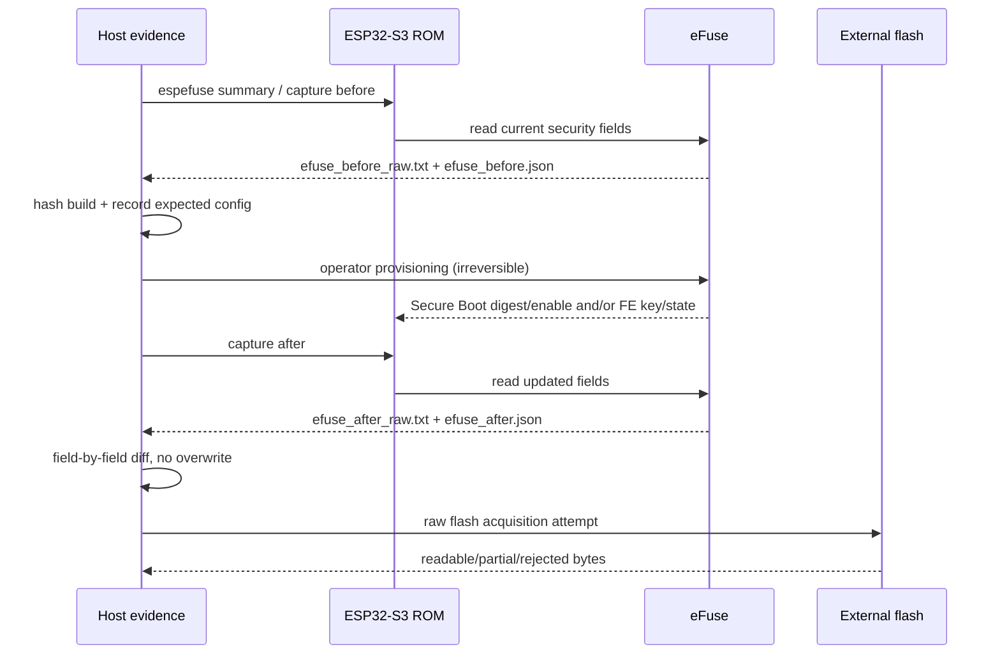

### Secure Boot V2: apa yang diisolasi

Secure Boot V2 menjawab pertanyaan **“apakah image yang akan dijalankan autentik dan tidak berubah?”**. Build menghasilkan bootloader/app yang ditandatangani dengan private key. Provisioning memprogram trust anchor, yaitu digest/public-key material pada key slot eFuse, lalu mengaktifkan enforcement Secure Boot melalui state eFuse.

Evidence yang relevan:

| Lapisan | Observasi | Makna |
|---|---|---|
| Build | image signed, signing scheme, key metadata/hash | image siap diverifikasi; belum membuktikan chip sudah enforcing |
| eFuse before | `SECURE_BOOT_EN=false`, key digest slot belum dipakai | kontrol awal masih baseline |
| eFuse after | `SECURE_BOOT_EN=true`, key-purpose/digest slot berubah sesuai prosedur | chip diarahkan untuk memverifikasi chain of trust |
| Boot | signed image boot / unsigned atau modified image ditolak | behavior authenticity/integrity yang teramati |
| Flash read | marker masih terlihat atau tidak | bukan ukuran Secure Boot; dengan FE OFF, plaintext masih dapat terbaca |

Perubahan Secure Boot tidak seharusnya ditafsirkan sebagai enkripsi flash. Jika raw flash masih berhasil dibaca dan marker ditemukan setelah Secure Boot aktif, itu konsisten dengan fungsi Secure Boot: image dilindungi dari modifikasi tanpa kunci, bukan dari pembacaan fisik.

### Flash Encryption: apa yang diisolasi

Flash Encryption menjawab pertanyaan **“apakah isi flash eksternal terlindungi dari pembacaan langsung?”**. Firmware di flash disimpan dalam bentuk terenkripsi dan ROM/bootloader menggunakan key/configuration internal untuk membaca dan mengeksekusinya.

Evidence yang relevan:

| Lapisan | Observasi | Makna |
|---|---|---|
| Build | `CONFIG_SECURE_FLASH_ENC_ENABLED`, Development/Release mode | niat/configuration build; belum cukup membuktikan state chip |
| eFuse before | `SPI_BOOT_CRYPT_CNT=0`, encryption key slot kosong/tidak aktif | kontrol awal FE OFF |
| eFuse after | counter berubah ke state enabled dan key-purpose/configuration terkait berubah | FE enforcement diprogram |
| Boot | firmware tetap boot dari flash | chip dapat mendekripsi secara internal |
| Flash read | dump gagal/acak/marker tidak ditemukan, dengan state FE terverifikasi | evidence confidentiality terhadap acquisition path |

Entropy tinggi saja tidak cukup. Hasil FE harus dikaitkan dengan eFuse state, mode Development/Release, command acquisition, dump size/hash, dan marker scan. Jika acquisition gagal karena port/wiring, statusnya `ACQUISITION_FAILED`, bukan otomatis `encrypted`.

### Perbandingan isolasi

| Pertanyaan | Secure Boot V2 | Flash Encryption |
|---|---|---|
| Properti utama | authenticity, integrity, boot authorization | confidentiality isi flash |
| Yang diverifikasi saat boot | signature dan trust anchor | kemampuan internal mendekripsi flash |
| Artifact build | signed bootloader/app | image/config yang kompatibel dengan FE |
| eFuse yang diamati | enable bit, key-purpose/digest/revoke state | crypt counter, encryption key-purpose/configuration |
| Raw flash boleh readable? | Ya, bila FE OFF | Diharapkan tidak mengandung plaintext yang dapat dipulihkan |
| Marker plaintext di dump | tetap mungkin ditemukan | diharapkan tidak ditemukan bila FE benar-benar aktif |
| Kegagalan image unsigned | evidence authenticity | bukan uji utama FE |
| Dump entropy | hanya pendukung | hanya pendukung, bukan proof |

### Cara membaca `diff`

`efuse_diff.json` harus mengelompokkan field menjadi:

1. **expected security changes** — perubahan yang memang direncanakan oleh konfigurasi/provisioning;
2. **observed security changes** — perubahan yang benar-benar muncul pada `after`;
3. **unexpected changes** — field lain yang ikut berubah dan perlu investigasi;
4. **unchanged fields** — tetap dicatat sebagai evidence, terutama ROM download, JTAG, read/write protection, dan counter yang tidak terkait.

Contoh interpretasi yang benar:

```text
expected: Secure Boot V2 ON, Flash Encryption OFF
observed: SECURE_BOOT_EN false → true
observed: SPI_BOOT_CRYPT_CNT tetap 0
observed: ROM download tetap accessible
conclusion: Secure Boot state berubah; FE tidak terobservasi aktif; acquisition masih dapat digunakan untuk menguji plaintext exposure.
```

Contoh interpretasi yang tidak sah:

```text
signature ditemukan di firmware → flash pasti terenkripsi
entropy dump tinggi → FE pasti aktif
marker tidak ditemukan setelah read timeout → confidentiality terbukti
```

Tiga contoh terakhir mencampur layer atau mengubah kegagalan operasional menjadi security observation. Karena itu snapshot, diff, boot evidence, acquisition status, dan analysis marker harus dibaca bersama.

## 15. Rencana operasional skenario 2: Secure Boot V2 aktif, Flash Encryption OFF

Tujuan B bukan membuat flash tidak terbaca. Tujuannya adalah mengaktifkan verifikasi signature pada rantai boot, lalu menguji apakah raw flash yang masih tidak terenkripsi tetap dapat diakuisisi dan dianalisis.

### Tahap 0 — kontrol sebelum perubahan

1. Pertahankan evidence baseline A yang sudah ada sebagai kontrol historis.
2. Gunakan run B final board02/COM7: `20261023T144258116020+0700_board02_ed05ab80d36e` (`ed05ab80d36e`). Run board01/COM5 hanya menjadi incident terpisah.
3. Pastikan `efuse_before` menunjukkan `SECURE_BOOT_EN=false` dan `SPI_BOOT_CRYPT_CNT=0`.
4. Arsipkan resolved sdkconfig, build manifest, signed bootloader/app/partition images, Git commit, dan hash signing-key metadata.

### Tahap 1 — siapkan image yang dipercaya

1. Build environment `secure_boot` dengan source aplikasi yang sama seperti baseline.
2. Gunakan `bootloader-signed.bin`, `partitions-signed.bin`, dan `firmware-signed.bin`.
3. Verifikasi signature/image metadata sebelum upload.
4. Jangan menggunakan firmware Arduino unsigned sebagai image utama yang diharapkan boot.

### Tahap 2 — provisioning Secure Boot V2 oleh operator

Operator memprogram trust anchor/digest dan enable state Secure Boot sesuai prosedur ESP-IDF yang cocok dengan versi terpasang. Tool research tidak mengeksekusi burn. Jangan mengaktifkan Flash Encryption, disable UART download, disable JTAG, atau key revoke untuk skenario ini.

### Tahap 3 — validasi setelah provisioning

1. Capture `efuse_after_raw.txt` dan `efuse_after.json` tanpa menimpa before.
2. Buat `efuse_diff.json` dan klasifikasikan expected/observed/unexpected/unchanged.
3. Reboot normal dan capture serial boot log.
4. Verifikasi Secure Boot aktif, Flash Encryption tetap OFF, dan ROM download masih accessible.
5. Jika signed image gagal boot, hentikan acquisition dan catat `BOOT_FAILED`; jangan mencoba membakar eFuse tambahan secara spontan.

### Tahap 4 — acquisition (rencana historis, superseded)

Untuk setiap try, buat run directory baru:

- boot normal untuk health/status evidence;
- pindahkan board ke ROM download mode;
- jalankan raw flash acquisition dengan ukuran hasil preflight;
- simpan command/stdout/stderr, dump penuh atau partial, metadata, dan SHA-256;
- kembali ke boot normal dan capture boot evidence;
- jalankan exact marker scan, partition parsing, image identification, entropy sebagai supporting evidence, dan hasil JSON.

Rencana awal membedakan image signed PlatformIO dan image Arduino. Rencana tersebut tidak dijalankan pada board02; hasil final memakai satu signed PlatformIO acquisition try. Jika image Arduino unsigned diuji pada eksperimen lanjutan dan ditolak, hasilnya adalah evidence Secure Boot menolak image yang tidak dipercaya, bukan evidence bahwa Flash Encryption menyembunyikan marker.

### Expected isolation

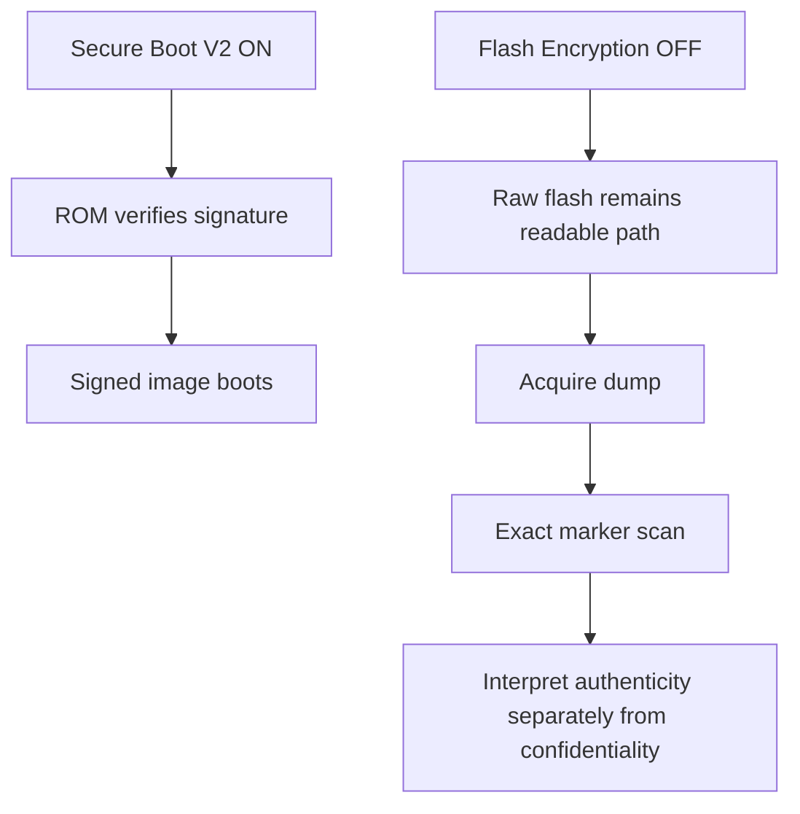

Hasil yang paling informatif untuk B adalah: signed firmware boot, unsigned/modified firmware ditolak bila diuji, raw flash read tetap berhasil, dan marker plaintext masih dapat atau tidak dapat dipulihkan. Marker result tidak boleh dipakai sebagai ukuran Secure Boot saja; ia dibaca bersama eFuse state dan acquisition evidence.

## 16. Cara provisioning Secure Boot V2: manual vs otomatis

ESP-IDF mendukung dua workflow resmi:

### A. Provisioning oleh bootloader pada first boot

Build Secure Boot mengaktifkan fitur pada bootloader dan menandatangani bootloader/app. Setelah artefak yang valid diflash, bootloader tahap kedua dapat menulis eFuse yang diperlukan pada first boot, lalu memverifikasi signature aplikasi. Dokumentasi ESP-IDF menyebut proses ini sebagai first-boot enablement.

Kelebihan: alur ESP-IDF terintegrasi.  
Risiko: satu kali reset setelah flash dapat menjadi titik burn eFuse; operator harus sudah menyimpan before evidence dan memastikan image/key benar.

### B. Provisioning host dengan `espsecure` + `espefuse`

Alur host-based yang harus direview operator:

```powershell
# Safe preparation: tidak menulis eFuse
python -m espsecure digest-sbv2-public-key `
  --keyfile keys/secure_boot_signing_key.pem `
  --output evidence\B_SECURE_BOOT\<RUN_ID>\build\secure_boot_digest.bin

# Read-only review
espefuse --port COM5 --chip esp32s3 summary
espefuse --port COM5 --chip esp32s3 burn-key --help
espefuse --port COM5 --chip esp32s3 burn-efuse --help
```

Dokumentasi resmi workflow host-based memberikan pola `burn-key` untuk menulis public-key digest ke key block dengan purpose `SECURE_BOOT_DIGEST0`, kemudian `burn-efuse SECURE_BOOT_EN` untuk mengaktifkan enforcement. Nama/sintaks flag harus diverifikasi terhadap `espefuse --help` versi terpasang sebelum digunakan.

Secara konseptual, langkah destructive-nya adalah:

```text
1. burn public-key digest ke key block kosong sebagai SECURE_BOOT_DIGEST0
2. enable SECURE_BOOT_EN
3. reboot dan capture efuse_after + serial boot
```

Perintah `burn-key`, `burn-efuse`, key revoke, read/write protection, UART download change, dan JTAG change tidak boleh dijalankan oleh automation default repository ini. `scripts/provisioning_plan.py` hanya menulis intended changes dan berhenti.

### Apakah bisa diotomatisasi?

Bisa secara teknis, tetapi hanya bagian non-destructive yang diotomatisasi pada penelitian ini:

- generate signing key/digest;
- validate image signature;
- cek slot key/eFuse kosong;
- tampilkan command dan intended changes;
- capture before/after/diff.

Burn eFuse tetap memerlukan operator action eksplisit. Dengan satu board, ini mencegah burn salah key, salah block, atau salah mode download sebelum ada kesempatan memeriksa ulang.

### Gate operator

Sebelum operator menjalankan provisioning:

- `efuse_before` sudah lengkap;
- signed bootloader/app/partition hashes cocok;
- key digest output cocok dengan signing key;
- `SPI_BOOT_CRYPT_CNT` tetap `0` untuk skenario B;
- UART/ROM download tidak dipermanenkan disabled;
- operator memahami board tidak dapat dikembalikan ke baseline A.

Setelah burn/first boot, segera capture `efuse_after`, boot log, dan diff. Jangan melakukan acquisition sebelum state after terverifikasi.

## 17. Instruksi operator untuk provisioning manual (CLI terpasang: espefuse v5.4.0)

Perintah di bawah adalah prosedur operator, bukan bagian automation default. Langkah 1–4 bersifat read-only atau flash write biasa. Langkah 5–6 membakar eFuse dan irreversible.

### 1. Tutup monitor serial dan verifikasi port

```powershell
python -m serial.tools.list_ports -v
python -m espefuse --chip esp32s3 --port COM5 summary
```

Pastikan output menunjukkan ESP32-S3 yang sama, `SECURE_BOOT_EN` masih disabled, `SPI_BOOT_CRYPT_CNT=0`, dan key-purpose slot yang dipilih masih kosong. Pada capture B saat ini semua key block security masih belum terpakai.

### 2. Pastikan digest dan signed image cocok

```powershell
Get-FileHash .\evidence\B_SECURE_BOOT\20261023T125211517231+0700_board01_5e34d746bc3c\build\secure_boot_digest.bin -Algorithm SHA256
```

Digest harus berasal dari `keys/secure_boot_signing_key.pem` yang sama dengan key yang dipakai build. Jangan mengganti key setelah digest dibuat.

### 3. Flash signed artifacts sebelum enablement

Board harus berada pada ROM download mode. Gunakan signed artifacts dari evidence build; jangan mengandalkan `pio upload` karena Secure Boot build memperingatkan bootloader tidak di-upload default.

```powershell
python -m esptool --chip esp32s3 --port COM5 write-flash --flash-size 16MB `
  0x0000 .\evidence\B_SECURE_BOOT\20261023T125211517231+0700_board01_5e34d746bc3c\build\.pio\build\secure_boot\bootloader-signed.bin `
  0x8000 .\evidence\B_SECURE_BOOT\20261023T125211517231+0700_board01_5e34d746bc3c\build\.pio\build\secure_boot\partitions-signed.bin `
  0x10000 .\evidence\B_SECURE_BOOT\20261023T125211517231+0700_board01_5e34d746bc3c\build\.pio\build\secure_boot\firmware-signed.bin
```

Simpan stdout/stderr dan hash. Ini belum membakar eFuse.

### 4. Capture ulang summary dan siapkan review akhir

```powershell
python -m espefuse --chip esp32s3 --port COM5 summary
python scripts/capture_efuse.py --run .\evidence\B_SECURE_BOOT\20261023T125211517231+0700_board01_5e34d746bc3c --port COM5 --phase before
```

Jangan lanjut jika board identity, key block, digest, atau image hash tidak cocok.

### 5. Burn public-key digest — irreversible

Pilih key block kosong yang ditunjukkan `summary`; contoh di bawah memakai `BLOCK_KEY0` dan purpose `SECURE_BOOT_DIGEST0`.

```powershell
python -m espefuse --chip esp32s3 --port COM5 burn-key `
  BLOCK_KEY0 `
  .\evidence\B_SECURE_BOOT\20261023T125211517231+0700_board01_5e34d746bc3c\build\secure_boot_digest.bin `
  SECURE_BOOT_DIGEST0
```

Baca ulang intended change dan konfirmasi prompt interaktif hanya jika semua field benar. Jangan gunakan `--do-not-confirm` atau `--force-write-always`.

### 6. Enable Secure Boot — irreversible

```powershell
python -m espefuse --chip esp32s3 --port COM5 burn-efuse SECURE_BOOT_EN 1
```

Konfirmasi prompt hanya setelah digest burn berhasil dan signed bootloader/app sudah berada di flash. Jangan membakar `SPI_BOOT_CRYPT_CNT`, `DIS_DOWNLOAD_MODE`, `DIS_USB_SERIAL_JTAG_DOWNLOAD_MODE`, JTAG disable, aggressive revoke, atau field lain; skenario B hanya menguji Secure Boot.

### 7. Capture after dan validasi boot

```powershell
python scripts/capture_efuse.py --run .\evidence\B_SECURE_BOOT\20261023T125211517231+0700_board01_5e34d746bc3c --port COM5 --phase after
python scripts/reparse_efuse.py --run .\evidence\B_SECURE_BOOT\20261023T125211517231+0700_board01_5e34d746bc3c
```

Reset ke boot normal, simpan serial boot log, lalu pastikan `SECURE_BOOT_EN=true`, Flash Encryption tetap disabled, dan akses ROM download masih sesuai rencana. Jika boot gagal, berhenti; jangan melakukan burn tambahan.

Setelah `efuse_after` tervalidasi, acquisition final dijalankan satu kali pada board02. Semua command destructive harus dicatat manual pada audit operator karena tidak dijalankan oleh script repository.

## 18. Incident: Secure Download Mode terpilih pada resolved sdkconfig

Setelah signed artifacts diflash dan board reset, output `esptool v5.4.0` melaporkan:

```text
Chip type: ESP32-S3 in Secure Download Mode
ERROR: A fatal error occurred: Secure Download Mode is enabled. The tool can not read eFuses.
```

Serial boot log pada run yang sama menunjukkan aplikasi tetap boot, tetapi:

```text
secure_boot: Mismatch in secure boot settings: the app config is enabled but eFuse not
```

Pemeriksaan resolved `sdkconfig.secure_boot` menemukan:

```text
CONFIG_SECURE_BOOT=y
CONFIG_SECURE_BOOT_V2_ENABLED=y
CONFIG_SECURE_ROM_DL_MODE_ENABLED=y
CONFIG_SECURE_ENABLE_SECURE_ROM_DL_MODE=y
# CONFIG_SECURE_INSECURE_ALLOW_DL_MODE is not set
```

Artinya build Secure Boot memilih secure ROM download mode. Ini tidak sesuai dengan tujuan acquisition B yang memerlukan jalur ROM download yang dapat dibaca. `espefuse` tidak boleh dipaksa melewati error tersebut. Tidak ada `burn-key` atau `burn-efuse` host yang dijalankan.

Status evidence saat ini:

- signed flash write: berhasil dan hash setiap image diverifikasi;
- normal boot: berhasil (`boot_confirmed=true`);
- Secure Boot enforcement: belum terkonfirmasi; boot log menyatakan eFuse belum aktif;
- eFuse after: capture gagal dengan status `Secure Download Mode is enabled`, dan error mentah disimpan;
- acquisition: belum dijalankan;
- provisioning: dihentikan.

Run ini diklasifikasikan sebagai `CONFIGURATION_INCIDENT / STOPPED_BEFORE_EFUSE_BURN`. Jangan menjalankan `burn-key`, `burn-efuse`, erase-all, atau mencoba memaksa `espefuse` pada board ini sebelum status secure-download dan reversibility-nya diverifikasi.

Untuk build board riset berikutnya, konfigurasi harus secara eksplisit memilih ROM download mode yang kompatibel dengan acquisition dan tidak mengaktifkan secure download mode. Perubahan konfigurasi tidak mengklaim dapat membalik eFuse yang mungkin sudah berubah pada board ini.

## 19. Tindakan sekarang setelah incident

1. Simpan board pada kondisi sekarang dan jangan jalankan burn/erase/force-write.
2. Simpan run B sebagai evidence incident; jangan menimpa `efuse_before`, serial log, atau error `efuse_after`.
3. Jangan mencoba acquisition melalui standard esptool selama chip melaporkan Secure Download Mode.
4. Konfigurasi project sudah diperketat untuk build berikutnya: secure ROM download mode tidak dipilih dan insecure ROM download diizinkan untuk jalur acquisition. Perubahan ini hanya berlaku pada build baru; tidak membalik eFuse board yang mungkin sudah berubah.
5. Catatan ini berlaku untuk incident board01 pada tahap awal dan sudah superseded. Hasil sah final berasal dari board02/COM7, dengan raw-flash acquisition berhasil dan marker dianalisis.
6. Untuk melanjutkan marker-recovery B atau C, gunakan board yang belum diprovision atau pastikan prosedur pemulihan secure-download resmi dan key transport tersedia. Jangan menebak atau memaksa recovery.

Board ini dapat dipertahankan sebagai sub-experiment authenticity/configuration incident. Ia tidak boleh dipakai sebagai kontrol A atau sebagai bukti bahwa Flash Encryption melindungi plaintext.

## 20. Recovery probe: `get-security-info` via `--no-stub`

Recovery probe read-only berhasil dengan:

```text
python -m esptool --chip esp32s3 --port COM5 --no-stub get-security-info
```

Observed:

```text
Chip type: ESP32-S3 in Secure Download Mode
Secure Boot: Disabled
Flash Encryption: Disabled
SPI Boot Crypt Count: 0x0
Key Purposes: BLOCK_KEY0..BLOCK_KEY5 USER/EMPTY
```

Ini memperjelas state: Secure Boot dan Flash Encryption belum aktif, tetapi Secure Download Mode sudah membatasi command ROM. `get-security-info` tersimpan di `device/secure_download_security_info.txt` dan command metadata tersimpan di `host/commands/secure_download_security_info/`.

Recovery yang masih aman:

- memakai `esptool --no-stub get-security-info`;
- basic flash write dengan `--no-stub`, bila image yang ditulis sesuai state dan tujuannya terdokumentasi;
- boot dan runtime serial.

Recovery yang belum tersedia pada board ini:

- standard `espefuse summary`;
- standard `read-flash` acquisition;
- pembalikan eFuse Secure Download Mode.

Karena eFuse mode ini tidak dapat dibalik melalui software, board dapat dipulihkan untuk operasi terbatas tetapi tidak dapat dipulihkan menjadi jalur raw-flash acquisition baseline tanpa hardware/prosedur resmi lain. Jangan menganggap basic flash write sebagai bukti bahwa flash dapat dibaca.

## 21. Hasil aktual B pada board02 — satu try

Run B yang sah:

`evidence/B_SECURE_BOOT/20261023T144258116020+0700_board02_ed05ab80d36e`

State eFuse after:

```text
SECURE_BOOT_EN = true
KEY_PURPOSE_0 = SECURE_BOOT_DIGEST0
SPI_BOOT_CRYPT_CNT = 0 (Flash Encryption disabled)
ENABLE_SECURITY_DOWNLOAD = false
DIS_DOWNLOAD_MODE = false
DIS_USB_SERIAL_JTAG_DOWNLOAD_MODE = false
```

Behavior boot:

- signed boot verification succeeded;
- aplikasi boot normal;
- heartbeat berjalan;
- tidak ada `SECRET_LOG_EXPOSURE`;
- `get-security-info` menunjukkan Secure Boot enabled dan Flash Encryption disabled.

Acquisition satu-satunya try berhasil:

| Item | Observed |
|---|---|
| flash size | 16,777,216 bytes |
| offset | `0x00000000` |
| requested/actual | 16,777,216 / 16,777,216 bytes |
| duration | 409.625 s |
| status | `SUCCESS` |
| dump SHA-256 | `66f100eccbadbe1d36c5e2dc005e3f4c7fc1c5da0b90c5614ad1879b6c559901` |
| partition table | parseable from raw dump |
| application image | identifiable at `0x00010000` |

Exact marker recovery dari raw dump:

| Marker | Found | Count | Offsets |
|---|---:|---:|---|
| `WIFI_SSID` | true | 3 | `0x00009144`, `0x00009584`, `0x000103CC` |
| `WIFI_PASSWORD` | true | 3 | `0x000091C0`, `0x000095A4`, `0x000103E0` |
| `API_KEY` | true | 1 | `0x0001CCC8` |
| `STATIC_SECRET` | true | 1 | `0x0001CCA4` |
| `NVS_SECRET` | true | 2 | `0x00009080`, `0x0001027C` |

Marker offsets in the NVS region are raw-dump observations; the application image offsets are separate structures. Analysis does not treat repeated NVS records as independent credentials without parser/state context.

Interpretation: B demonstrates that Secure Boot V2 can authenticate the signed boot chain while raw flash remains readable and plaintext markers remain recoverable because Flash Encryption is OFF. This is consistent with the intended isolation; it is not a Secure Boot confidentiality failure.

### Timing evidence

- run created: `2026-10-23T14:42:58.117+07:00`;
- preflight: `14:43:05.241`–`14:43:10.660`;
- eFuse before: `14:43:12.287`–`14:43:16.836`;
- build: `14:43:23.499`–`14:45:35.718`;
- signed flash with no-reset: `14:45:52.950`–`14:46:43.082`;
- digest preparation: `14:46:50.013`–`14:46:50.597`;
- eFuse after: `14:52:36.547`–`14:52:40.084`;
- boot/security validation: `14:52:49.293`–`14:53:30.430`;
- acquisition: `14:53:50.371`–`15:00:40.000`;
- analysis and aggregation completed after acquisition.

Skenario B satu-try selesai secara evidential. Board02 kini tidak boleh dipakai sebagai kontrol A atau untuk skenario C murni; board lain yang belum memiliki Secure Boot state digunakan untuk C.

## 22. Lampiran command transcript untuk dokumentasi gambar

Bagian ini merangkum command yang dapat ditampilkan dalam screenshot naskah. Output terminal lengkap tetap berada di command logs/evidence; ringkasan di sini menjaga report dapat dibaca tanpa mengandalkan gambar.

> Untuk panduan pembaca gambar yang lebih operasional—tujuan command, arti output, konsekuensi perangkat, dan alur sebab-akibat incident Secure Download Mode—lihat [docs/screenshots/SKENARIO_2/README.md](docs/screenshots/SKENARIO_2/README.md). Dokumen tersebut adalah caption guide untuk tim naskah dan memisahkan board01/COM5 dari hasil valid board02/COM7.

### 22.1 Insiden pertama — board01/COM5

Kesalahan awal terjadi ketika PowerShell backtick ditempel pada address dalam satu baris:

```cmd
python -m esptool --chip esp32s3 --port COM5 write-flash --flash-size 16MB `0x0000 ...
```

Observed error:

```text
Invalid value for '<address <filename>...': Address "`0x0000" must be a number.
```

Command yang benar menggunakan satu baris tanpa backtick atau backtick hanya sebagai karakter terakhir baris:

```cmd
python -m esptool --chip esp32s3 --port COM5 write-flash --flash-size 16MB 0x0000 "<bootloader-signed.bin>" 0x8000 "<partitions-signed.bin>" 0x10000 "<firmware-signed.bin>"
```

Flash write berhasil, tetapi setelah reset board01 melaporkan:

```text
Chip type: ESP32-S3 in Secure Download Mode
ERROR: Secure Download Mode is enabled. The tool can not read eFuses.
```

Serial log juga mencatat:

```text
secure_boot: Mismatch in secure boot settings: the app config is enabled but eFuse not
```

Recovery read-only yang berhasil:

```cmd
python -m esptool --chip esp32s3 --port COM5 --no-stub get-security-info
```

Observed:

```text
Secure Boot: Disabled
Flash Encryption: Disabled
SPI Boot Crypt Count: 0x0
```

Board01 kemudian dipulihkan untuk operasi aplikasi dengan baseline image melalui `--no-stub`; raw-flash read standar tetap tidak tersedia. Incident ini disimpan di evidence B board01.

### 22.2 Board baru — board02/COM7 preflight

```cmd
python -m serial.tools.list_ports -v
python scripts/capture_versions.py --scenario B_SECURE_BOOT --board-id board02 --experiment-id EXP_B_SECURE_BOOT_BOARD02
python scripts/preflight.py --run "<RUN>" --port COM7 --board-marking "same-class-N16R8-marking-not-recorded" --wiring "USB-C CH343 COM7; external 3.3V USB-to-TTL not used"
python scripts/capture_efuse.py --run "<RUN>" --port COM7 --phase before
```

Observed before:

```text
ESP32-S3 revision v0.2
Flash 16 MiB
PSRAM 8 MiB
SECURE_BOOT_EN = False
SPI_BOOT_CRYPT_CNT = 0
ENABLE_SECURITY_DOWNLOAD = False
```

### 22.3 Build dan signed flash tanpa first-boot reset

Resolved config board02 diverifikasi memuat:

```text
CONFIG_SECURE_BOOT=y
CONFIG_SECURE_BOOT_V2_ENABLED=y
# CONFIG_SECURE_ENABLE_SECURE_ROM_DL_MODE is not set
CONFIG_SECURE_INSECURE_ALLOW_DL_MODE=y
```

Signed artifacts diflash dengan reset ditahan:

```cmd
python -m esptool --chip esp32s3 --port COM7 --after no-reset write-flash --flash-size 16MB 0x0000 "<bootloader-signed.bin>" 0x8000 "<partitions-signed.bin>" 0x10000 "<firmware-signed.bin>"
```

Verifikasi read-only setelah flash:

```cmd
python -m espefuse --chip esp32s3 --port COM7 summary
```

Pada titik ini `SECURE_BOOT_EN=False`, sehingga belum ada enforcement.

### 22.4 Digest dan provisioning Secure Boot

Digest disiapkan tanpa eFuse write:

```cmd
python -m espsecure digest-sbv2-public-key --keyfile keys/secure_boot_signing_key.pem --output secure_boot_digest_reproduced.bin
```

Digest burn:

```cmd
python -m espefuse --chip esp32s3 --port COM7 burn-key BLOCK_KEY0 "<RUN>\build\secure_boot_digest_reproduced.bin" SECURE_BOOT_DIGEST0
```

Preview menunjukkan `BLOCK_KEY0` kosong dan purpose berubah `USER` → `SECURE_BOOT_DIGEST0`. Operator mengetik `BURN`; tool mengembalikan:

```text
BURN BLOCK4 - OK (write block == read block)
BURN BLOCK0 - OK (all write block bits are set)
Successful.
```

Enable Secure Boot:

```cmd
python -m espefuse --chip esp32s3 --port COM7 burn-efuse SECURE_BOOT_EN 1
```

Preview hanya menunjukkan `SECURE_BOOT_EN 0b0 -> 0b1`. Operator mengetik `BURN`; tool mengembalikan:

```text
BURN BLOCK0 - OK (all write block bits are set)
Reading updated eFuses...
Checking eFuses...
Successful.
```

### 22.5 Capture after, boot, dan security info

```cmd
python scripts/capture_efuse.py --run "<RUN>" --port COM7 --phase after
python scripts/capture_security_info.py --run "<RUN>"
python scripts/capture_serial.py --run "<RUN>" --port COM7 --seconds 35
```

Observed after:

```text
KEY_PURPOSE_0 = SECURE_BOOT_DIGEST0
SECURE_BOOT_EN = True
SPI_BOOT_CRYPT_CNT = 0
ENABLE_SECURITY_DOWNLOAD = False
```

Serial boot evidence:

```text
Valid secure boot key blocks: 0
secure boot verification succeeded
heartbeat: application healthy
```

Tidak ada secret log exposure.

### 22.6 Satu acquisition try B

```cmd
python scripts/acquire_flash.py --run "<RUN>" --port COM7 --baud 460800
python scripts/analyze_dump.py --run "<RUN>"
python scripts/compare_results.py
```

Observed acquisition:

```text
status: SUCCESS
requested_size: 16777216
actual_size: 16777216
SHA-256: 66f100eccbadbe1d36c5e2dc005e3f4c7fc1c5da0b90c5614ad1879b6c559901
```

Observed marker scan:

```text
WIFI_SSID       found=true  count=3
WIFI_PASSWORD   found=true  count=3
API_KEY         found=true  count=1
STATIC_SECRET   found=true  count=1
NVS_SECRET      found=true  count=2
```

### 22.7 Evidence source utama

```text
Run: evidence/B_SECURE_BOOT/20261023T144258116020+0700_board02_ed05ab80d36e
```

Subfolder yang dirujuk screenshot:

```text
host/commands/
device/
build/
runtime/
acquisition/
analysis/
```

Screenshot harus menjadi ilustrasi command/evidence, sedangkan nilai final tetap diambil dari JSON, hash file, event log, dan manifest.

## 23. Pemetaan screenshot dan koreksi konteks

Screenshot yang tersedia telah diperiksa secara visual. Nama file dipertahankan agar jejak operator tidak berubah; konteks ilmiah dikoreksi berdasarkan command, COM port, dan state yang tampak pada gambar.

| No. | Screenshot | Konteks benar | Board/run | Evidence terkait |
|---:|---|---|---|---|
| 1 | [Cari COM port](docs/screenshots/SKENARIO_2/S2_01_port_inventory_board01_COM5.png) | Inventaris port Windows. Gambar menampilkan COM5 CH343 dan port Bluetooth; ini masih board01, bukan board02. | board01 / COM5 | incident run B board01 |
| 2 | [Cek status device Secure Boot](docs/screenshots/SKENARIO_2/S2_02_efuse_summary_board01_before.png) | Potongan `espefuse summary` board01 sebelum incident; bukan hasil provisioning B yang berhasil. | board01 / COM5 | `efuse_before` board01 |
| 3 | [Secure Boot off](docs/screenshots/SKENARIO_2/S2_03_board01_secure_boot_off.png) | Security-fuse section board01: `SECURE_BOOT_EN=False`, `SPI_BOOT_CRYPT_CNT=0`, key purpose masih USER, download normal. | board01 / COM5 | `efuse_before` board01 |
| 4 | [Flash signed firmware](docs/screenshots/SKENARIO_2/S2_04_board01_signed_flash_incident.png) | Flash signed bootloader/partition/app ke board01. Hash tiap image verified, tetapi reset kemudian memicu incident secure download. | board01 / COM5 | `secure_signed_flash`/incident |
| 5 | [Incident Secure Download Mode](docs/screenshots/SKENARIO_2/S2_05_board01_secure_download_incident.png) | Error `espefuse` tidak bisa membaca eFuse karena Secure Download Mode; `Get-FileHash` juga salah shell karena dijalankan di cmd.exe. | board01 / COM5 | `efuse_after` error + incident log |
| 6 | [Burn-key preview](docs/screenshots/SKENARIO_2/S2_06_board02_digest_burn_preview.png) | Bukan flash ulang. Ini preview **burn-key** untuk board02: `BLOCK_KEY0` → `SECURE_BOOT_DIGEST0`, menunggu konfirmasi `BURN`. | board02 / COM7 | `secure_boot_digest_reproduced` + operator transcript |
| 7 | [Burn-key berhasil](docs/screenshots/SKENARIO_2/S2_07_board02_digest_burn_success.png) | Konfirmasi digest burn board02 berhasil; `BLOCK4` dan `BLOCK0` dilaporkan OK. | board02 / COM7 | eFuse key provisioning |
| 8 | [Cek summary](docs/screenshots/SKENARIO_2/S2_08_board02_summary_after_digest.png) | Awal output `espefuse summary` board02 setelah digest burn; command terlihat jelas memakai COM7. | board02 / COM7 | intermediate eFuse summary |
| 9 | [Secure Boot masih off](docs/screenshots/SKENARIO_2/S2_09_board02_pre_enable_checkpoint.png) | Lanjutan summary board02: key purpose sudah `SECURE_BOOT_DIGEST0`, tetapi `SECURE_BOOT_EN=False`; ini checkpoint sebelum enablement, bukan hasil akhir. | board02 / COM7 | intermediate eFuse summary |
| 10 | [Enable Secure Boot preview](docs/screenshots/SKENARIO_2/S2_10_board02_secure_boot_enable_preview.png) | Preview `burn-efuse SECURE_BOOT_EN 1`; hanya bit Secure Boot akan berubah `0b0 → 0b1`, menunggu `BURN`. | board02 / COM7 | provisioning preview |
| 11 | [Secure Boot burn berhasil](docs/screenshots/SKENARIO_2/S2_11_board02_secure_boot_enable_success.png) | Konfirmasi enablement board02 berhasil: `Checking eFuses... Successful.` | board02 / COM7 | `device/efuse_after.json` |

### Narasi rigid untuk naskah

Gambar 1–5 merekam fase board01 yang menghasilkan configuration incident. Gambar 1 mengidentifikasi COM5 sebagai CH343; gambar 2–4 menunjukkan status awal dan flashing signed image; gambar 5 menjadi bukti bahwa konfigurasi awal memilih Secure Download Mode dan menghalangi pembacaan eFuse standar. Gambar-gambar ini tidak boleh diberi caption sebagai keberhasilan skenario B.

Gambar 6–11 merekam board02 yang dipakai untuk B yang valid. Gambar 6–7 menunjukkan provisioning digest ke `BLOCK_KEY0` dengan purpose `SECURE_BOOT_DIGEST0`. Gambar 8–9 menunjukkan checkpoint penting bahwa trust anchor sudah tersimpan sementara `SECURE_BOOT_EN` masih OFF. Gambar 10–11 menunjukkan preview dan konfirmasi irreversible untuk mengaktifkan Secure Boot. Setelah gambar 11, evidence JSON mengonfirmasi `SECURE_BOOT_EN=true`, `SPI_BOOT_CRYPT_CNT=0`, dan `ENABLE_SECURITY_DOWNLOAD=false`; kemudian signed boot verification dan satu raw-flash acquisition berhasil.

Caption wajib menyebut board dan port. Jangan menggabungkan Gambar 4 dari board01 dengan hasil board02. Jangan menyebut Gambar 9 sebagai Secure Boot enabled; gambar itu justru checkpoint sebelum bit enable dibakar.

## 24. Galeri visual dan narasi setiap step

Screenshot sudah dinormalisasi ke nama canonical di `docs/screenshots/SKENARIO_2/`. Gambar 1–5 adalah board01 incident; gambar 6–11 adalah board02 valid B.

### Board01 — incident

#### Gambar 1 — port inventory board01/COM5

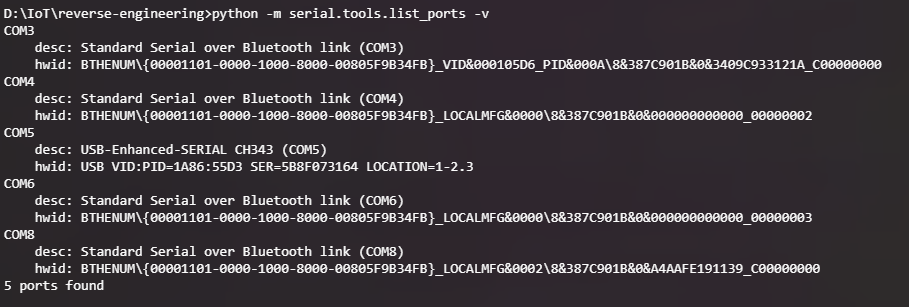

Windows menemukan CH343 pada COM5. Port Bluetooth yang ikut tampil bukan target. Screenshot ini mendukung identifikasi interface, bukan security state.

#### Gambar 2 — eFuse summary board01 before

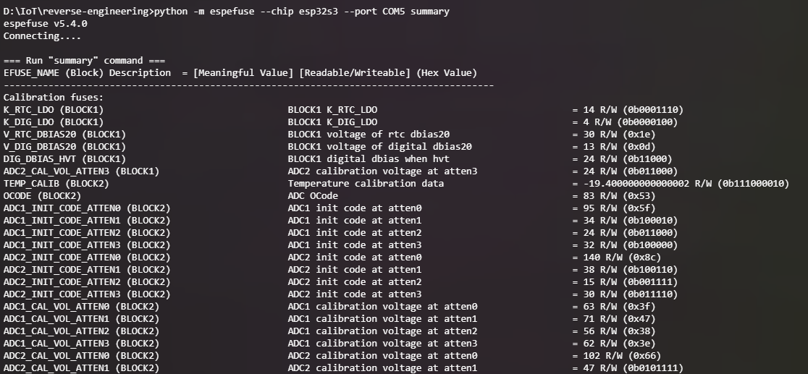

`espefuse summary` menjadi snapshot read-only sebelum flash signed image. Output lengkap diperlakukan sebagai evidence, sedangkan field security dibaca pada Gambar 3.

#### Gambar 3 — board01 Secure Boot OFF

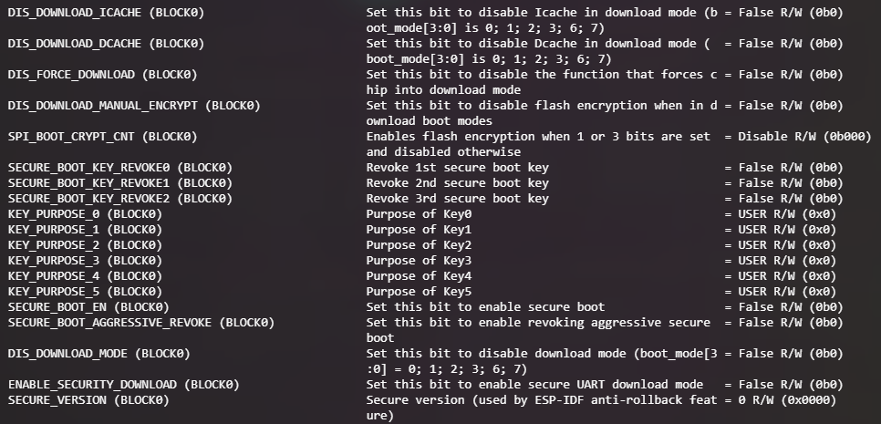

Security fields menunjukkan `SECURE_BOOT_EN=False`, `SPI_BOOT_CRYPT_CNT=0`, key purpose USER, dan secure download false. Ini kontrol awal board01.

#### Gambar 4 — signed flash board01

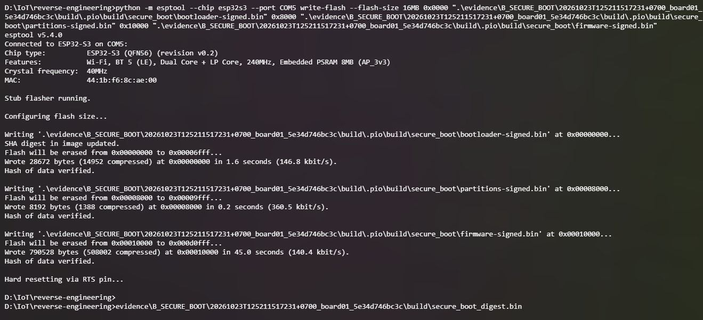

Esptool menulis tiga signed artifacts dan memverifikasi hash. Reset setelah flashing memicu incident konfigurasi; screenshot ini tidak boleh digunakan untuk mengklaim provisioning berhasil.

#### Gambar 5 — Secure Download incident board01

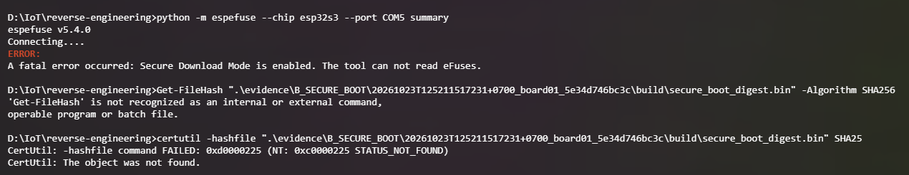

`espefuse` tidak dapat membaca eFuse karena Secure Download Mode. Kesalahan `Get-FileHash` terjadi karena shell yang digunakan adalah cmd.exe. Kedua hal dicatat sebagai evidence operasional.

### Board02 — hasil valid B_SECURE_BOOT

#### Gambar 6 — digest burn preview board02/COM7

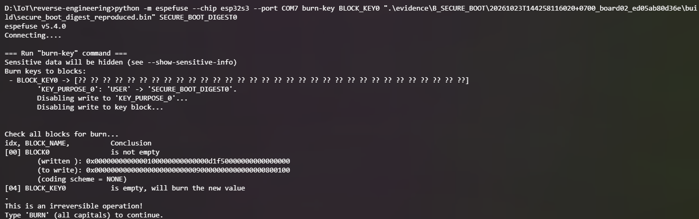

Preview menunjukkan key block kosong, purpose `SECURE_BOOT_DIGEST0`, dan prompt irreversible. Ini adalah langkah trust-anchor provisioning.

#### Gambar 7 — digest burn success

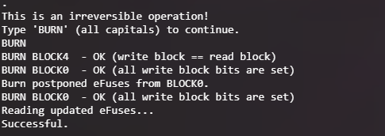

`BLOCK4` dan `BLOCK0` berhasil dibakar. Digest tersimpan, tetapi enforcement Secure Boot masih harus diaktifkan secara terpisah.

#### Gambar 8 — summary setelah digest

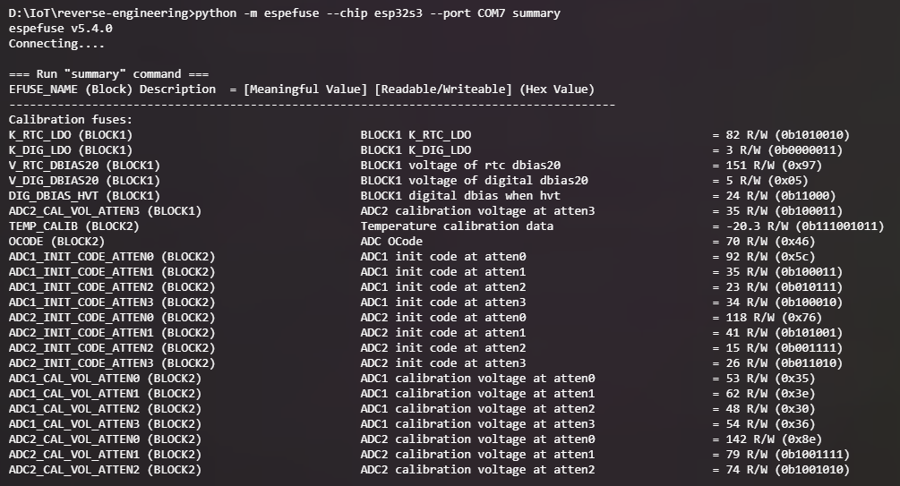

Summary read-only dijalankan pada COM7 untuk memastikan state setelah digest dan sebelum enablement.

#### Gambar 9 — checkpoint Secure Boot masih OFF

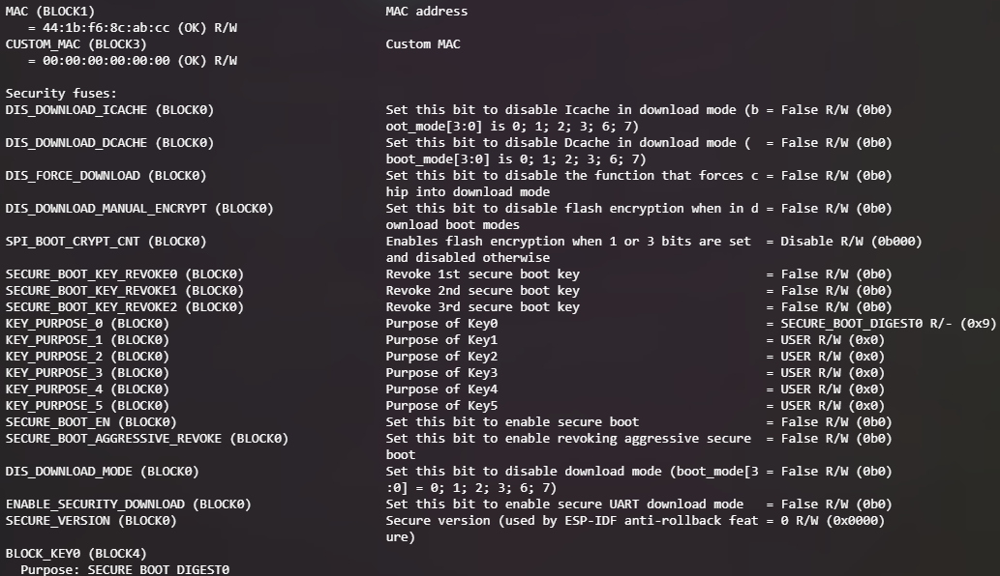

`KEY_PURPOSE_0=SECURE_BOOT_DIGEST0` sudah berubah, tetapi `SECURE_BOOT_EN=False`. Ini bukti pemisahan antara trust-anchor storage dan enforcement bit.

#### Gambar 10 — enable preview

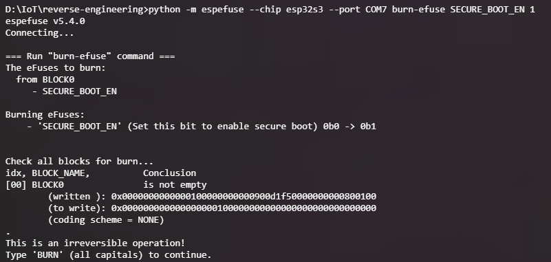

Preview hanya menunjukkan `SECURE_BOOT_EN 0b0 -> 0b1`. Tidak ada field FE, UART, JTAG, atau revoke yang ikut ditargetkan.

#### Gambar 11 — enable success

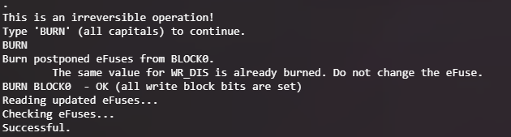

Konfirmasi `BURN` berhasil dan tool mengakhiri proses dengan `Checking eFuses... Successful`. Setelahnya, boot verification, heartbeat, acquisition 16 MiB, dan marker analysis dilakukan sebagai evidence terpisah.

### Aturan caption

Dalam naskah, setiap gambar harus menyebut nomor gambar, board ID, COM port, timestamp screenshot bila tersedia, command yang terlihat, dan evidence path. Gambar 1–5 tidak boleh dipakai sebagai hasil B; gambar 6–11 hanya mendukung provisioning, sementara kesimpulan B tetap berasal dari JSON, hash, event log, boot log, acquisition, dan analysis evidence.


