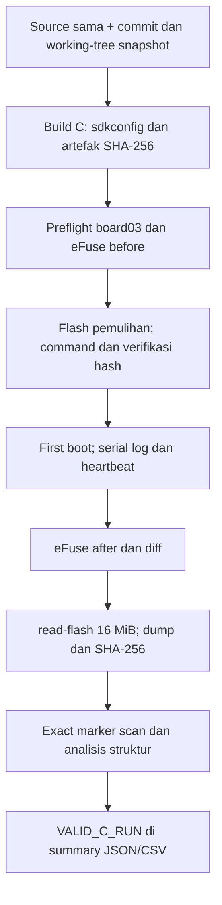

# Laporan final Skenario 3 — Flash Encryption pada ESP32-S3

**Status:** `VALID_C_RUN` · **Tanggal pengukuran valid:** 26 Oktober 2026, WIB (UTC+07:00) · **Scenario ID:** `C_FLASH_ENCRYPTION` · **Board:** `board03` · **Run valid:** `044fc73049da`.

## Ringkasan eksekutif

Skenario 3 menguji satu pertanyaan sempit: ketika Flash Encryption aktif dan Secure Boot tidak aktif, apakah pihak dengan akses fisik ke UART/ROM download masih dapat mengambil raw flash lalu memulihkan kredensial sintetis dari byte yang diperoleh? Pada board03, jawabannya terpisah menjadi dua. **Raw flash 16 MiB berhasil diakuisisi penuh**, tetapi pencarian exact ASCII terhadap lima marker penelitian menghasilkan **nol temuan**. Boot log menyatakan enkripsi selesai dan mode RELEASE; snapshot eFuse sesudah boot mengonfirmasi `SPI_BOOT_CRYPT_CNT` berubah dari `0x0` ke `0x7`, sementara `SECURE_BOOT_EN` tetap false. Jadi, pada jalur uji ini Flash Encryption melindungi plaintext marker dari pembacaan raw, meskipun ROM download masih mengizinkan akuisisi byte flash.

Jalan menuju pengukuran valid ini tidak mulus. Build awal memiliki ketidakcocokan konfigurasi aplikasi dan bootloader. Build berikutnya lolos gate flag Flash Encryption, tetapi first boot terputus setelah sebagian flash dienkripsi dan sebelum counter aktif. Kegagalan itu dipreservasi sebagai insiden, termasuk dump 16 MiB yang masih mengandung marker plaintext. Board kemudian dipulihkan dari image plaintext lengkap, dengan partisi `nvs_keys` ditambahkan, dan first boot selanjutnya berhasil. Semua kegagalan tetap ada dalam evidence; hanya run setelah enkripsi selesai yang dipakai sebagai hasil Skenario 3.

## Status penyelesaian

| Kriteria uji utama | Status teramati |
|---|---|
| Board, port, flash 16 MiB, PSRAM 8 MiB teridentifikasi | Selesai |
| Build C dan hash artefak diarsipkan | Selesai |
| Boot normal dan heartbeat aplikasi | Selesai |
| eFuse before/after menunjukkan FE ON, SB OFF | Selesai |
| Raw flash penuh diperoleh dan di-hash | Selesai: 16.777.216 byte |
| Lima marker exact dipindai dari dump | Selesai: semua count 0 |
| Analisis struktur dan agregasi JSON/CSV | Selesai |
| Screenshot terminal khusus run valid | Tidak tersedia; log mentah, JSON, BIN, dan hash tersedia sebagai bukti utama |

Dengan kriteria primary extraction dalam [seed.md](seed.md), **Skenario 3 selesai**. Screenshot tambahan atau replikasi pada board lain dapat memperkaya naskah, tetapi bukan syarat yang belum terpenuhi untuk menyatakan hasil run ini. Skenario D adalah eksperimen terpisah.

## 1. Pertanyaan 5W1H dan desain

| Aspek | Definisi operasional |
|---|---|
| **What** | Uji keterbacaan raw flash, struktur firmware, dan lima marker sintetis: `WIFI_SSID`, `WIFI_PASSWORD`, `API_KEY`, `STATIC_SECRET`, `NVS_SECRET`. |
| **Why** | Mengisolasi kontribusi Flash Encryption terhadap kerahasiaan firmware. Secure Boot V2 sengaja OFF; autentisitas boot bukan variabel yang diukur di C. |
| **Who** | Peneliti memodelkan attacker yang memiliki perangkat penelitian secara sah, PC Windows, dan akses fisik ke port USB/UART. Tidak diasumsikan memiliki key flash dari eFuse. |
| **Where** | ESP32-S3 board03, MAC `e0:72:a1:d5:4d:fc`, CH343 COM9, flash terdeteksi 16 MiB dan PSRAM terdeteksi 8 MiB. |
| **When** | Build dan percobaan berlangsung 24–26 Oktober 2026; run C valid dicatat pada 26 Oktober pukul 21:43–23:09 WIB. |
| **How** | Source aplikasi tetap sama; konfigurasi ESP-IDF mengaktifkan Flash Encryption Release. Setelah boot dan eFuse terverifikasi, esptool membaca offset `0x0` sepanjang `0x1000000` byte. Python menghitung SHA-256, memindai marker exact, dan mencoba parsing struktur dari raw dump. |

Unit inferensi adalah **satu board dan satu run C valid**. Percobaan gagal sebelumnya tidak diubah menjadi replikasi sukses. Nilai marker adalah sintetis sesuai [seed.md](seed.md) dan implementasi pencariannya ada di [analysis.py](scripts/lib/analysis.py); tidak ada kredensial produksi.

## 2. Perangkat, konfigurasi, dan batas kontrol

PlatformIO memakai manifest umum `esp32-s3-devkitc-1`, tetapi [dokumentasi board PlatformIO](https://docs.platformio.org/en/latest/boards/espressif32/esp32-s3-devkitc-1.html) mencantumkan varian default N8 tanpa PSRAM. Karena itu identitas N16R8 tidak disimpulkan dari nama board: [preflight run valid](evidence/C_FLASH_ENCRYPTION/20261026T214306270096+0700_board03_044fc73049da/device/preflight.json) mengukur ESP32-S3 revisi v0.2, flash 16.777.216 byte, dan informasi PSRAM 8 MB. USB board terhubung melalui CH343 COM9; adapter USB-to-TTL eksternal tidak dipakai.

[Build C](evidence/C_FLASH_ENCRYPTION/20261026T214306270096+0700_board03_044fc73049da/build/build_reference.json) mengarsipkan resolved `sdkconfig`, header konfigurasi aplikasi dan bootloader, BIN/ELF/MAP, tabel partisi, serta SHA-256. Keduanya memuat `CONFIG_SECURE_FLASH_ENC_ENABLED=1`; mode yang terpilih adalah Release dan `CONFIG_SECURE_BOOT` tidak diset. Tabel build menempatkan `factory` pada `0x10000` dan `nvs_keys` pada `0x310000` dengan flag encrypted. Source aplikasi tidak dibedakan per skenario.

Commit yang dicatat adalah `bd6537c3805cf62a2570f841c6588235621861e4`, **dengan working tree dirty**. Karena itu commit saja tidak cukup mereproduksi binary C: snapshot konfigurasi, patch build, file partisi, dan hash artefak dalam evidence adalah bagian dari provenance. ESP-IDF 6.1.0 tampak pada boot log; host mencatat Python 3.14.0, PlatformIO Core 6.2.0, platform `espressif32@7.1.3`, dan esptool/espefuse 5.4.0. `pio pkg list` pada capture versi mengembalikan exit 1 setelah menampilkan platform; OpenSSL tidak tersedia pada PATH. Keduanya tidak dipakai untuk menyimpulkan hasil C.

## 3. Tooling menurut layer dan alasan pemilihan

| Layer | Tool/asal | Fungsi dalam uji ini | Mengapa dipakai |
|---|---|---|---|
| Pengembangan | VS Code, PlatformIO Core, platform Espressif32 | Build environment `flash_encryption` dan arsip output. | PlatformIO adalah workflow proyek; versi serta environment dipin. |
| Mekanisme keamanan | ESP-IDF 6.1.0 dari paket framework PlatformIO | Bootloader first boot, konfigurasi Release, NVS Encryption, log boot. | ESP-IDF adalah otoritas implementasi fitur keamanan ESP32-S3. |
| Identifikasi/akuisisi | [esptool resmi Espressif](https://docs.espressif.com/projects/esptool/en/latest/esp32s3/esptool/), versi 5.4.0 | Identitas chip, flash ID, erase/write pemulihan, `read-flash` 16 MiB. | Tool vendor memahami protokol ROM; stdout, stderr, exit code dan command lengkap diarsipkan. |
| State perangkat | `espefuse` resmi Espressif, versi 5.4.0 | Snapshot eFuse before/after dan diff. | eFuse adalah bukti perangkat untuk status FE/SB; tidak disimpulkan dari build saja. |
| Serial | pySerial melalui `capture_serial.py` | Log first boot, status aplikasi, heartbeat dan cek kebocoran secret ke log. | Menjaga log byte dan timestamp attempt, termasuk kegagalan membuka COM9. |
| Analisis & provenance | Python standar + `research_logger.py`, `acquire_flash.py`, `analyze_dump.py`, `compare_results.py` | Direktori run unik, hash SHA-256, exact scan, parsing struktur, agregasi CSV/JSON. | Tool resmi tidak menyediakan format evidence/marker spesifik penelitian. Script lokal mengorkestrasi tool vendor dan menghitung metrik yang didefinisikan seed; hasil dapat diuji dengan fixture sintetis. |

`espsecure` tersedia dalam inventaris tooling tetapi **tidak dipakai untuk mengekstrak key** pada C. Key Flash Encryption dibuat oleh first boot yang sempat gagal, lalu dipakai kembali pada recovery. Tidak ada operasi manual burn eFuse oleh agen. Script flash diberi flag operator dan akhirnya diperbaiki agar menolak singkatan flag.

## 4. Alur dan jejak bukti

Run valid menyimpan [manifest](evidence/C_FLASH_ENCRYPTION/20261026T214306270096+0700_board03_044fc73049da/manifest.json), `events.jsonl`, `audit.jsonl`, command per tahap, eFuse mentah/JSON, log serial, dump, hash, analisis, dan [validity check](evidence/C_FLASH_ENCRYPTION/20261026T214306270096+0700_board03_044fc73049da/analysis/validity_check.json). Screenshot adalah pelengkap; hasil akhir dapat ditelusuri tanpa screenshot.

## 5. Kronologi insiden sebelum run valid

| Waktu WIB / run | Apa yang terjadi | Klasifikasi |
|---|---|---|
| 24 Okt, `1d34048d0b2e` | Preflight N16R8 dan eFuse berhasil. Build 133,875 detik, tetapi first boot abort karena aplikasi meminta Flash Encryption sedangkan bootloader tidak. eFuse diff masih kosong. | Insiden konfigurasi; bukan uji FE aktif. |
| 26 Okt, `01e7f9f427d0` | Gate menemukan flag FE aplikasi true dan bootloader false. | STOP sebelum flash baru; bukti ketidakcocokan. |
| 26 Okt, `905c84ce2642` | Build bersih 140,146 detik menghasilkan flag FE pada aplikasi dan bootloader. First boot V2 memprogram key/proteksi, mengenkripsi bootloader dan tabel partisi, mulai enkripsi aplikasi, lalu terputus. Counter tetap `0x0`; aplikasi tidak boot. | `FIRST_BOOT_PARTIAL_PROVISIONING_INCIDENT`. Penyebab reset tidak terbukti. |
| 26 Okt 16:17, `3413338da138` | Pembacaan preservasi timeout setelah 240,054 detik; file dump tidak dihasilkan. | Failed acquisition tetap disimpan. |
| 26 Okt 16:29, `50072e1e628f` | Pembacaan dihentikan saat operator meminta jeda; durasi 134,226 detik, ukuran aktual 0. | Failed acquisition tetap disimpan. |
| 26 Okt 20:03–20:10, `09203ff391be` | Preservasi berhasil 16 MiB dalam 409,442 detik. Raw dump masih memuat lima marker, tetapi counter FE `0x0` dan boot gagal. | Evidence keadaan insiden, **bukan** hasil C valid. |
| 26 Okt 20:12–20:15, `c856d72fc248` | Build pemulihan di host, 150,215 detik. Partisi `nvs_keys` ditambahkan tanpa menggeser offset lama; app/bootloader FE gate PASS. | Persiapan host, belum pengukuran perangkat. |

Analisis halaman terhadap build V2 menunjukkan bootloader, tabel partisi, dan awal aplikasi telah berubah, sedangkan 179 halaman aplikasi dari `0x1B000` sampai akhir image cocok persis dengan build plaintext. Ini mendukung insiden enkripsi parsial; non-kecocokan byte sendiri bukan pembuktian algoritme. Detail dan sebab yang masih hipotesis ada di [C22](docs/C22_FIRST_BOOT_EFUSE_INCIDENT_20261026.md) dan [C23](docs/C23_RECOVERY_REVIEW.md). [Panduan Espressif](https://docs.espressif.com/projects/esp-idf/en/release-v5.3/esp32s3/security/flash-encryption.html) menjelaskan bahwa first boot yang terputus dapat memerlukan penulisan ulang image plaintext.

## 6. Proses run valid, langkah demi langkah

| Tahap | Waktu WIB dan durasi yang terekam | Bukti / konsekuensi |
|---|---|---|
| Run dan preflight | Run dibuat 21:43:06; identitas chip 21:43:15–21:43:16 (1,402 dtk); flash ID 21:43:16–21:43:18 (1,775 dtk). | COM9, ESP32-S3 v0.2, MAC board03, 16 MiB flash, 8 MB PSRAM. |
| eFuse before | 21:43:21–21:43:23 (1,458 dtk untuk raw summary). | `SPI_BOOT_CRYPT_CNT=0x0`, `SECURE_BOOT_EN=0`, key purpose `XTS_AES_128_KEY`; key telah ada dari insiden. |
| Operator flash | Erase 21:54:04–21:54:10 (6,248 dtk); write 21:54:10–21:55:00 (49,880 dtk). | Erase 16 MiB sukses. Bootloader di `0x0000`, partisi di `0x8000`, aplikasi di `0x10000`; masing-masing diverifikasi esptool. `--after no-reset` meninggalkan board di ROM. |
| Capture serial dan first boot | Capture siap 22:57:03.775; berakhir 23:00:04.369 (180 dtk diminta). Waktu log boot bersifat relatif, bukan timestamp reset host. | Bootloader memakai key eFuse yang sudah ada. Enkripsi aplikasi mulai pada boot relatif 821 ms, selesai pada 8339 ms; `CRYPT_CNT` ditetapkan pada 8345 ms, enkripsi selesai pada 8357 ms, lalu reboot. Aplikasi menyala dan heartbeat berulang. |
| eFuse after | 23:00:29–23:00:32 (raw 1,486 dtk; JSON 1,353 dtk). | Counter menjadi `0x7` dan FE aktif; Secure Boot tetap OFF. Hanya counter yang berubah dibanding snapshot before run ini. |
| Akuisisi raw | 23:00:58.818–23:07:47.842 (409,022 dtk). | ROM download dapat diakses; 16.777.216 byte diminta dan diperoleh, exit code 0. |
| Analisis dan agregasi | Scan dimulai 23:07:57.788; selesai 23:07:58.919. Run dinyatakan valid 23:09:15.160. | Hash cocok; lima exact marker masing-masing count 0; tabel partisi/app tidak teridentifikasi dari raw bytes. |

Ada dua insiden operasional pada run valid, dan keduanya dipertahankan. Pertama, operator mengetik `--confirm-destructiv`; `argparse` semula menerima singkatan itu sebagai flag penuh. Erase/write **benar-benar terjadi** dan berhasil; script kemudian diberi `allow_abbrev=False` serta uji regresi. Kedua, empat attempt capture awal ditolak COM9 (`Access is denied`) sebelum port terbuka. Logger retry dan pesan error diperbaiki; attempt kelima berhasil. Detail pada [C25](docs/C25_RECOVERY_FLASH_AND_FLAG_INCIDENT_20261026.md) dan [C26](docs/C26_SERIAL_CAPTURE_PORT_BLOCKED_20261026.md). Tidak ada bukti first boot dari attempt yang ditolak port.

## 7. State eFuse dan pembacaan keamanan

| Field | Before run valid | After boot valid | Arti untuk laporan |
|---|---|---|---|
| `SPI_BOOT_CRYPT_CNT` | `0x0` / Disable | `0x7` / Enable | FE aktif pada perangkat. Boot log juga menyebut `flash encryption is enabled (0 plaintext flashes left)`. |
| `SECURE_BOOT_EN` | false | false | Skenario tetap FE saja; tidak mengukur Secure Boot. |
| `KEY_PURPOSE_0` | `XTS_AES_128_KEY` | sama | Key dari insiden sebelumnya dipakai kembali; tidak dibuat ulang pada run valid. |
| `DIS_DOWNLOAD_MODE` | false | false | ROM download tidak dinonaktifkan. |
| `ENABLE_SECURITY_DOWNLOAD` | false | false | Secure download mode tidak diaktifkan oleh run ini. |

[efuse_diff.json](evidence/C_FLASH_ENCRYPTION/20261026T214306270096+0700_board03_044fc73049da/device/efuse_diff.json) hanya memuat perubahan counter. Field yang tidak berubah tetap disimpan di JSON/raw before dan after. JSON `espefuse` masih menandai counter `writeable=true`; laporan **tidak** mengklaim bit write-protect baru dibakar pada run ini. Nilai tiga bit `0x7` sudah penuh, dan boot log menyatakan tidak ada plaintext flash tersisa. Mode Release dikonfirmasi oleh resolved config dan runtime log, bukan sekadar nama environment.

## 8. Akuisisi, peta dump, dan analisis

Perintah inti yang terekam dalam [command.txt](evidence/C_FLASH_ENCRYPTION/20261026T214306270096+0700_board03_044fc73049da/acquisition/command.txt) adalah `esptool --chip esp32s3 --port COM9 --baud 460800 --after no-reset read-flash 0x0 0x1000000 <flash_dump.bin>`. Status [acquisition.json](evidence/C_FLASH_ENCRYPTION/20261026T214306270096+0700_board03_044fc73049da/acquisition/acquisition.json) adalah SUCCESS. [Dump mentah](evidence/C_FLASH_ENCRYPTION/20261026T214306270096+0700_board03_044fc73049da/acquisition/flash_dump.bin) berukuran tepat 16.777.216 byte; SHA-256 `1d948d10f7756c50aaed7938a20b790dd85e89682c7a93c4b9ca6af3e0b2e752`. Hash pada sidecar, metadata, analisis, dan hitung ulang cocok.

| Region referensi dari build | Offset dan ukuran | Status dari raw dump |
|---|---|---|
| Bootloader | `0x000000`; image build 32.240 byte | Raw byte tidak dapat dibaca sebagai image plaintext build. |
| Tabel partisi | `0x008000`; BIN build 3.072 byte | Parser raw tidak menemukan tabel partisi valid. |
| NVS | `0x009000`–`0x00EFFF` | Struktur NVS/isi secret tidak diklaim berhasil diparse dari raw. |
| Factory app | `0x010000`; partisi 3 MiB | Parser raw tidak mengidentifikasi image aplikasi; lima marker exact tidak ditemukan. |
| `nvs_keys` | `0x310000`; 4 KiB, flag encrypted | Alamat/flag diketahui dari **build**, bukan hasil dekripsi dump. |

Peta ini berasal dari [partisi build](evidence/C_FLASH_ENCRYPTION/20261026T214306270096+0700_board03_044fc73049da/analysis/build_reference_offsets.json). [analysis.json](evidence/C_FLASH_ENCRYPTION/20261026T214306270096+0700_board03_044fc73049da/analysis/analysis.json) secara terpisah menyatakan `partition_table.parseable=false` dan `image_detection.app_identifiable=false` dari raw bytes. Tidak ada klaim bahwa alamat referensi itu ditemukan secara independen pada ciphertext.

[Spot check byte mentah](evidence/C_FLASH_ENCRYPTION/20261026T214306270096+0700_board03_044fc73049da/analysis/structural_spotcheck.json) mencatat 8 byte awal tiap region referensi:

| Offset referensi | Build plaintext (hex) | Raw dump (hex) |
|---|---|---|
| Bootloader `0x000000` | `e903024ffc883c40` | `75d389b3df9987be` |
| Partisi `0x008000` | `aa50010200900000` | `29733ec3d11a59f1` |
| Aplikasi `0x010000` | `e906024f885f3740` | `d0c551c883bdc012` |

Perbandingan ini adalah observasi tambahan dari raw bytes terhadap build referensi. Ia bukan proses dekripsi dan, tanpa eFuse/boot log, non-kecocokan sendiri tidak membuktikan enkripsi.

| Marker exact ASCII | Count dalam dump C valid | Offset yang diperoleh |
|---|---:|---|
| `WIFI_SSID` | 0 | `[]` |
| `WIFI_PASSWORD` | 0 | `[]` |
| `API_KEY` | 0 | `[]` |
| `STATIC_SECRET` | 0 | `[]` |
| `NVS_SECRET` | 0 | `[]` |

Entropi whole-file hanya **0,6696 bit/byte**; 15.960.921 byte adalah `0xFF` karena sebagian besar kapasitas flash kosong. Karena itu entropi global tidak dipakai untuk menyimpulkan enkripsi. Enkripsi didukung oleh build Release, boot log, dan counter eFuse; ketidakpulihan marker didukung oleh exact scan seluruh byte hasil akuisisi. Penemuan literal `NVS_SECRET` pada source/build tidak sama dengan bukti entri NVS tersimpan; runtime log menyatakan marker NVS disimpan, sedangkan raw dump C tidak memuat literalnya.

## 9. Hasil terstruktur dan interpretasi

| Metrik | Observasi run valid |
|---|---|
| Flash Encryption aktif | Ya; counter `0x7`, boot log mode RELEASE |
| Secure Boot aktif | Tidak |
| ROM download dapat diakses | Ya |
| Read raw flash sukses | Ya; 16 MiB penuh |
| SHA-256 dump | `1d948d10f7756c50aaed7938a20b790dd85e89682c7a93c4b9ca6af3e0b2e752` |
| Tabel partisi parseable dari raw | Tidak |
| App identifiable dari raw | Tidak |
| SSID/password/API/static/NVS marker recoverable melalui exact scan | Tidak; masing-masing count 0 |
| Secret tercetak ke serial | Tidak teramati |

Hasil ini menjawab RQ3 dalam [seed.md](seed.md): pada konfigurasi C yang terobservasi aktif, akuisisi raw tetap mungkin, tetapi plaintext marker yang diuji tidak terlihat di byte hasil baca. Ini konsisten dengan tujuan Flash Encryption untuk kerahasiaan off-chip flash sebagaimana dijelaskan [Espressif](https://docs.espressif.com/projects/esp-idf/en/release-v5.3/esp32s3/security/flash-encryption.html). Kesimpulan sengaja dibatasi pada jalur ROM raw read, lima marker exact, satu board, dan satu run valid. Ia tidak menguji serangan runtime, side channel, bug aplikasi, atau semua bentuk penyimpanan secret.

Hasil insiden parsial tidak dipakai sebagai kegagalan Flash Encryption aktif. Ketika marker ditemukan pada dump preservasi `09203ff391be`, eFuse masih `0x0`, boot gagal, dan image hanya sebagian terproses. [Agregat JSON](results/experiment_summary.json) dan [CSV](results/experiment_summary.csv) memberi label `INVALID_INCIDENT_STATE` untuk run itu, sementara run `044fc73049da` berlabel `VALID_C_RUN`.

## 10. Dokumentasi visual: urutan command, fungsi, dan konsekuensi

Seluruh 22 screenshot berikut berasal dari **fase historis sebelum run valid**. Nama C01–C22 mengikuti catatan operator; C11/C12 baru dilakukan pada run valid, sedangkan C13–C22 adalah diagnosis yang disisipkan setelah insiden. Gambar terminal membuktikan tampilan command saat itu, sedangkan status teknis akhir ditentukan dari log dan JSON pada run terkait. Waktu modifikasi gambar bukan timestamp eksekusi. Salinan gambar dan hash tersimpan dalam [manifest screenshot](docs/screenshots/SKENARIO_3/review_20261026/screenshot_manifest.json).

### C01–C05 — Mengenali board dan state awal

**C01 — Inventaris port.** `python -m serial.tools.list_ports -v` memisahkan COM9 CH343 dari port Bluetooth. Konsekuensinya COM9 dipilih untuk perintah perangkat; daftar port sendiri belum membuktikan identitas MCU.

**C02 — Identitas MCU.** `python -m esptool --chip esp32s3 --port COM9 chip-id` menghubungi ROM ESP32-S3 dan menunjukkan revisi v0.2, MAC `e0:72:a1:d5:4d:fc`, serta PSRAM 8 MB. MAC dipakai untuk mengikat evidence ke board03.

**C03 — Kapasitas flash.** `type preflight.json` menampilkan hasil preflight 16.777.216 byte flash. Ini hasil deteksi perangkat, bukan asumsi dari manifest `esp32-s3-devkitc-1`.

**C04a — Summary eFuse.** `python -m espefuse --chip esp32s3 --port COM9 summary` membaca state silikon tanpa memprogramnya. WR_DIS/RD_DIS awal bernilai nol pada gambar.

**C04b — Kontrol keamanan awal.** Lanjutan summary memperlihatkan `SPI_BOOT_CRYPT_CNT=000`, `SECURE_BOOT_EN=false`, tujuan key `USER`, dan ROM download belum ditutup. Ini snapshot sebelum percobaan pertama, bukan state akhir C.

**C05 — Cuplikan ulang.** Gambar mengulang bagian security fuses dari C04b. Ia tidak dihitung sebagai snapshot atau try baru.

### C06–C10 — Build awal dan insiden konfigurasi

**C06 — Manifest build.** `type build_manifest.json` menghubungkan commit, ukuran, SHA-256, dan file BIN. Build berhasil menghasilkan artefak, tetapi status itu belum memastikan bootloader dan aplikasi memakai flag FE yang sama.

**C07 — Rencana Release.** `type provisioning_plan.json` mencatat mode Release yang dimaksud dan Secure Boot OFF. Field `NOT_IMPLEMENTED` menjelaskan bahwa planner host tidak membakar eFuse; bootloader ESP-IDF tetap dapat memprogram eFuse saat first boot normal.

**C08 — Flash tiga image.** `esptool write-flash` menulis bootloader pada `0x0000`, partisi pada `0x8000`, dan aplikasi pada `0x10000`. Tiga hash tulis diverifikasi. Durasi transfer yang tampak 1,4/0,0/44,7 detik, bukan durasi seluruh prosedur. `--after no-reset` meninggalkan perangkat di ROM, sehingga verifikasi flash belum membuktikan boot.

**C09 — Capture first boot awal.** `python scripts\capture_serial.py --run <run-awal> --port COM9 --seconds 35` mengumpulkan log serial setelah operator memindah board ke boot normal. Gambar hanya menampilkan command/path; log menunjukkan abort karena aplikasi meminta FE sementara bootloader tidak.

**C09b — Diff eFuse awal.** `type efuse_diff.json` menunjukkan daftar perbedaan kosong pada insiden 24 Oktober. Artinya percobaan awal belum mengaktifkan FE; ini tidak berlaku untuk insiden V2 atau run valid berikutnya.

**C10 — Catatan insiden.** Gambar memuat ringkasan diagnosis turunan, bukan stdout perangkat. Konsekuensinya build awal dinyatakan insiden konfigurasi, dan hasilnya dikeluarkan dari pengukuran confidentiality FE aktif.

### C13–C15 — Menahan build yang tidak konsisten

**C13 — Run diagnosis dan path salah.** `python scripts\capture_versions.py --scenario C_FLASH_ENCRYPTION --board-id board03 --experiment-id EXP_C_FLASH_ENCRYPTION_BOARD03_BOOTLOADER_FIX` membuat run aktual `20261026T152246530539+0700_board03_01e7f9f427d0`. Operator kemudian mengisi `RUN` dengan timestamp contoh `20261026T170000000000...`; `build_evidence.py` gagal `FileNotFoundError` karena manifest pada path contoh tidak ada. Kegagalan ini murni path host, bukan perubahan perangkat.

**C14 — Path dibetulkan, gate menolak.** Setelah `RUN` menunjuk folder aktual, `python scripts\build_evidence.py --run "%RUN%"` dapat membaca manifest. `python scripts\verify_build_security_config.py --env flash_encryption --build-dir ".pio\build\flash_encryption" --json "%RUN%\build\build_security_check.json"` melaporkan aplikasi `true`, bootloader `false`, `pass=false`. STOP berarti image ini tidak boleh dipakai untuk pengujian C.

**C15 — Bukti asal mismatch.** `findstr /N /C:"CONFIG_SECURE_FLASH_ENC_ENABLED"` menemukan definisi di header aplikasi dan tidak menemukan definisi di header bootloader. Pengulangan gate menguatkan diagnosis; ia bukan try flash tambahan.

### C16–C22 — Build V2 lolos gate, first boot tetap terputus

**C16 — Run baru.** `capture_versions.py` membuat run `905c84ce2642`, terpisah dari run gate gagal. Pemisahan ini mempertahankan evidence lama tanpa overwrite.

**C17 — Clean host.** `py -3.12 -m platformio run -e flash_encryption -t clean` selesai 1,871 detik. Command menghapus cache build di PC, bukan flash atau eFuse board.

**C18 — Build dan arsip.** `python scripts\build_evidence.py --run "%RUN%"` membangun dan menyimpan artefak V2. Path yang tercetak harus dibaca bersama build log, exit code, resolved sdkconfig, dan hash untuk memastikan keluaran yang benar.

**C19 — Gate PASS.** `verify_build_security_config.py` serta `findstr` pada kedua header menunjukkan flag FE aktif untuk aplikasi dan bootloader. Ini memvalidasi satu prasyarat konfigurasi; ia belum membuktikan first boot, key, NVS, atau eFuse counter berhasil.

**C20 — eFuse before V2.** `python scripts\capture_efuse.py --run "%RUN%" --port COM9 --phase before` mengarsipkan state sebelum first boot V2. Isi state dibuktikan oleh raw/JSON, bukan oleh path output pada layar.

**C21 — Flash V2.** `esptool write-flash` memverifikasi bootloader 32.240 byte, tabel 3.072 byte, dan aplikasi 777.536 byte; transfer sekitar 2,0/0,0/44,7 detik. Tulis sukses masih belum menjamin boot atau selesai enkripsi.

**C22 — First boot V2 dan insiden parsial.** `capture_serial.py --seconds 35` merekam bootloader membuat key dan proteksi eFuse, mengenkripsi bootloader/tabel, lalu mulai mengenkripsi aplikasi. ROM reset muncul sebelum pesan penyelesaian; snapshot after menunjukkan counter tetap `0x0` dan aplikasi tidak boot. Penyebab reset belum terbukti. Key/proteksi yang sudah berubah adalah perubahan permanen pada board03 dan menjadi kondisi awal run valid berikutnya.

Tidak ada screenshot operator untuk eFuse after, serial boot sukses, akuisisi, atau analisis **run valid**. Hasil tahap akhir ditopang log mentah, JSON, dump BIN, dan hash pada folder run `044fc73049da`; gambar C22 tidak boleh diberi caption sebagai boot sukses.

## 11. Keterbatasan, integritas, dan tindak lanjut

1. Hanya satu board dan satu run C valid. Replikasi akan mengukur konsistensi prosedur, tetapi tidak boleh mengubah hasil run ini.
2. Board valid bukan perangkat baru: key/proteksi eFuse telah diprogram pada insiden V2. Kondisi before dan diff dicatat, sehingga state tidak disamarkan sebagai provisioning dari pabrik.
3. Build C berasal dari working tree dirty; file konfigurasi, patch, artefak, dan hash diarsipkan untuk merekonstruksi keadaan yang dipakai.
4. Exact scan hanya menilai marker sintetis yang diketahui dalam representasi ASCII. Tidak ditemukannya marker bukan pembuktian bahwa setiap rahasia atau setiap encoding aman.
5. Enkripsi tidak disimpulkan dari entropi, dan alamat build tidak disajikan sebagai struktur yang terdeteksi dari raw dump.
6. Empat kegagalan COM9, timeout preservasi, parser flag terpotong, serta first boot parsial tetap dicatat; tidak ada evidence gagal yang ditimpa atau dihapus.

Skenario 3 selesai untuk tujuan primary extraction. Langkah analisis penelitian berikutnya adalah membandingkan A/B/C dari `experiment_summary` sambil memisahkan insiden dan run valid. Skenario D, bila tetap dilaksanakan sesuai matriks penelitian, memerlukan perencanaan perangkat dan provisioning tersendiri; hasil D belum diisi pada laporan ini.
