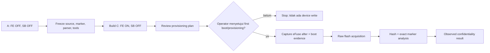
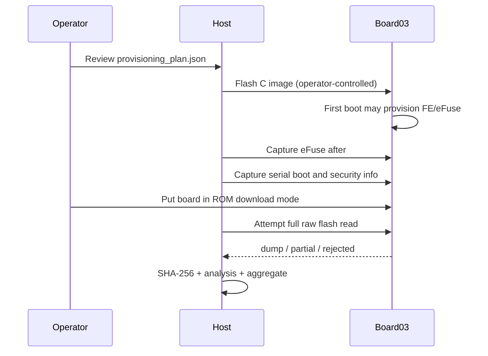

# SKENARIO_3 — Flash Encryption (C_FLASH_ENCRYPTION)

> **ARSIP KRONOLOGI, bukan laporan status terbaru.** Baris “belum dilakukan”, nilai `null`, dan `PENDING_CAPTURE` di bawah merekam keadaan pada tahap historis tertentu. Pengujian C kemudian selesai pada run `044fc73049da`; hasil final ada di [SKENARIO_3.md](SKENARIO_3.md).

**Laporan final lengkap:** [SKENARIO_3_FINAL.md](SKENARIO_3_FINAL.md). Bagian historis di bawah mempertahankan urutan diagnosis sebelum run valid; gunakan laporan final untuk hasil penelitian dan metrik akhir.

**Status terbaru:** `VALID_C_RUN` pada run `044fc73049da`: Flash Encryption Release aktif, dump raw 16 MiB berhasil, lima exact marker tidak ditemukan. Lihat [hasil C27](docs/C27_VALID_FLASH_ENCRYPTION_RESULT_20261026.md). Insiden sebelumnya tetap tercatat di [C23–C26](docs/C23_RECOVERY_REVIEW.md).

**Tanggal pembaruan evidence:** 2026-10-26 (Asia/Jakarta)  
**Scenario ID:** `C_FLASH_ENCRYPTION`  
**Security layer:** Flash Encryption Release aktif pada run valid; Secure Boot tetap OFF  
**Board:** `board03` / `COM9`  
**MAC:** `e0:72:a1:d5:4d:fc`

> Pada insiden awal 24 Oktober eFuse tidak berubah; pada first boot V2 26 Oktober bootloader memprogram key dan protection fuse, tetapi aktivasi FE tidak selesai. Dump insiden 16 MiB pada run `09203ff391be` **tidak valid sebagai pengukuran C**. Build pemulihan `c856d72fc248` kemudian ditulis ke board pada run `044fc73049da`; first boot berikutnya menyelesaikan enkripsi, eFuse counter menjadi `0x7`, dan dump valid tidak memuat exact marker.

## Pembaruan utama — run V2 dan dokumentasi gambar

Kelanjutan C23: [preservasi dan analisis insiden](docs/C23_RECOVERY_REVIEW.md). Dua acquisition awal gagal tanpa dump; run `09203ff391be` akhirnya menghasilkan dump lengkap dan SHA-256. [Review build pemulihan C24](docs/C24_RECOVERY_BUILD_REVIEW_20261026.md) mengarsipkan image baru dengan partisi `nvs_keys`. [C25](docs/C25_RECOVERY_FLASH_AND_FLAG_INCIDENT_20261026.md) mencatat erase/write yang berhasil dan cacat parser yang menerima flag terpotong. [C26](docs/C26_SERIAL_CAPTURE_PORT_BLOCKED_20261026.md) mempertahankan upaya serial yang gagal. [C27](docs/C27_VALID_FLASH_ENCRYPTION_RESULT_20261026.md) memuat pengukuran C setelah first boot berhasil.

Run directory: `20261026T153522657033+0700_board03_905c84ce2642`; field `run_id`: `905c84ce2642`. Skenario tetap C, target Release dengan Secure Boot OFF. Insiden dan build ulang tidak dihitung sebagai replikasi acquisition yang berhasil.

Seluruh 22 screenshot telah diperiksa, disalin tanpa perubahan piksel, diberi nama deskriptif, dan di-hash. File asli di folder operator dipertahankan. [Dossier per langkah](docs/screenshots/SKENARIO_3/review_20261026/README.md) memuat semua gambar, command, tujuan, konsekuensi, serta koreksi konteks. [Timeline](docs/screenshots/SKENARIO_3/review_20261026/TIMELINE.md) berasal dari structured command evidence; waktu yang tidak tercatat tetap unknown. [Manifest screenshot](docs/screenshots/SKENARIO_3/review_20261026/screenshot_manifest.json) menghubungkan nama asli dan salinan beserta SHA-256.

| Tahap aktual | Hasil yang dapat dinyatakan |
|---|---|
| C13–C15 | Gate gagal: flag FE aplikasi true, bootloader false |
| C16–C19 | Perbaikan path resolved sdkconfig; kedua flag true. PASS terbatas pada flag FE |
| C20 | Snapshot before: counter 0, Secure Boot OFF, key purpose USER |
| C21 | Penulisan tiga artefak diverifikasi esptool |
| C22 | Key/proteksi diprogram, bootloader dan tabel dilaporkan terenkripsi; reset saat tahap aplikasi |
| After V2 | Counter tetap 0, key purpose XTS_AES_128_KEY, key read/write-protected, JTAG berubah |
| C11/C12 | Belum dilakukan; hasil marker, dump size/hash tetap null |


PASS membuktikan konsistensi satu flag build. Pemeriksaan ini belum mencakup semua efek provisioning. Arahan sebelumnya terlalu luas saat menyebut build valid sebagai landasan menuju provisioning: perubahan JTAG dan proteksi lain seharusnya dirinci lebih dahulu dalam rencana.


Screenshot C22 hanya menampilkan lokasi capture. Bukti kegagalan ada pada `runtime/serial_boot.log`: pembuatan key pada 254 ms, commit pada 301 ms, bootloader encrypted pada 648 ms, partition table encrypted pada 690 ms, dan enkripsi aplikasi dimulai pada 839 ms. Sesudahnya muncul ROM `POWERON` dan `invalid header: 0xb389d375`. Angka ini relatif terhadap boot; penyebab fisik reset belum diketahui.

Kesimpulan terbaru adalah provisioning parsial dengan boot gagal. Counter 0 berarti FE belum aktif untuk boot, tetapi tidak berarti seluruh flash masih plaintext: bootloader sudah melaporkan enkripsi sebagian region. Bukti ini belum menguji efektivitas confidentiality atau pemulihan credential. Board juga belum dapat dinyatakan tidak dapat dipulihkan tanpa peninjauan recovery lebih lanjut.

Bagian historis di bawah merujuk terutama pada run 24 Oktober `1d34048d0b2e`. Pernyataan eFuse tidak berubah hanya berlaku pada run tersebut. Dossier terbaru menjadi acuan state V2.

## 1. Tujuan penelitian

Skenario C mengisolasi confidentiality dari Flash Encryption. Source firmware, marker, partition table, dan metode analisis harus sama dengan A dan B. Perubahan hanya berasal dari konfigurasi ESP-IDF dan state keamanan board.

Pertanyaan utama:

> Setelah Flash Encryption aktif dan firmware tetap dapat boot, apakah raw off-chip flash yang dibaca melalui UART masih mengandung marker plaintext yang dapat dipulihkan?

Secure Boot sengaja tetap OFF agar authenticity/integrity tidak bercampur dengan uji confidentiality.

## 2. State historis run 24 Oktober (bukan state V2)

| Item | Observed |
|---|---|
| Board ID | `board03` |
| Port | `COM9` |
| USB serial | CH343, serial `5B8F070504` |
| Chip | ESP32-S3 QFN56, revision `v0.2` |
| Flash | 16 MiB tervalidasi |
| PSRAM | 8 MiB AP_3v3 tervalidasi |
| MAC | `e0:72:a1:d5:4d:fc` |
| `SECURE_BOOT_EN` before | `false` |
| `SPI_BOOT_CRYPT_CNT` before | `0` / disabled |
| `ENABLE_SECURITY_DOWNLOAD` before | `false` |
| Build | berhasil pada run `1d34048d0b2e` |
| Flashing | berhasil, hash diverifikasi |
| First boot | gagal; reboot loop pada Flash Encryption check |
| eFuse provisioning | belum dijalankan; crypt counter tetap 0 |
| Acquisition | belum dijalankan |
| Marker analysis | belum dijalankan |

## 3. Evidence runs dan kegagalan yang dipertahankan

Setiap percobaan memakai run directory baru. Kegagalan tidak dihapus atau ditimpa.

| Run | Status | Keterangan |
|---|---|---|
| `aae10bdd459a` | BUILD_FAILED | NVS HMAC dipilih dengan `CONFIG_NVS_SEC_HMAC_EFUSE_KEY_ID=-1`; gagal pada compile-time validation. |
| `809552876d76` | BUILD_FAILED | Internal compiler error GCC pada `esp_lcd_panel_rgb.c`; tidak terkait eFuse atau board. |
| `1d34048d0b2e` | BUILD_COMPLETED + FIRST_BOOT_INCIDENT | Build C berhasil; flash berhasil; first boot masuk reboot loop karena eFuse FE belum enabled. |
| `a1a6f1687865` | BUILD_COMPLETED + CONFIG_REVIEW | Clean rebuild berhasil, tetapi bootloader resolved config tetap tidak memuat `CONFIG_SECURE_FLASH_ENC_ENABLED`; belum diflash. |

Evidence utama C:

```text
evidence/C_FLASH_ENCRYPTION/20261024T144838579740+0700_board03_1d34048d0b2e
```

## 4. Mengapa baseline dan Secure Boot harus dipisahkan

Baseline A menunjukkan bahwa metode acquisition dan marker scanner dapat menemukan data plaintext tanpa security layer. B menunjukkan Secure Boot dapat aktif sementara Flash Encryption OFF dan marker masih dapat ditemukan. C mengubah hanya confidentiality layer.



## 5. Layer tooling dan justifikasi

| Layer | Tool | Fungsi | Justifikasi |
|---|---|---|---|
| Host workflow | VS Code, PowerShell, PlatformIO | menjalankan environment dan command Windows-first | sesuai workflow penelitian dan dapat direproduksi |
| Security authority | ESP-IDF 6.1.0 | sdkconfig, Flash Encryption mode, bootloader/image behavior | sumber konfigurasi security resmi |
| Device identity | `esptool`, `scripts/preflight.py` | chip, MAC, flash, PSRAM, port | official Espressif tooling + evidence wrapper |
| eFuse read | `espefuse`, `scripts/capture_efuse.py` | capture before/after dan diff | snapshot read-only; burn tidak diotomatisasi |
| Build evidence | `scripts/build_evidence.py` | build log, resolved sdkconfig, artifacts, SHA-256 | traceability source → configuration → binary |
| Provisioning review | `scripts/provisioning_plan.py` | intended change dan gate | memisahkan rencana dari irreversible action |
| Acquisition | `scripts/acquire_flash.py`, `esptool` | full/partial raw flash read | command resmi dan menyimpan failed attempt |
| Analysis | `scripts/analyze_dump.py` | entropy pendukung, region summary, partition, exact markers | deterministic dan tidak bergantung binwalk |
| Aggregation | `scripts/compare_results.py` | CSV/JSON hasil | observed evidence, bukan expected value |
| Logging | `research_logger.py` | manifest, events, audit, command stdout/stderr | setiap langkah dapat direkonstruksi |

Tool custom tidak menggantikan Espressif tooling. Fungsinya menambahkan timestamp, run identity, hash, error retention, dan hubungan antar artefak.

## 6. Preflight board03

### 6.1 Inventaris port dan identitas

Command:

```cmd
python -m serial.tools.list_ports -v
python -m esptool --chip esp32s3 --port COM9 chip-id
```

Observed:

```text
USB-Enhanced-SERIAL CH343 (COM9)
ESP32-S3 revision v0.2
MAC e0:72:a1:d5:4d:fc
```

`chip-id` membaca identitas dan melakukan reset melalui RTS; command ini tidak menulis flash atau eFuse.

### 6.2 Preflight hardware

Command yang direkam:

```cmd
python scripts/preflight.py --run .\evidence\C_FLASH_ENCRYPTION\20261024T144838579740+0700_board03_1d34048d0b2e --port COM9 --board-marking "same-class-N16R8-marking-not-recorded" --wiring "USB-C CH343 COM9; external 3.3V USB-to-TTL not used"
```

Hasil: chip, flash 16 MiB, dan PSRAM 8 MiB tervalidasi.

### 6.3 eFuse before

Command:

```cmd
python scripts/capture_efuse.py --run <RUN> --port COM9 --phase before
```

Field penting sebelum perubahan:

```text
SECURE_BOOT_EN = false
SPI_BOOT_CRYPT_CNT = 0 / Disable
ENABLE_SECURITY_DOWNLOAD = false
```

Artefak disimpan sebagai `device/efuse_before_raw.txt` dan `device/efuse_before.json`. Snapshot ini tidak boleh ditimpa oleh `after`.

## 7. Konfigurasi build C

Environment PlatformIO:

```text
[env:flash_encryption]
framework = espidf
board_build.flash_size = 16MB
board_build.esp-idf.sdkconfig_path = sdkconfig.flash_encryption
```

Security configuration resolved:

```text
CONFIG_SECURE_FLASH_ENC_ENABLED=y
CONFIG_SECURE_FLASH_ENCRYPTION_MODE_RELEASE=y
# CONFIG_SECURE_BOOT is not set
CONFIG_SECURE_INSECURE_ALLOW_DL_MODE=y
# CONFIG_SECURE_ENABLE_SECURE_ROM_DL_MODE is not set
# CONFIG_SECURE_DISABLE_ROM_DL_MODE is not set
CONFIG_NVS_SEC_KEY_PROTECT_USING_FLASH_ENC=y
# CONFIG_NVS_SEC_KEY_PROTECT_USING_HMAC is not set
```

Release mode dipilih sebagai konfigurasi C yang akan diuji. Mode ini harus direview secara khusus karena first boot dapat memulai provisioning Flash Encryption dan mengubah eFuse secara irreversible.

### 7.1 Perbaikan build yang tercatat

Build pertama gagal karena ESP-IDF memilih NVS HMAC dengan key ID `-1`. Konfigurasi kemudian diperjelas agar NVS key protection menggunakan Flash Encryption, tanpa menambah eFuse HMAC baru. Build kedua mengalami internal compiler error GCC pada komponen LCD. Kedua kegagalan dipertahankan sebagai evidence.

Build ketiga berhasil pada run `1d34048d0b2e`.

## 8. Artefak dan hash build berhasil

Sumber lengkap: `build/build_manifest.json` pada run utama.

| Artefak | Ukuran | SHA-256 |
|---|---:|---|
| `sdkconfig.flash_encryption` | 97,832 | `5b65fd75825e42f6afbd39feacd57ebf0cc31acef7913fef78f810c75e0b52ec` |
| `bootloader.bin` | 21,120 | `7c3a9d264dbccfacf1e099c134271f3ba47eae21fbf1b650a3ca441d2d2cba15` |
| `firmware.bin` | 777,536 | `34e2c6c1be936a13d84ef98801afae98948df6dfd7bd7112056f68182db24151` |
| `partitions.bin` | 3,072 | `73c0b5c3e5fcba3a151cc70c453c93dd5f4798899e7f2f8cca76da1f32ffc501` |
| `bootloader.elf` | 619,776 | `9a2e243e926d41bd38a13a23a3e7341e2199e1abf44ad5c51331ca41562e57bc` |
| `firmware.elf` | 8,865,808 | `d732e6e0dc33775eb024da1e7db7b168bf8b56e8f54ad55f95e1c4c0ce63e2bc` |

Git commit build: `bd6537c3805cf62a2570f841c6588235621861e4`.

## 9. Provisioning boundary

Planner yang dibuat:

```cmd
python scripts/provisioning_plan.py --run .\evidence\C_FLASH_ENCRYPTION\20261024T144838579740+0700_board03_1d34048d0b2e
```

Output menyatakan intended change hanya:

```text
Flash Encryption key and enablement
```

Planner tidak memiliki jalur eFuse write. Tidak ada command `burn-key`, `burn-efuse`, atau first-boot provisioning yang dijalankan pada board03.

Sebelum operator melanjutkan, harus dipastikan:

1. board `COM9` tetap MAC `e0:72:a1:d5:4d:fc`;
2. eFuse before dan build hash sudah diarsipkan;
3. mode Release memang dipilih secara sadar;
4. UART/download policy dipahami;
5. operator siap menerima perubahan eFuse yang tidak dapat dibalik.

## 10. Prosedur lanjutan setelah operator menyetujui gate

Bagian ini adalah urutan kerja, bukan bukti bahwa langkah sudah dijalankan.



Command sequence evidence yang akan dipakai setelah gate:

```cmd
python scripts/flash_baseline.py --run <RUN> --port COM9
python scripts/capture_efuse.py --run <RUN> --port COM9 --phase after
python scripts/capture_security_info.py --run <RUN>
python scripts/capture_serial.py --run <RUN> --port COM9 --seconds 35
python scripts/acquire_flash.py --run <RUN> --port COM9 --baud 460800
python scripts/analyze_dump.py --run <RUN>
python scripts/compare_results.py
```

Nama command flashing harus diverifikasi terhadap mode dan artefak C yang terpasang sebelum execution. Jangan menganggap `flash_baseline.py` aman untuk first boot Release tanpa review operator.

## 10A. Incident first boot yang teramati

Setelah C8, capture serial 35 detik tidak menemukan banner aplikasi atau heartbeat. Board berulang kali menampilkan:

```text
E (338) flash_encrypt: Flash encryption eFuse bit was not enabled in bootloader but CONFIG_SECURE_FLASH_ENC_ENABLED is on
abort() was called...
Rebooting...
```

`runtime_status.json` mencatat `boot_confirmed=false` dan tidak ada `SECRET_LOG_EXPOSURE`. Pemeriksaan read-only sesudahnya menunjukkan:

```text
SPI_BOOT_CRYPT_CNT = Disable (0b000)
SECURE_BOOT_EN = False
ENABLE_SECURITY_DOWNLOAD = False
```

Interpretasi yang sah: image tertulis, tetapi first boot tidak mencapai aplikasi normal dan Flash Encryption belum terobservasi aktif. Ini adalah **configuration/provisioning incident**, bukan bukti bahwa dump terenkripsi atau bahwa eFuse telah terbakar. Transkrip disimpan di `device/first_boot_c10_incident.txt`.

Langkah aman setelah incident: tahan GPIO0/BOOT LOW, tekan EN/RESET untuk kembali ke ROM download mode, lalu jangan melakukan reset normal atau flash ulang sebelum konfigurasi Release/Development dan prosedur provisioning ditinjau.

Capture eFuse after pada run yang sama menghasilkan `device/efuse_diff.json` dengan `"differences": {}`. Dengan demikian tidak ada perubahan eFuse yang teramati akibat first-boot incident.

## 11. Analysis dan metrik

Analisis tidak boleh menyimpulkan “terenkripsi” hanya dari entropy. Kesimpulan harus menggabungkan:

- eFuse after dan nilai `SPI_BOOT_CRYPT_CNT`;
- mode Development/Release;
- boot berhasil atau ditolak;
- status dan ukuran dump;
- SHA-256 dump;
- parse partition table;
- exact marker search;
- apakah acquisition gagal karena security atau karena port/wiring.

Untuk setiap marker, hasil harus berbentuk:

```json
{
  "found": null,
  "count": null,
  "offsets_hex": null,
  "status": "NOT_RUN"
}
```

`null` berarti belum ada observasi, bukan marker tidak ditemukan.

## 12. Status hasil penelitian pada run historis

| Metric | Status |
|---|---|
| `secure_boot_state_observed` | `false` sebelum provisioning |
| `flash_encryption_state_observed` | disabled sebelum provisioning |
| `rom_download_accessible` | true sebelum provisioning |
| `flash_read_success` | `null` — belum dicoba |
| `partition_table_parseable` | `null` |
| `app_image_identifiable` | `null` |
| `wifi_ssid_found` | `null` |
| `wifi_password_found` | `null` |
| `api_key_found` | `null` |
| `static_secret_found` | `null` |
| `nvs_secret_found` | `null` |

Tidak boleh mengisi metric di atas dengan expected result sebelum acquisition nyata dilakukan.

## 13. Screenshot dan dokumentasi visual

Panduan caption dan checklist screenshot berada di [docs/screenshots/SKENARIO_3/README.md](docs/screenshots/SKENARIO_3/README.md). Karena provisioning belum dilakukan, gambar post-provisioning dan acquisition diberi status `PENDING_CAPTURE`.

## 14. Kesimpulan historis sebelum V2

Board03 adalah kandidat valid untuk C dan eFuse tetap aman, tetapi first boot menghasilkan incident karena bootloader/app security configuration tidak konsisten: aplikasi mengaktifkan Flash Encryption sementara bootloader hasil PlatformIO belum memuat flag yang sama. Board harus dihentikan pada mode ROM download; Skenario C belum boleh disebut berhasil atau “Flash Encryption terbukti”.
