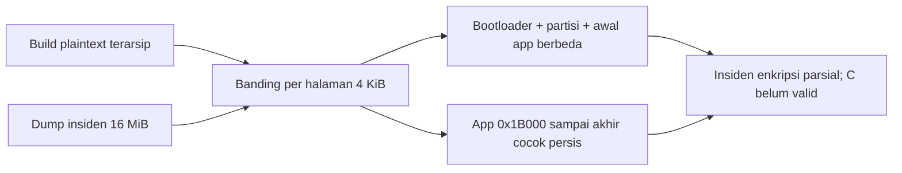

# C23 — preservasi insiden dan review recovery

> **Status historis:** rencana recovery di bawah telah dilaksanakan kemudian. Hasil pengujian valid ada di [laporan final Skenario 3](../SKENARIO_3.md); jangan membaca langkah “berikutnya” di file ini sebagai pekerjaan yang masih pending.

Tahap ini melanjutkan Skenario 3 tanpa menganggap insiden sebagai hasil C yang valid.

## State dan jalur yang dinilai

Keterangan operator setelah review: hanya menekan RST satu kali setelah command capture berjalan; tidak ada reset tambahan atau pencabutan USB yang dilaporkan. Ini sesuai instruksi yang diberikan saat C22. Keterangan tersebut tidak membuktikan maupun meniadakan transisi otomatis DTR/RTS pada saat membuka port. Jangan menyatakan operator menyebabkan interupsi.

Review capture lama: `serial.Serial(port, 115200, timeout=1)` langsung membuka port dan tidak menetapkan state DTR/RTS. [Dokumentasi pySerial](https://pyserial.readthedocs.io/en/latest/pyserial_api.html#serial.Serial.open) menjelaskan kemungkinan aktivasi/glitch sinyal oleh OS/driver saat open. Satu hipotesis adalah boot sudah dimulai akibat transisi port sebelum RST manual. Hipotesis ini belum terbukti karena tidak ada timestamp serial per chunk atau rekaman level EN/GPIO0.

Snapshot tanggal 26 Oktober, run `3413338da138`, mengonfirmasi MAC board03 `e0:72:a1:d5:4d:fc`, counter `0` masih writable, Secure Boot OFF, key purpose `XTS_AES_128_KEY`, serta ROM download tidak dinonaktifkan. Pembacaan dump pada run ini gagal karena timeout; tidak ada dump yang dihasilkan. Preservasi penuh akhirnya berhasil pada run `09203ff391be` di bawah.

Dokumentasi [Espressif v6.1 Flash Encryption](https://docs.espressif.com/projects/esp-idf/en/stable/esp32s3/security/flash-encryption.html) menjelaskan bahwa interupsi first boot dapat memerlukan pemulihan plaintext. Source ESP-IDF yang terpasang, `components/bootloader_support/src/flash_encryption/flash_encrypt.c`, memeriksa key yang sudah diprogram dan dapat memakainya kembali. Karena itu board belum terbukti irrecoverable. Jalur tersebut masih kandidat, bukan hasil recovery.

## Urutan penyelesaian

1. Preservasi dump insiden, SHA-256, snapshot eFuse dan analisis. Hasil ini berlabel incident preservation; counter FE masih 0.
2. Perbaiki/review seluruh build: FE pada app/bootloader, Release, Secure Boot OFF, kebijakan ROM download, ukuran bootloader, tabel partisi dan kebutuhan NVS.
3. Selesaikan penghalang NVS: build V2 memiliki `CONFIG_NVS_ENCRYPTION=y` dan menggunakan flash-encryption key protection, tetapi tabel partisinya tidak menyediakan `nvs_keys`. Perubahan partisi untuk kebutuhan security harus dicatat sebagai deviasi terkontrol; source aplikasi tetap identik. Jangan flash ulang build lama tanpa menangani ini.
4. Siapkan run recovery baru dan artefak terverifikasi. Recovery plaintext harus mencakup seluruh region yang hendak dienkripsi ulang; jangan mengenkripsi ulang ciphertext parsial atau hanya menulis bootloader.
5. Operator meninjau semua eFuse yang dapat diprogram pada next boot. First boot merupakan operasi irreversible walau tidak mengetik burn-efuse. Counter Release dapat menuju 111; existing key/proteksi tidak dikembalikan ke kondisi pabrik.
6. Capture serial harus siap sebelum reset tunggal; review transisi DTR/RTS dan jangan membuka monitor/alat lain atau memutus daya di tengah enkripsi. Durasi 35 detik dan tindakan reset pada prosedur lama tidak cukup menjadi jaminan penyelesaian.
7. Verifikasi boot sehat dan eFuse after pada run recovery; baru lakukan acquisition penelitian C, hashing, analisis marker, dan agregasi hasil.

## Batas eksekusi

Hasil preservasi pertama: read-flash mencapai batas timeout host 240.054 detik; tidak ada file dump yang tersimpan (actual_size 0, SHA-256 null). Ini tidak membuktikan read protection. Batas 240 detik terlalu pendek untuk 16 MiB pada 460800 baud (batas serial ideal saja sekitar 364 detik). Kesalahan timeout berasal dari wrapper assessment yang disiapkan agen. Log kegagalan dipertahankan; script diperbaiki menjadi 900 detik untuk run baru. Jangan melanjutkan recovery sebelum preservasi diulang atau kegagalan preservasi ditinjau.

Script `assess_c_recovery.py` hanya identifikasi, summary eFuse, flash-id dan read-flash. Semua command perangkat diakhiri no-reset; tidak ada write-flash atau burn. Masuk ROM download dapat melibatkan reset oleh esptool. Jangan menjalankan ulang script untuk mencoba recovery: script ini hanya membuat run assessment baru.

Belum ada command burn atau command flash recovery yang disetujui di dokumen ini. Jangan membakar counter secara manual untuk memaksa boot pada image yang enkripsinya belum lengkap.

## Preservasi penuh dan hasil analisis insiden

Run `50072e1e628f` dihentikan saat operator meminta jeda. Ia tercatat `FAILED`, ukuran aktual 0 dan SHA-256 null; jangan mengubahnya menjadi hasil parsial yang tidak pernah ditulis oleh esptool.

Run baru `09203ff391be` membaca penuh 16.777.216 byte dari COM9 pada 26 Oktober 2026 pukul 20:03:22–20:10:11 WIB (409,442 detik). [Metadata acquisition](../evidence/C_FLASH_ENCRYPTION/20261026T200312059829+0700_board03_09203ff391be/acquisition/acquisition.json) mencatat status `SUCCESS`, exit code 0, dan SHA-256 `e4bfdb2d8fdd0d630332cd93da164b5de389b1dc86f1328b50f49e8ff2487f64`. [Dump mentah](../evidence/C_FLASH_ENCRYPTION/20261026T200312059829+0700_board03_09203ff391be/acquisition/flash_dump.bin) dipreservasi tanpa perubahan. Snapshot eFuse run ini tetap menunjukkan `SPI_BOOT_CRYPT_CNT=0`, `SECURE_BOOT_EN=0`, dan `KEY_PURPOSE_0=XTS_AES_128_KEY`; ROM download dapat diakses.

[Analisis mesin](../evidence/C_FLASH_ENCRYPTION/20261026T200312059829+0700_board03_09203ff391be/analysis/analysis.json) tidak dapat mem-parse tabel partisi atau mengenali image aplikasi dari struktur mentah. Semua lima marker sintetis masih ditemukan: SSID dua kali, password Wi-Fi dua kali, API key sekali, static secret sekali, dan NVS secret sekali. Offset lengkap ada di `analysis.json`. Penemuan literal `NVS_SECRET` dalam image aplikasi tidak membuktikan entri NVS telah berhasil disimpan; lokasi NVS harus diperiksa terpisah. Temuan ini **bukan** hasil C yang valid: counter FE masih nol dan first boot terputus. Entropi seluruh flash 1,1744 bit/byte hanya metrik pendukung dan tidak dipakai untuk membuktikan enkripsi.

Pemeriksaan langsung terhadap build yang diarsipkan dari run `905c84ce2642` menunjukkan bootloader (`0x0000`), tabel partisi (`0x8000`), dan halaman aplikasi `0x10000`–`0x1AFFF` tidak cocok dengan halaman build plaintext. Seluruh 179 halaman aplikasi mulai `0x1B000` sampai akhir `firmware.bin` (termasuk halaman akhir yang lebih pendek) cocok persis byte demi byte dengan build tersebut. Non-kecocokan sendiri tidak membuktikan algoritme enkripsi; digabung dengan log first boot, eFuse, dan kecocokan identik pada sisa image, ia mendukung klasifikasi **proses enkripsi terhenti di tengah aplikasi**. Header mentah pada `0x0000` dan `0x10000` juga bukan header plaintext build. Perbandingan ini memakai **artefak build sebagai referensi**, bukan hasil parse struktur dari dump.

Manifest run preservasi diberi `scenario_validity=INVALID_INCIDENT_STATE`. Agregator kini membawa label tersebut agar pembaca dapat menyaring run insiden dari pengukuran skenario C. Langkah berikutnya tetap review recovery terpisah: validasi partisi `nvs_keys`, hasil build dan seluruh region yang akan ditulis, lalu tinjau konsekuensi eFuse pada first boot **sebelum** operator memutuskan tindakan perangkat. Tidak ada flash atau eFuse burn pada tahap preservasi ini.
