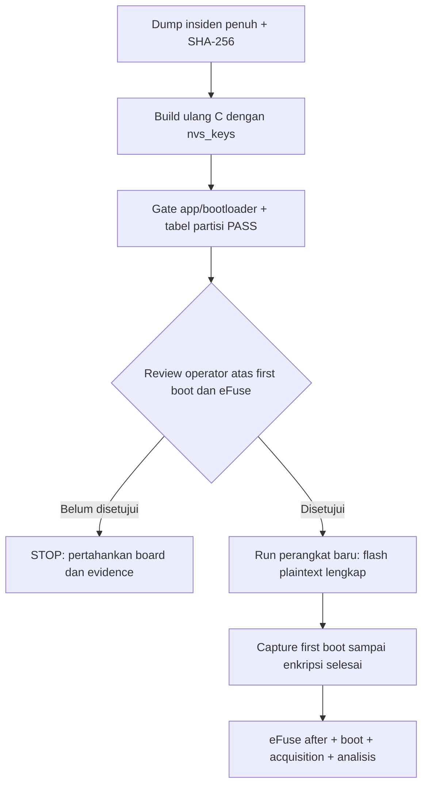

# C24 — Review build pemulihan board03 (belum dijalankan di perangkat)

**Pembaruan sesudah C24:** Operator telah menjalankan erase/write pada run `044fc73049da`. Lihat [C25](C25_RECOVERY_FLASH_AND_FLAG_INCIDENT_20261026.md) untuk hasil aktual dan insiden flag terpotong. Pernyataan “belum dijalankan” di bawah menjelaskan status saat review C24 dibuat.

## Mengapa tahap ini diperlukan

Dump preservasi run `09203ff391be` membuktikan 16 MiB flash dapat dibaca, tetapi kondisi board bukan C yang valid: `SPI_BOOT_CRYPT_CNT=0`, boot gagal, dan aplikasi hanya sebagian berubah dari build plaintext. Lihat [C23](C23_RECOVERY_REVIEW.md). [Panduan Espressif](https://docs.espressif.com/projects/esp-idf/en/release-v6.1/esp32s3/security/flash-encryption.html) menyebut image plaintext perlu ditulis ulang jika first boot encryption terputus. Panduan yang sama menjelaskan first boot akan memakai kembali key eFuse yang sudah ada, lalu dapat membakar counter saat enkripsi selesai. Karena itu pemulihan **bukan** reset ke kondisi pabrik.

## Perubahan host dan bukti build

Run host `c856d72fc248` mengarsipkan build baru di [direktori evidence](../evidence/C_FLASH_ENCRYPTION/20261026T201250682324+0700_board03_c856d72fc248). Source aplikasi tidak diubah. `platformio.ini` memilih `config/flash_encryption/partitions.recovery.csv` khusus environment C. Tabel ini mempertahankan `nvs`, `phy_init`, dan `factory` pada offset lama, lalu menambah `nvs_keys` seluas 0x1000 pada 0x310000 dengan flag encrypted. [Dokumentasi NVS Espressif](https://docs.espressif.com/projects/esp-idf/en/stable/esp32s3/api-reference/storage/nvs_flash.html) menjelaskan bahwa inisialisasi NVS terenkripsi mencari partisi `nvs_keys` untuk membaca atau membuat kunci NVS.

Build PlatformIO berhasil. [Pemeriksaan security](../evidence/C_FLASH_ENCRYPTION/20261026T201250682324+0700_board03_c856d72fc248/build/build_security_check.json) mengembalikan PASS: aplikasi dan bootloader sama-sama memiliki `CONFIG_SECURE_FLASH_ENC_ENABLED=1`. Keduanya juga memuat Release mode dan `CONFIG_SECURE_INSECURE_ALLOW_DL_MODE=1`; `CONFIG_SECURE_BOOT` tetap tidak diset. [Pemeriksaan tabel partisi](../evidence/C_FLASH_ENCRYPTION/20261026T201250682324+0700_board03_c856d72fc248/build/partition_table_check.json) membaca langsung `partitions.bin` dan mengonfirmasi entri `nvs_keys`, flag encrypted, dan ketiadaan overlap dengan factory. Artefak BIN/ELF, header config, resolved sdkconfig, dan SHA-256 masing-masing tersimpan di [build manifest](../evidence/C_FLASH_ENCRYPTION/20261026T201250682324+0700_board03_c856d72fc248/build/build_manifest.json).

`sdkconfig.flash_encryption` masih menampilkan nama generik `partitions.csv` karena normalisasi PlatformIO; isi `partitions.bin` dan file CSV yang diarsipkan menunjukkan tabel efektif yang dipakai. Build berlangsung pada working tree yang belum bersih. Commit `bd6537c...` **tidak sendirian** merepresentasikan konfigurasi ini; `host/versions.json` mencatat `git status`, sedangkan salinan `platformio.ini`, `sdkconfig.defaults`, CSV, dan `git_build_diff.patch` tersimpan di run.

## Batas perangkat

Tidak ada `erase-flash`, `write-flash`, reset normal, atau burn eFuse pada C24. Status `HOST_READY_OPERATOR_GATE` berarti build siap ditinjau, **bukan** recovery berhasil. Board03 tetap mempunyai key FE yang read-protected dan eFuse lain yang sudah berubah pada insiden C22; counter FE masih nol pada snapshot terakhir.



## Rencana tindakan berikutnya, belum dieksekusi

1. Buat run perangkat baru; catat MAC `e0:72:a1:d5:4d:fc`, flash ID 16 MiB, dan eFuse sebelum tindakan. Cocokkan dengan snapshot insiden. Jika berbeda, berhenti.
2. Operator meninjau kemungkinan perubahan irreversible pada first boot Release, terutama `SPI_BOOT_CRYPT_CNT` dan write protection. First boot bisa melakukan burn tanpa command `espefuse burn-*`; ia tetap berada di gerbang operator.
3. Setelah keputusan operator, siapkan capture serial yang mencetak `SERIAL_READY` sebelum reset. Script kini meminta DTR/RTS deasserted sebelum membuka COM9 dan mencatat timestamp chunk di `serial_timing.jsonl`. Driver masih dapat menghasilkan glitch saat membuka port; ini tidak dapat dijamin hilang secara software. Adapter RX/TX/GND tanpa DTR/RTS dapat dipakai bila tersedia dan terverifikasi 3,3 V.
4. Recovery yang direncanakan adalah menghapus flash penuh lalu menulis bootloader, tabel partisi, dan aplikasi **plaintext** dari satu build C24 pada offset `0x0000`, `0x8000`, dan `0x10000`. Penghapusan penuh menghilangkan ciphertext parsial dan sisa NVS lama; raw dump insiden sudah dicadangkan dan di-hash. Jangan menulis hanya satu region atau mencampur build lama dan baru.
5. Reset normal hanya setelah capture siap dan operator memahami first boot. Tunggu hingga bootloader melaporkan enkripsi selesai dan aplikasi mencapai heartbeat. Lalu capture eFuse after, pastikan counter FE odd, Secure Boot tetap OFF, dan rekam seluruh perubahan termasuk field yang tetap.
6. Baru sesudah boot sehat, masuk ROM download untuk acquisition penuh 16 MiB, hashing, analisis exact marker, dan agregasi. Hasil run ini yang dapat dinilai sebagai Skenario C; dump insiden tetap terpisah.

Tidak ada command perangkat di dokumen ini yang telah dijalankan. Eksekusi perangkat harus memakai run baru agar semua stdout/stderr, timestamp, dan eFuse before/after terikat pada run yang sama.

## Command CMD untuk gerbang operator

Jalankan hanya saat operator memutuskan memulai recovery. Perintah pertama sampai `--confirm-destructive` bersifat pembacaan dan review. Ganti nilai `RUN` dengan path yang **benar-benar dicetak** oleh `capture_versions.py`; contoh di bawah memakai placeholder, bukan run yang sudah ada.

```cmd
python scripts\capture_versions.py --scenario C_FLASH_ENCRYPTION --board-id board03 --experiment-id C_RECOVERY_DEVICE_BOARD03
set "RUN=D:\IoT\reverse-engineering\evidence\C_FLASH_ENCRYPTION\PASTE_RUN_BARU_DI_SINI"
python scripts\preflight.py --run "%RUN%" --port COM9 --board-marking same-class-N16R8-marking-not-recorded --wiring "USB-C CH343 COM9; external 3.3V USB-to-TTL not used"
python scripts\capture_efuse.py --run "%RUN%" --port COM9 --phase before
python scripts\flash_c_recovery_no_reset.py --run "%RUN%" --build-run ".\evidence\C_FLASH_ENCRYPTION\20261026T201250682324+0700_board03_c856d72fc248" --port COM9
```

Dry run terakhir hanya mencetak alamat, nama file, dan hash, lalu berhenti. Jika MAC, ukuran flash, eFuse, atau hash berbeda dari review, jangan lanjut. Setelah operator meninjau konsekuensi penghapusan flash **dan** potensi burn eFuse pada first boot, perintah yang memulai penulisan flash adalah:

```cmd
python scripts\flash_c_recovery_no_reset.py --run "%RUN%" --build-run ".\evidence\C_FLASH_ENCRYPTION\20261026T201250682324+0700_board03_c856d72fc248" --port COM9 --confirm-destructive
```

Script ini memeriksa MAC, flash ID, dan eFuse lagi tepat sebelum `erase-flash`. Ia memakai `--after no-reset`, menyimpan command/stdout/stderr ke run baru, dan berhenti jika erase gagal. Ia tidak menjalankan first boot. **Jangan jalankan perintah berflag tersebut hanya karena tertulis di dokumen**; itu adalah keputusan operator yang terpisah dari persiapan agen.

Gerbang tanpa flag telah diuji memakai run sintetis sementara: exit code 2, rencana dan hash dicetak, dan tidak ada command perangkat dijalankan. Sebelas tes host juga lulus. Uji ini tidak menggantikan verifikasi perangkat sesudah operator memutuskan recovery.

Sesudah penulisan berhasil, perintah berikutnya dijalankan sambil board masih di ROM download. Tunggu pesan `SERIAL_READY`, lalu lepaskan BOOT/GPIO0 dan tekan RST **sekali** untuk boot normal. Pertahankan catu daya selama enkripsi berlangsung; capture 180 detik memberi ruang waktu lebih panjang tetapi tetap harus dinilai dari log, bukan dari timer saja.

```cmd
python scripts\capture_serial.py --run "%RUN%" --port COM9 --seconds 180
```

Jika log menunjukkan boot sehat dan heartbeat, baru ambil eFuse after. Jika boot gagal atau proses enkripsi terlihat terputus, simpan log dan hentikan prosedur; jangan mengulangi flash/boot secara membabi buta. Perintah acquisition baru relevan setelah state FE diamati sesuai skenario dan board dikembalikan ke ROM download.

## Run perangkat yang sudah disiapkan

Pada 26 Oktober 2026, run `044fc73049da` dibuat di [evidence C](../evidence/C_FLASH_ENCRYPTION/20261026T214306270096+0700_board03_044fc73049da). `capture_versions`, preflight COM9, dan eFuse before selesai. Chip ESP32-S3 v0.2, flash 16 MiB, PSRAM 8 MiB, MAC `e0:72:a1:d5:4d:fc`. `SPI_BOOT_CRYPT_CNT` masih 0, Secure Boot OFF, key purpose `XTS_AES_128_KEY`, ROM download tidak dinonaktifkan. Dry run tanpa flag mencetak tiga hash build C24 di atas dan berhenti; status manifest `OPERATOR_FLASH_GATE`. Belum ada erase, write, atau normal boot pada run ini.

Jika operator menerima risiko penghapusan flash dan konsekuensi eFuse pada boot berikutnya, **command CMD berikut adalah tindakan operator berikutnya**; jalankan dari `D:\IoT\reverse-engineering`:

```cmd
python scripts\flash_c_recovery_no_reset.py --run ".\evidence\C_FLASH_ENCRYPTION\20261026T214306270096+0700_board03_044fc73049da" --build-run ".\evidence\C_FLASH_ENCRYPTION\20261026T201250682324+0700_board03_c856d72fc248" --port COM9 --confirm-destructive
```

Setelah command itu selesai, jangan reset board sebelum meninjau stdout/stderr dan menyiapkan capture serial. Jika ada kegagalan erase/write, hentikan rangkaian dan laporkan outputnya; jangan langsung mencoba ulang dengan run yang sama.
