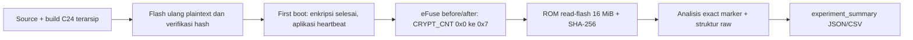

# C27 — Hasil valid Skenario 3: Flash Encryption saja

**Skenario:** `C_FLASH_ENCRYPTION` · **Board:** `board03` / MAC `e0:72:a1:d5:4d:fc` · **Run:** `044fc73049da` · **Mode:** Release · **Secure Boot:** OFF.

## Pertanyaan dan batas uji

Dengan akses fisik ke ROM download/UART, apakah peneliti dapat membaca flash mentah dan memulihkan lima marker kredensial sintetis yang sama seperti firmware penelitian? Hasil di bawah berlaku untuk exact marker ASCII pada satu board dan satu run sukses. Ini bukan klaim bahwa semua jalur pengambilan rahasia pada perangkat mustahil.

## Rantai evidence

Artefak build, resolved config, hash, ELF/BIN, dan tabel partisi yang digunakan disalin serta diverifikasi dari run build `c856d72fc248` ke [build evidence run ini](../evidence/C_FLASH_ENCRYPTION/20261026T214306270096+0700_board03_044fc73049da/build/build_reference.json). Commit yang dicatat adalah `bd6537c3805cf62a2570f841c6588235621861e4`, dengan working tree dirty; perubahan config/build spesifik juga diarsipkan. Aplikasi sumber tetap sama antar skenario.

## Urutan teramati

| Tahap | Bukti dan observasi |
|---|---|
| Recovery flash | Erase penuh dan tiga image ditulis/di-hash oleh esptool; lihat [C25](C25_RECOVERY_FLASH_AND_FLAG_INCIDENT_20261026.md). |
| Capture serial | Setelah beberapa kegagalan COM9 yang dicatat di [C26](C26_SERIAL_CAPTURE_PORT_BLOCKED_20261026.md), attempt `20261026T225703755753+0700_888a380d` mulai pukul 22:57:03.775 WIB dan berlangsung 180 detik. |
| First boot | [Boot log](../evidence/C_FLASH_ENCRYPTION/20261026T214306270096+0700_board03_044fc73049da/runtime/serial_boot.log) mencatat key eFuse lama dipakai, bootloader dan tabel partisi terenkripsi, aplikasi dan `nvs_keys` selesai dienkripsi, `CRYPT_CNT` ditetapkan, lalu restart dengan enkripsi aktif. |
| Runtime | [Status runtime](../evidence/C_FLASH_ENCRYPTION/20261026T214306270096+0700_board03_044fc73049da/runtime/runtime_status.json): `boot_confirmed=true`, heartbeat ada, tidak ada `SECRET_LOG_EXPOSURE`. Log boot menyatakan mode RELEASE dan NVS Encryption; Wi-Fi mencoba koneksi tetapi gagal tersambung, yang tidak mengubah validitas uji flash. |
| eFuse after | Capture 23:00:29–23:00:32 WIB. [Diff](../evidence/C_FLASH_ENCRYPTION/20261026T214306270096+0700_board03_044fc73049da/device/efuse_diff.json) menunjukkan hanya `SPI_BOOT_CRYPT_CNT` berubah dari `0x0` (OFF) menjadi `0x7` (ON). `SECURE_BOOT_EN` tetap 0. MAC, key purpose `XTS_AES_128_KEY`, dan status ROM download tetap menjadi evidence meskipun tidak berubah. |
| Akuisisi | [Metadata](../evidence/C_FLASH_ENCRYPTION/20261026T214306270096+0700_board03_044fc73049da/acquisition/acquisition.json): `read-flash` pada COM9/460800 baud, offset 0, 16.777.216 byte diminta dan diperoleh, exit code 0, 23:00:58.818–23:07:47.842 WIB (409,022 detik). ROM download tetap dapat diakses. |
| Hash | SHA-256 dump `1d948d10f7756c50aaed7938a20b790dd85e89682c7a93c4b9ca6af3e0b2e752`; hash acquisition, analisis, dan hitung ulang cocok. |

## Hasil analisis dari byte yang diakuisisi

[analysis.json](../evidence/C_FLASH_ENCRYPTION/20261026T214306270096+0700_board03_044fc73049da/analysis/analysis.json) memindai exact marker ASCII pada keseluruhan dump 16 MiB:

| Marker | Jumlah exact match | Offset |
|---|---:|---|
| `WIFI_SSID` | 0 | tidak ada |
| `WIFI_PASSWORD` | 0 | tidak ada |
| `API_KEY` | 0 | tidak ada |
| `STATIC_SECRET` | 0 | tidak ada |
| `NVS_SECRET` | 0 | tidak ada |

Tabel partisi tidak dapat diparse dari **raw dump**, dan header aplikasi tidak dapat diidentifikasi melalui tabel partisi raw. [Offset referensi build](../evidence/C_FLASH_ENCRYPTION/20261026T214306270096+0700_board03_044fc73049da/analysis/build_reference_offsets.json) disimpan terpisah: mengetahui alamat factory 0x10000 dari build tidak berarti struktur itu terbaca dari dump.

Entropi seluruh flash 0,6696 bit/byte karena mayoritas 16 MiB masih `0xFF`; angka ini **bukan** dasar kesimpulan enkripsi. Dasar state FE adalah resolved config Release, log boot enkripsi selesai, dan eFuse after `0x7`. Dasar hasil kerahasiaan pada jalur uji ini adalah dump penuh yang benar-benar terbaca tetapi tidak memuat exact marker plaintext.

## Kesimpulan terukur

Pada board03 ini, attacker model berhasil **mengakuisisi raw flash**, tetapi **tidak memulihkan lima marker plaintext** dengan metode exact scan yang sama. Jadi hasilnya bukan “flash tidak bisa dibaca”; hasilnya adalah “flash terbaca sebagai byte mentah, sedangkan marker yang diuji tidak ditemukan.” [Validity check](../evidence/C_FLASH_ENCRYPTION/20261026T214306270096+0700_board03_044fc73049da/analysis/validity_check.json) memberi `VALID_C_RUN`, dan [agregat](../results/experiment_summary.json) membawa hasil teramati tersebut.

Run preservasi insiden `09203ff391be` tetap terpisah: saat `CRYPT_CNT=0`, marker masih ditemukan tetapi boot gagal, sehingga ia **bukan** pengukuran C dengan layer keamanan aktif. Skenario C valid ini hanya satu board dan satu keberhasilan; replikasi tambahan akan memperkuat reliabilitas operasional, bukan mengubah observasi saat ini.
