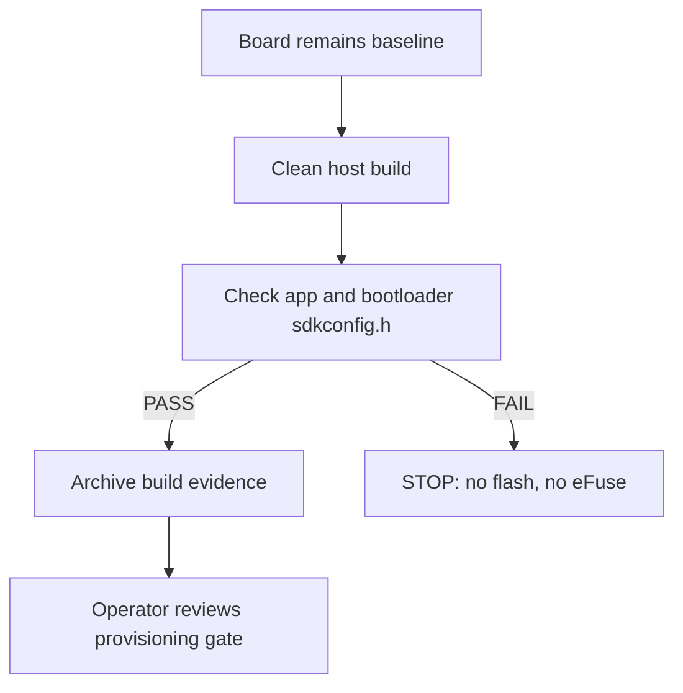

# C FLASH ENCRYPTION — Host-only bootloader configuration gate

Board03 was restored to baseline and the same-run eFuse diff is empty. The next action is host-only. Do not flash a new C image until the bootloader and application configuration check passes.

## Why this gate exists

PlatformIO/ESP-IDF builds the application and bootloader as separate CMake projects. A relative `config/.../sdkconfig.defaults` can reach the application but not the bootloader. The previous C image therefore had Flash Encryption enabled in the application and disabled in the bootloader, causing the observed first-boot reboot loop. This is a build configuration incident, not evidence of eFuse provisioning.



## C13 — no device action

Do not run `write-flash`, `burn-key`, or `burn-efuse`. The board may remain connected; do not reset it for a C first boot.

## C14 — clean and build (PowerShell)

```powershell
$env:PLATFORMIO_CORE_DIR = 'D:\IoT\.platformio-core'
$env:SDKCONFIG_DEFAULTS = (Resolve-Path '.\config\flash_encryption\sdkconfig.defaults').Path.Replace('\','/')
py -3.12 -m platformio run -e flash_encryption -t clean
py -3.12 -m platformio run -e flash_encryption
```

`clean` changes only host build artifacts. Preserve the complete console output. A warning that the Flash Encryption key is not set is not permission to flash; review it as build evidence.

## C15 — mandatory verification

```powershell
python scripts/verify_build_security_config.py --env flash_encryption --json .\build_security_check.json
```

Both files must contain `#define CONFIG_SECURE_FLASH_ENC_ENABLED 1`:

```text
.pio\build\flash_encryption\config\sdkconfig.h
.pio\build\flash_encryption\bootloader\config\sdkconfig.h
```

The command must end in `PASS`. If it prints `STOP` or the bootloader flag is `ABSENT`, preserve `build_security_check.json` and the build log, then stop. Do not flash or burn eFuse.

## C16 — after PASS only

Create a new evidence run with `capture_versions.py` and `build_evidence.py`; archive resolved sdkconfig, both config headers, artifact hashes, and the provisioning plan. Only after operator review of Release-mode first-boot eFuse consequences may manual flashing/provisioning continue. No burn is automated.
