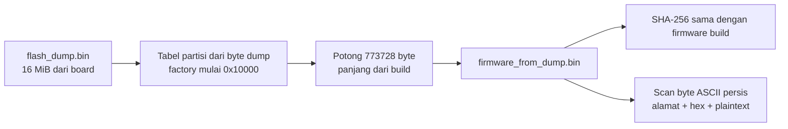

# Secret sintetis pada firmware yang diekstrak dari dump ESP32-S3

**Skenario:** `A_BASELINE` · **Board:** `board01` · **Run:** `46879abd4c3e`  
**Sumber byte:** [raw flash dump 16 MiB](../evidence/A_BASELINE/20260926T130728889848+0700_board01_46879abd4c3e/acquisition/flash_dump.bin) yang dibaca dari board melalui `COM5`, bukan file build yang disalin ulang.

## Apa yang dimaksud “firmware.bin dari dump”?

Tabel partisi yang terparse **dari byte dump** menempatkan partisi aplikasi `factory` pada alamat flash `0x00010000`. Dari alamat itu, alat mengambil **773.728 byte** menjadi [firmware_from_dump.bin](../evidence/A_BASELINE/20260926T130728889848+0700_board01_46879abd4c3e/analysis/firmware_from_dump.bin). Panjang potongan berasal dari ukuran `firmware.bin` build yang diarsipkan; jadi batas akhir image memakai referensi build, sementara seluruh byte file hasil potongan berasal dari board. Ini dinyatakan eksplisit agar identifikasi struktur dari dump tidak tertukar dengan pengetahuan dari build.

SHA-256 image hasil potongan adalah `5ef5be740464ce9a8a7c66b4af10265a1fc112caec21de0fdfb2a139d63f7f70`, **identik byte demi byte** dengan [firmware.bin build](../evidence/A_BASELINE/20260926T130728889848+0700_board01_46879abd4c3e/build/.pio/build/baseline/firmware.bin). Pemeriksaan `esptool image-info` pada file hasil potongan juga sukses. [JSON ekstraksi](../evidence/A_BASELINE/20260926T130728889848+0700_board01_46879abd4c3e/analysis/firmware_secret_extraction.json) mencatat hash dump asal, hash image, asal offset dan panjang, commit alat, serta semua kecocokan marker.

## Alamat dan isi yang ditemukan

Rumus alamat: **alamat flash = `0x00010000` + offset di image**. Setiap baris di bawah adalah kecocokan byte ASCII persis dalam `firmware_from_dump.bin`; semua nilai adalah marker riset sintetis dari `seed.md`, bukan kredensial produksi.

| Marker | Alamat flash | Offset image | Plaintext ASCII | Byte tersimpan, ditampilkan sebagai hex |
|---|---|---|---|---|
| `WIFI_SSID` | `0x000103CC` | `0x000003CC` | `THESIS_IOT_LAB_26` | `5448455349535f494f545f4c41425f3236` |
| `WIFI_PASSWORD` | `0x000103E0` | `0x000003E0` | `THESIS_WIFI_PW_9X7K2M` | `5448455349535f574946495f50575f3958374b324d` |
| `API_KEY` | `0x0001C49C` | `0x0000C49C` | `THESIS_API_KEY_A81F93C72E` | `5448455349535f4150495f4b45595f41383146393343373245` |
| `STATIC_SECRET` | `0x0001C478` | `0x0000C478` | `THESIS_STATIC_SECRET_ESP32S3_2026` | `5448455349535f5354415449435f5345435245545f455350333253335f32303236` |
| `NVS_SECRET` | `0x0001027C` | `0x0000027C` | `THESIS_NVS_SECRET_4F29B7` | `5448455349535f4e56535f5345435245545f344632394237` |

**Apa arti “encoded” di sini?** Kolom hex adalah cara manusia menulis byte yang benar-benar tersimpan; misalnya `54 48 45` dibaca ASCII sebagai `THE`. Marker di image ini tersimpan sebagai **plaintext ASCII**. Skrip juga menghitung Base64 dari byte yang sama untuk kemudahan pertukaran data, tetapi Base64 itu **dibuat saat analisis**, bukan format yang terbukti tersimpan di flash. Pencarian terpisah pada image menemukan **nol** salinan marker dalam bentuk teks hex, teks Base64, maupun UTF-16LE. Representasi Base64 dan jumlah pencarian alternatif ada di [tabel ekstraksi lengkap](../evidence/A_BASELINE/20260926T130728889848+0700_board01_46879abd4c3e/analysis/firmware_secret_extraction.md).

`NVS_SECRET` juga muncul pada `0x0000DE40` di raw dump, **di luar image firmware** dan dalam rentang partisi NVS yang terparse. Tabel di atas hanya menampilkan salinan yang berada di firmware pada `0x0001027C`. Karena firmware harus memuat literal itu untuk menulisnya ke NVS, marker tersebut belum dapat dipakai untuk mengisolasi kebocoran NVS dari kebocoran image aplikasi.

## Arti temuan dan batasnya

Temuan ini memberi bukti langsung untuk baseline: setelah firmware tanpa Flash Encryption di-flash dan raw flash diperoleh, byte aplikasi yang sama dengan build dapat dibaca kembali, dan marker sintetisnya hadir sebagai teks ASCII pada alamat yang tercatat. Pembuktian tidak hanya berdasarkan pencarian string pada file build; potongan **berasal dari dump board**, cocok persis dengan build, lalu dipindai.

Ini **bukan** hasil untuk Secure Boot V2 atau Flash Encryption. Dalam eksperimen berikutnya, pembandingan harus menggunakan source aplikasi dan nilai marker yang sama, status konfigurasi/eFuse yang teramati, serta prosedur akuisisi dan scanner yang setara. Tidak ditemukannya plaintext nanti harus dibahas bersama keberhasilan/gagalnya pembacaan, struktur dump, dan state keamanan—bukan otomatis dianggap bukti enkripsi.

Untuk mengulang proses pada **run baru** yang sudah memiliki dump dan build evidence, jalankan `python scripts/extract_firmware_secrets.py --run <path-run>`. Skrip menolak menimpa file ekstraksi pada run yang sama. File raw dump asli tidak diubah.
