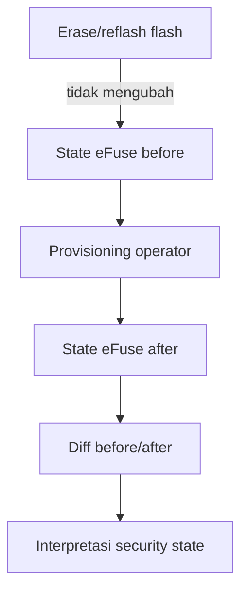
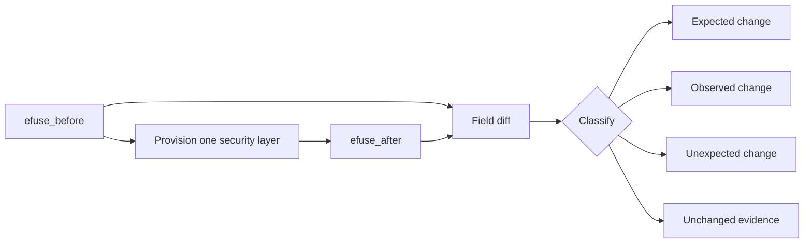

# eFuse ESP32-S3 — catatan penelitian

## Definisi

**eFuse** adalah bit konfigurasi yang dapat diprogram secara elektrik di dalam ESP32-S3. eFuse menyimpan state internal chip seperti konfigurasi boot, status security feature, key purpose, digest, dan pilihan interface. Sebagian besar perubahan hanya berjalan satu arah, dari `0` ke `1`.

Flash eksternal berisi bootloader, partition table, firmware, dan NVS. eFuse berada di dalam chip dan tidak ikut terhapus ketika flash di-*erase* atau ditulis ulang.

## Mengapa penting untuk eksperimen

Penelitian membandingkan konfigurasi keamanan, sehingga firmware saja tidak cukup untuk membuktikan state perangkat. `efuse_before` menunjukkan kontrol awal; `efuse_after` menunjukkan state sesudah provisioning. Tanpa dua snapshot tersebut, hasil acquisition tidak dapat ditautkan secara kuat ke konfigurasi Secure Boot atau Flash Encryption.



## Field yang relevan

- `SECURE_BOOT_EN`: enablement Secure Boot pada chip.
- `SECURE_BOOT_KEY_REVOKE0..2`: status revoke slot key Secure Boot.
- `SPI_BOOT_CRYPT_CNT`: counter konfigurasi Flash Encryption; nilai bit menentukan enabled/disabled sesuai ESP-IDF.
- `DIS_DOWNLOAD_MODE` dan field USB/UART download: akses ROM download.
- key blocks dan digest fields: material/digest keamanan; diperlakukan sebagai evidence sensitif.

## Aturan keselamatan

Perintah pembacaan seperti `espefuse summary` tidak mengubah state. Perintah `burn_*`, key programming, Secure Boot enablement, Flash Encryption enablement, UART download disablement, JTAG disablement, dan key revoke dapat irreversible. Tool penelitian hanya membuat plan dan menangkap state; operator harus melakukan langkah destructive secara sadar di luar automation default.

Jangan menyimpulkan “Flash Encryption aktif” hanya dari entropy dump. Gabungkan eFuse state, konfigurasi build, command acquisition, dan hasil analisis marker.

## Klarifikasi: enable/disable Secure Boot

Ada dua state yang harus dibedakan:

1. **Konfigurasi build**: `CONFIG_SECURE_BOOT_V2_ENABLED=y` membuat ESP-IDF membangun dan menandatangani image Secure Boot. Ini belum berarti chip sudah enforcing Secure Boot.
2. **State perangkat**: ROM ESP32-S3 memeriksa bit Secure Boot pada eFuse saat startup. Setelah bit enable diprogram, signature image harus cocok dengan digest/public key yang dipercaya chip.

Jadi, Secure Boot bukan sekadar switch yang dapat diubah bebas dari firmware. Sebelum eFuse diprogram, chip dapat tetap boot seperti baseline walaupun artefak signed sudah dibuat. Setelah eFuse enable diprogram, software tidak dapat mengembalikan bit tersebut ke `0`.

Dokumentasi resmi Espressif menjelaskan bahwa eFuse OTP hanya terbakar satu arah `0 → 1`; `1 → 0` tidak tersedia. Konfigurasi tambahan kadang dapat ditambah dengan membakar bit lain, tetapi itu bukan rollback dan dapat mempersempit kemampuan perangkat. Wrong signing key, semua digest key direvoke, atau disable download/JTAG dapat membuat board tidak dapat dipakai untuk alur penelitian biasa.

## Isolasi Secure Boot V2 dan Flash Encryption

### Secure Boot V2

Secure Boot V2 menguji authenticity/integrity. Image bootloader dan aplikasi ditandatangani; chip memverifikasi signature terhadap trust anchor yang diprogram pada eFuse. `SECURE_BOOT_EN` dan field key-purpose/digest/revoke adalah indikator state perangkat, sedangkan keberhasilan atau penolakan boot adalah behavior runtime.

Secure Boot tidak menyembunyikan isi flash. Dengan Flash Encryption OFF, raw flash dapat tetap mengandung plaintext marker meskipun image wajib signed untuk bisa boot.

### Flash Encryption

Flash Encryption menguji confidentiality off-chip flash. eFuse menyimpan state counter dan konfigurasi key/purpose yang membuat ROM/bootloader mendekripsi isi flash secara internal. Peneliti membaca raw bytes melalui ROM download lalu memeriksa apakah plaintext marker dapat dipulihkan.

FE tidak dibuktikan hanya oleh entropy. Evidence minimal harus menggabungkan eFuse after, mode Development/Release, keberhasilan acquisition, ukuran/hash dump, dan exact marker scan.

### Before/after/diff

- `efuse_before.*`: kontrol awal, sebelum provisioning.
- `efuse_after.*`: state setelah provisioning, tanpa menimpa before.
- `efuse_diff.json`: perubahan field-by-field dan klasifikasi expected/observed/unexpected/unchanged.

Field yang tidak berubah juga penting. Misalnya `SPI_BOOT_CRYPT_CNT` tetap `0` pada skenario B adalah evidence bahwa Flash Encryption tidak ikut aktif; ROM download tetap accessible adalah evidence bahwa jalur acquisition belum ditutup.



## Provisioning: dua workflow resmi

ESP-IDF mendukung provisioning Secure Boot V2 oleh bootloader pada first boot, atau provisioning host-based menggunakan `espsecure` dan `espefuse`. Keduanya dapat menulis eFuse.

Workflow penelitian ini hanya mengotomatisasi persiapan dan review: membuat digest, memeriksa image, memeriksa slot, membuat plan, dan menangkap before/after. Burn eFuse tetap operator-gated.

Persiapan digest yang tidak menulis eFuse:

```powershell
python -m espsecure digest-sbv2-public-key `
  --keyfile keys/secure_boot_signing_key.pem `
  --output secure_boot_digest.bin
```

Workflow host kemudian secara konseptual menulis digest ke key block dengan purpose `SECURE_BOOT_DIGEST0`, lalu mengaktifkan `SECURE_BOOT_EN`. Sintaks tepat harus diverifikasi dengan `espefuse --help` versi terpasang. Jangan menjalankan `burn-key` atau `burn-efuse` sebagai bagian dari script otomatis.

## Instruksi operator manual

Urutan aman adalah: capture before → flash signed artifacts → review key block/digest → burn digest → burn `SECURE_BOOT_EN` → capture after → boot validation. `burn-key` dan `burn-efuse` memerlukan prompt interaktif dan bersifat irreversible. Jangan memakai `--do-not-confirm` atau `--force-write-always`.

Gunakan `--chip esp32s3` karena `espefuse` tanpa chip dapat menampilkan default ESP32 yang salah. Sebelum burn, jalankan `summary` dan pastikan key block kosong, `SECURE_BOOT_EN` belum aktif, dan `SPI_BOOT_CRYPT_CNT=0`. Setelah burn, capture after dan diff tanpa menimpa before.

## Incident Secure Download Mode

Resolved `sdkconfig.secure_boot` ternyata memilih `CONFIG_SECURE_ENABLE_SECURE_ROM_DL_MODE=y`. Sesudah flash/reset, ROM melaporkan `ESP32-S3 in Secure Download Mode` dan menolak pembacaan eFuse melalui `espefuse`. Serial boot juga mencatat `app config is enabled but eFuse not`, sehingga Secure Boot belum boleh dianggap aktif.

Ini adalah configuration incident, bukan hasil confidentiality. Provisioning host dihentikan; tidak ada `burn-key` atau `burn-efuse`. Untuk board riset berikutnya, pilih ROM download mode yang tetap dapat dipakai untuk acquisition dan simpan resolved sdkconfig sebagai evidence. Jangan menganggap perubahan sdkconfig dapat membalik eFuse yang sudah terprogram.
