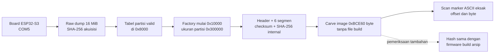

# Laporan forensik firmware dari raw flash — A_BASELINE

**Eksperimen:** `esp32s3_security_research` · **Skenario:** `A_BASELINE` · **Board:** `board01` · **Run:** `46879abd4c3e` · **Tanggal akuisisi:** 26 September 2026, 13:17–13:24 WIB.  
**Objek:** byte flash fisik ESP32-S3 yang dibaca melalui CH343 `COM5`, bukan file firmware dari direktori build. Semua nilai rahasia dalam laporan ini adalah **marker sintetis riset** yang ditetapkan di [`seed.md`](../seed.md).

## Ringkasan eksekutif dan pertanyaan 5W1H

**Apa yang ditemukan?** Kelima marker sintetis ditemukan sebagai byte ASCII plaintext di image aplikasi yang berada dalam raw dump. Setiap marker muncul tepat satu kali di image tersebut. Nilai, alamat absolut, dan representasi hex/Base64 ditampilkan di bawah. Di luar image aplikasi, dump juga memuat salinan beberapa marker di partisi NVS; itu dilaporkan terpisah.

**Mengapa penting?** Ini adalah pengukuran kondisi awal ketika Flash Encryption dan Secure Boot sama-sama tidak aktif. Baseline menunjukkan bahwa, pada board dan jalur akuisisi ini, isi image aplikasi dapat dibaca dan marker dapat dipulihkan secara eksak. Nilai ini menjadi pembanding untuk skenario B–D; hasil skenario keamanan belum diukur di laporan ini. Secure Boot menguji autentisitas/integritas boot, sedangkan Flash Encryption menguji kerahasiaan flash terlindungi.

**Siapa dan di mana?** Peneliti dengan akses fisik yang diizinkan membaca flash board `board01` lewat ROM download interface di `COM5`. Chip teridentifikasi ESP32-S3 revisi v0.2 dan kapasitas flash terdeteksi 16 MiB. Marking modul/PCB dan kapasitas PSRAM hasil ukur masih belum terdokumentasi/teramati, sehingga keduanya tidak dijadikan bukti temuan ini.

**Kapan?** Akuisisi dimulai `2026-09-26T13:17:31.823+07:00` dan selesai `2026-09-26T13:24:22.613+07:00`. Run mempunyai ID unik dan status `COMPLETE` pada [manifest](../evidence/A_BASELINE/20260926T130728889848+0700_board01_46879abd4c3e/manifest.json).

**Bagaimana?** `esptool` membaca 16.777.216 byte dari offset flash `0x00000000`; hasilnya di-hash, tabel partisi dibaca dari dump, image aplikasi dikenali dari header dan segmen, batas akhir dihitung dari checksum dan hash image, lalu byte image dipindai untuk urutan ASCII marker yang persis. Proses mandiri ini **tidak membaca `firmware.bin` build**. Perbandingan dengan build di akhir hanyalah pemeriksaan tambahan.

## Rantai bukti dan artefak

Semua path di tabel berikut relatif terhadap direktori run `evidence/A_BASELINE/20260926T130728889848+0700_board01_46879abd4c3e/`.

| Tahap | Artefak utama | Fungsi pembuktian |
|---|---|---|
| Identitas dan state | [`manifest.json`](../evidence/A_BASELINE/20260926T130728889848+0700_board01_46879abd4c3e/manifest.json), `device/efuse_before.json`, `device/efuse_after.json`, `device/efuse_diff.json` | Mengikat run, board, COM5, serta Secure Boot OFF dan Flash Encryption OFF; diff eFuse kosong. |
| Akuisisi | [`acquisition/acquisition.json`](../evidence/A_BASELINE/20260926T130728889848+0700_board01_46879abd4c3e/acquisition/acquisition.json), `acquisition/command.txt`, `acquisition/stdout.log`, `acquisition/stderr.log` | Mencatat offset `0`, ukuran diminta/aktual, durasi `410.788` detik, exit code `0`, status `SUCCESS`. |
| Byte primer | [`acquisition/flash_dump.bin`](../evidence/A_BASELINE/20260926T130728889848+0700_board01_46879abd4c3e/acquisition/flash_dump.bin), `acquisition/flash_dump.sha256` | Raw dump 16 MiB; SHA-256 `1c1cfa61d87269ad196e330515ac5e3319e11f1626359fd0d27f00c203770d20`. |
| Peta struktur | [`analysis/analysis.json`](../evidence/A_BASELINE/20260926T130728889848+0700_board01_46879abd4c3e/analysis/analysis.json) | Tabel partisi dan header image dikenali dari byte dump, bukan dari asumsi lokasi build. |
| Verifikasi tanpa build | [`analysis/firmware_independent_final.json`](../evidence/A_BASELINE/20260926T130728889848+0700_board01_46879abd4c3e/analysis/firmware_independent_final.json), [`firmware_independent_final.bin`](../evidence/A_BASELINE/20260926T130728889848+0700_board01_46879abd4c3e/analysis/firmware_independent_final.bin), `firmware_independent_final.sha256`, `firmware_independent_final_image_info.txt` | Panjang image diturunkan dari format image; checksum, hash internal, dan `esptool image-info` valid; marker dipindai pada byte hasil carve. JSON juga mencatat SHA-256 source skrip verifikasi. |
| Pembanding opsional | [`analysis/firmware_secret_extraction.json`](../evidence/A_BASELINE/20260926T130728889848+0700_board01_46879abd4c3e/analysis/firmware_secret_extraction.json), `build/.pio/build/baseline/firmware.bin` | Memastikan image hasil dump identik byte demi byte dengan arsip build; **tidak diperlukan** untuk penemuan marker dan batas image pada metode mandiri. |

Perintah eksternal beserta argumen, waktu, exit code, stdout, dan stderr ada di `host/commands/`; kronologi ada di `events.jsonl` dan `audit.jsonl`. Dua percobaan awal verifikasi image mandiri yang gagal akibat interpreter tanpa `esptool` dan perbedaan sintaks versi `esptool` **tetap disimpan**, tidak ditimpa. Percobaan berhasil memakai `esptool` 5.4.0 pada Python 3.14; skrip kini memilih `image-info` atau `image_info` sesuai bantuan versi yang terpasang.



## Peta raw dump dan batas file hasil potong

Alamat di bawah adalah **offset fisik di file raw dump**. Angka `end` adalah batas eksklusif, sehingga byte terakhir image aplikasi ada di `0x000CCE5F`.

| Rentang `start..end` | Ukuran | Interpretasi dan asal |
|---|---:|---|
| `0x00000000..0x00008000` | 32 KiB | Area sebelum tabel partisi; tidak seluruhnya diklasifikasi dalam laporan ini. |
| `0x00008000..0x00009000` | 4 KiB | Sektor tabel partisi; entri valid dibaca langsung dari dump. |
| `0x00009000..0x0000F000` | 24 KiB | Partisi `nvs`, sesuai entri tabel dari dump. |
| `0x0000F000..0x00010000` | 4 KiB | Partisi `phy_init`, sesuai entri tabel dari dump. |
| `0x00010000..0x00310000` | 3 MiB | Partisi aplikasi `factory`, sesuai entri tabel dari dump. |
| `0x00010000..0x000CCE60` | 773.728 byte (`0xBCE60`) | **Image aplikasi yang tervalidasi** di dalam partisi `factory`; panjang dihitung dari struktur image, tanpa build. |
| `0x000CCE60..0x00310000` | Sisa partisi | Bukan bagian image yang terhitung; jangan menamai seluruh partisi sebagai `firmware.bin`. |
| `0x00310000..0x01000000` | Sisa flash | Di luar partisi yang terdaftar di tabel ini; tidak diklaim seluruhnya kosong. |

Parser membaca magic image `0xE9` pada `0x10000`, jumlah **6 segmen**, panjang tiap segmen, dan footer. Data segmen terakhir selesai pada offset relatif `0xBCE30`; zero padding berakhir sebelum checksum di `0xBCE3F`. Checksum `0x06` sesuai XOR data segmen dengan nilai awal `0xEF`. Field `hash_appended=1`, sehingga 32 byte setelah checksum adalah SHA-256 dari image sampai checksum; nilainya `9d6e8ef42612a7ddaaf3e1e029118d60c5a775c26872d18320078bb9dc76c86f` dan cocok dengan hasil hitung. Ini memberi batas akhir relatif `0xBCE60` tanpa menggunakan panjang build. `esptool image-info` secara terpisah melaporkan tipe ESP32-S3, enam segmen, checksum valid, dan validation hash valid. Format header/segmen/footer mengikuti [dokumentasi resmi esptool untuk ESP32-S3](https://docs.espressif.com/projects/esptool/en/latest/esp32s3/advanced-topics/firmware-image-format.html) dan [format image ESP-IDF](https://docs.espressif.com/projects/esp-idf/en/stable/esp32s3/api-reference/system/app_image_format.html).

SHA-256 file image hasil carve mandiri adalah `5ef5be740464ce9a8a7c66b4af10265a1fc112caec21de0fdfb2a139d63f7f70`. Pemeriksaan tambahan kemudian menunjukkan hash dan seluruh byte image sama dengan `firmware.bin` arsip build. Kesamaan ini menguatkan provenance baseline, tetapi metode mandiri tetap dapat dipakai ketika file build itu hilang.

## Metode ekstraksi, alamat, dan konversi

Scanner mengambil setiap nilai marker dari `seed.md` sebagai urutan byte ASCII, lalu mencari **kecocokan byte eksak** di image mandiri. Tidak ada fuzzy matching atau dekripsi. Jika posisi relatif marker dalam image adalah `r`, alamat flash absolutnya adalah `0x00010000 + r`. Contoh password: `0x00010000 + 0x000003E0 = 0x000103E0`. Hex di tabel adalah ejaan byte yang dibaca, bukan lapisan encoding tambahan. Base64 dihitung dari byte yang sama untuk pertukaran data dan **tidak ditemukan sebagai teks yang tersimpan** di image.

| Marker | Offset image | Alamat flash | Plaintext ASCII hasil decode | Byte raw sebagai hex | Base64 turunan |
|---|---|---|---|---|---|
| `WIFI_SSID` | `0x000003CC` | `0x000103CC` | `THESIS_IOT_LAB_26` | `5448455349535f494f545f4c41425f3236` | `VEhFU0lTX0lPVF9MQUJfMjY=` |
| `WIFI_PASSWORD` | `0x000003E0` | `0x000103E0` | `THESIS_WIFI_PW_9X7K2M` | `5448455349535f574946495f50575f3958374b324d` | `VEhFU0lTX1dJRklfUFdfOVg3SzJN` |
| `API_KEY` | `0x0000C49C` | `0x0001C49C` | `THESIS_API_KEY_A81F93C72E` | `5448455349535f4150495f4b45595f41383146393343373245` | `VEhFU0lTX0FQSV9LRVlfQTgxRjkzQzcyRQ==` |
| `STATIC_SECRET` | `0x0000C478` | `0x0001C478` | `THESIS_STATIC_SECRET_ESP32S3_2026` | `5448455349535f5354415449435f5345435245545f455350333253335f32303236` | `VEhFU0lTX1NUQVRJQ19TRUNSRVRfRVNQMzJTM18yMDI2` |
| `NVS_SECRET` | `0x0000027C` | `0x0001027C` | `THESIS_NVS_SECRET_4F29B7` | `5448455349535f4e56535f5345435245545f344632394237` | `VEhFU0lTX05WU19TRUNSRVRfNEYyOUI3` |

Contoh konversi yang dapat diperiksa byte demi byte: ASCII `T`, `H`, `E` bernilai `0x54`, `0x48`, `0x45`; tiga byte `54 48 45` menjadi awalan teks `THE`, sedangkan Base64 atas byte yang sama dimulai `VEhF`. Scanner mencatat **satu** kecocokan ASCII per marker dalam image. Pemindaian alternatif pada image menemukan **nol** kecocokan untuk marker yang ditulis sebagai teks hex, teks Base64, atau UTF-16LE. Hasil nol ini hanya berlaku untuk tiga representasi yang diperiksa pada image ini; tidak membuktikan ketiadaan bentuk transformasi lain.

Pemindaian seluruh dump menemukan salinan tambahan di partisi NVS: `WIFI_SSID` pada `0x0000A064` dan `0x0000DEA4`, `WIFI_PASSWORD` pada `0x0000A084` dan `0x0000DF20`, serta `NVS_SECRET` pada `0x0000DE40`. `API_KEY` dan `STATIC_SECRET` hanya memiliki satu kecocokan masing-masing, di image aplikasi. Lokasi NVS berasal dari tabel partisi dump; konteks spesifik tiap salinan NVS belum dibuktikan melalui parsing record NVS, sehingga laporan hanya mengklaim keberadaan byte marker pada rentang partisi itu. `NVS_SECRET` yang ada di image diperlukan sebagai literal untuk penulisan ke NVS, sehingga temuan itu sendiri belum mengisolasi kebocoran dari NVS.

## Tingkat keyakinan dan batas klaim “100% confidence”

Untuk **lima nilai marker yang telah ditetapkan**, klaim pemulihan byte bersifat deterministik: dump sukses dengan ukuran penuh dan hash tercatat; partisi dan image dikenali dari dump; checksum dan SHA-256 internal image valid; `esptool` menerima image; setiap marker cocok persis pada alamat yang dihitung. Pembaca dapat mengulang dan memperoleh hasil byte yang sama **tanpa `firmware.bin` build**. Ini memberi keyakinan sangat tinggi terhadap pernyataan sempit: *kelima urutan byte plaintext tersebut hadir pada alamat tersebut di file dump yang diakuisisi*. Dalam definisi metrik `seed.md`, kelimanya `found=true` (5/5 marker yang diketahui), bukan “100% semua rahasia perangkat”.

Angka **100% sebagai probabilitas forensik universal tidak dapat dibenarkan**. SHA-256 file mendeteksi perubahan terhadap salinan evidence yang dicatat, tetapi tidak dengan sendirinya membuktikan asal fisik dump sebelum akuisisi; hash validasi image bersifat **tidak berkunci**, bukan tanda tangan autentikasi. Tanpa seed/pengetahuan nilai marker, peneliti masih dapat mengekstrak ASCII yang terlihat, tetapi tidak dapat mengidentifikasi semua string sebagai kredensial atau menjamin penemuan rahasia yang dienkode/diobfuskasi dengan cara lain. Tanpa file build, kesamaan dengan source/build dan perilaku saat runtime juga tidak dapat dibuktikan hanya dari dump; runtime dan eFuse mempunyai evidence terpisah. Satu run belum mengukur repeatability lintas pembacaan atau board. Tidak ada klaim tentang skenario B, C, atau D dari hasil ini.

## Cara mengulang tanpa `firmware.bin` asli

Jalankan dari root repo pada host dengan Python yang memiliki `esptool`; gunakan `--tag` baru pada setiap pengulangan agar evidence lama tidak tertimpa. Contoh host eksperimen ini memakai `C:\Python314\python.exe`. Skrip di bawah **tidak membuka `build_manifest.json` atau file build**; ia membaca raw dump, metadata akuisisi, dan nilai marker riset dari source scanner.

```powershell
$run = 'evidence\A_BASELINE\20260926T130728889848+0700_board01_46879abd4c3e'
& 'C:\Python314\python.exe' scripts\verify_dump_independent.py --run $run --tag uji_mandiri_01
```

Untuk pemeriksaan manual hasilnya, bandingkan `analysis/uji_mandiri_01.json`, `analysis/uji_mandiri_01.sha256`, output `esptool image-info` yang dicatat dalam run, dan byte pada `analysis/uji_mandiri_01.bin`. Saat diterapkan ke image bertanda tangan Secure Boot atau flash terenkripsi, metode penentuan batas/scan perlu menyesuaikan struktur dan akses yang benar; jangan memaksakan hasil baseline sebagai hasil skenario keamanan.

**Kesimpulan fase:** Pada `A_BASELINE` board ini, akuisisi raw flash melalui ROM download berhasil dan lima marker sintetis dipulihkan secara eksak dari image aplikasi plaintext. Image dan alamat marker dapat ditentukan dari dump saja. File build memberikan validasi tambahan, bukan prasyarat untuk hasil pemulihan tersebut.
