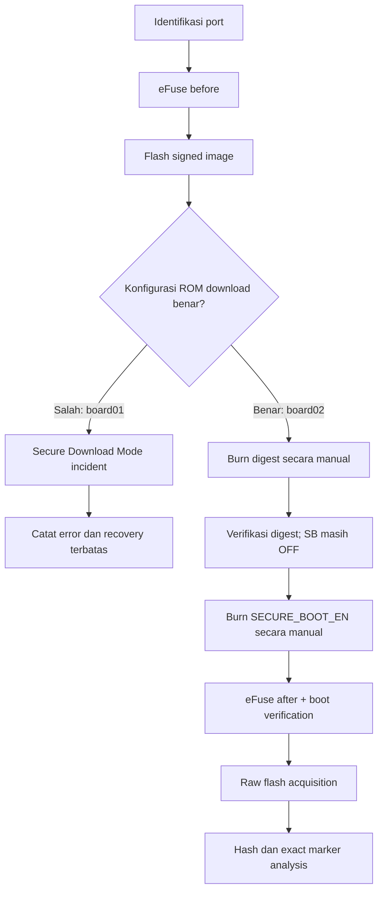
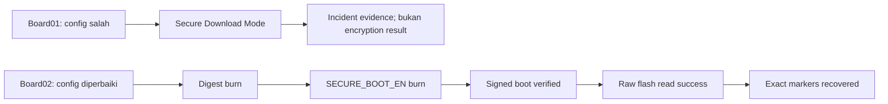

# Panduan membaca screenshot — SKENARIO_2 / B_SECURE_BOOT

Dokumen ini menjelaskan setiap screenshot dengan empat hal: tujuan langkah, command, hasil pada perangkat, dan konsekuensinya. Screenshot adalah bukti visual pendukung; nilai final tetap berasal dari `manifest.json`, `events.jsonl`, `efuse_before/after.json`, `acquisition.json`, dan `analysis.json`.

## Konteks board

- **board01 / COM5:** percobaan awal yang mengalami configuration incident.
- **board02 / COM7:** board pengganti untuk hasil B yang valid.

Kedua board tidak boleh digabungkan dalam satu caption atau satu kesimpulan.



## Mengapa incident board01 terjadi?

Incident bukan disebabkan oleh `burn-key` atau `burn-efuse`; pada board01 belum ada eFuse Secure Boot yang dibakar. Penyebabnya adalah image signed dibangun dengan konfigurasi ESP-IDF yang mengaktifkan **Secure ROM Download Mode** (`CONFIG_SECURE_ENABLE_SECURE_ROM_DL_MODE=y`). Konfigurasi ini membuat ROM download menjadi mode terbatas yang menolak operasi eFuse standar.

Urutan sebab-akibatnya:

1. Signed bootloader berhasil ditulis. `Hash of data verified` hanya membuktikan byte berhasil ditulis, bukan bahwa konfigurasi keamanan sudah benar.
2. Setelah reset, ROM masuk Secure Download Mode karena konfigurasi image.
3. `espefuse summary` ditolak dengan pesan `Secure Download Mode is enabled. The tool can not read eFuses.`
4. Snapshot eFuse normal dan raw-flash acquisition tidak dapat dilanjutkan melalui jalur biasa.
5. `get-security-info --no-stub` masih dipakai sebagai observasi read-only terbatas. Hasilnya menunjukkan Secure Boot dan Flash Encryption tetap disabled; incident ini bukan bukti Secure Boot aktif.

Perbaikan metodologis: build ulang dengan `CONFIG_SECURE_INSECURE_ALLOW_DL_MODE=y`, tanpa secure ROM download dan tanpa disable ROM download, kemudian gunakan board02. Tidak ada eFuse board01 yang di-burn selama incident.

## Fase incident — board01 / COM5

### Gambar 1 — inventaris port


**Tujuan:** menentukan port Windows target.

**Command:**

```cmd
python -m serial.tools.list_ports -v
```

**Hasil:** `COM5` teridentifikasi sebagai USB-Enhanced-SERIAL CH343. Port Bluetooth yang ikut tampil bukan target ESP32-S3.

**Konsekuensi:** command board01 harus memakai `--port COM5`. Screenshot ini hanya membuktikan identitas interface, bukan state keamanan.

### Gambar 2 — snapshot eFuse sebelum perubahan


**Command:**

```cmd
python -m espefuse --chip esp32s3 --port COM5 summary
```

**Tujuan:** membuat kontrol sebelum provisioning. `summary` bersifat read-only; output disimpan sebagai `efuse_before_raw.txt` dan `efuse_before.json` tanpa overwrite.

### Gambar 3 — Secure Boot dan Flash Encryption masih OFF


Field penting: `SECURE_BOOT_EN=False`, `SPI_BOOT_CRYPT_CNT=0`, key purpose masih `USER`, dan download mode belum disabled. Ini adalah kondisi awal, bukan hasil B.

### Gambar 4 — menulis signed image


**Command yang benar:**

```cmd
python -m esptool --chip esp32s3 --port COM5 write-flash --flash-size 16MB 0x0000 "<bootloader-signed.bin>" 0x8000 "<partitions-signed.bin>" 0x10000 "<firmware-signed.bin>"
```

Offset `0x0000`, `0x8000`, dan `0x10000` masing-masing adalah bootloader, partition table, dan aplikasi. `Wrote ...` serta `Hash of data verified` hanya membuktikan penulisan berhasil; enforcement Secure Boot ditentukan eFuse/ROM.

**Konsekuensi:** setelah reset, image mulai dijalankan dan konfigurasi secure ROM download yang keliru memicu incident pada gambar berikutnya.

### Gambar 5 — Secure Download Mode incident


**Command yang gagal:**

```cmd
python -m espefuse --chip esp32s3 --port COM5 summary
```

**Error:** `Secure Download Mode is enabled. The tool can not read eFuses.`

**Makna teknis:** ROM mengizinkan koneksi download terbatas, tetapi menolak akses eFuse normal. Ini bukan indikasi `SECURE_BOOT_EN=1`.

Screenshot juga memuat error `'Get-FileHash' is not recognized...` karena cmdlet PowerShell dijalankan di `cmd.exe`. Kesalahan shell ini tidak mengubah board; gunakan PowerShell atau Python untuk hashing.

**Observasi read-only pemulihan:**

```cmd
python -m esptool --chip esp32s3 --port COM5 --no-stub get-security-info
```

Output menunjukkan Secure Boot disabled, Flash Encryption disabled, dan crypt count `0x0`. Board dipulihkan untuk boot aplikasi terbatas, tetapi raw-flash read standar tidak dianggap berhasil. Incident disimpan dan tidak dihitung sebagai hasil confidentiality atau marker recovery B.

## Fase valid — board02 / COM7

### Gambar 6 — preview burn Secure Boot digest


**Command:**

```cmd
python -m espefuse --chip esp32s3 --port COM7 burn-key BLOCK_KEY0 "<secure_boot_digest.bin>" SECURE_BOOT_DIGEST0
```

Tool menampilkan perubahan `BLOCK_KEY0 -> SECURE_BOOT_DIGEST0` dan berhenti pada prompt `BURN`. Belum ada perubahan sebelum operator mengonfirmasi. Ini provisioning trust anchor, bukan flash ulang.

### Gambar 7 — digest berhasil diprogram


`BURN BLOCK4 - OK`, `BURN BLOCK0 - OK`, dan `Successful` membuktikan digest tersimpan. `SECURE_BOOT_EN` masih OFF; enforcement belum aktif.

### Gambar 8 — summary setelah digest


```cmd
python -m espefuse --chip esp32s3 --port COM7 summary
```

Ini pemeriksaan read-only setelah digest. Tujuannya memastikan digest terbaca dan tidak ada perubahan Flash Encryption atau download-mode yang tidak direncanakan.

### Gambar 9 — checkpoint sebelum enforcement


`KEY_PURPOSE_0=SECURE_BOOT_DIGEST0` sudah benar, tetapi `SECURE_BOOT_EN=False`. Caption yang benar adalah **checkpoint sebelum enablement**, bukan “Secure Boot aktif”.

### Gambar 10 — preview enable Secure Boot


```cmd
python -m espefuse --chip esp32s3 --port COM7 burn-efuse SECURE_BOOT_EN 1
```

Tool menunjukkan perubahan `0b0 -> 0b1`, lalu meminta `BURN`. Flash Encryption, UART download disable, JTAG disable, dan key revoke sengaja tidak diprogram agar B hanya mengisolasi Secure Boot.

### Gambar 11 — Secure Boot aktif


Setelah operator mengetik `BURN`, `Checking eFuses... Successful` menunjukkan bit berhasil diprogram. `efuse_after.json` mengonfirmasi `SECURE_BOOT_EN=True`, `SPI_BOOT_CRYPT_CNT=0`, dan `ENABLE_SECURITY_DOWNLOAD=False`.

## Ringkasan konsekuensi

| Fase | State perangkat | Status penelitian |
|---|---|---|
| board01 sebelum incident | Secure Boot OFF, FE OFF | kontrol awal |
| board01 setelah signed flash | image tertulis, konfigurasi ROM download salah | incident |
| board01 Secure Download Mode | eFuse read standar ditolak | interface-failure evidence |
| board02 setelah digest | trust anchor ada, enforcement belum aktif | checkpoint |
| board02 setelah `SECURE_BOOT_EN` | Secure Boot ON, FE OFF | provisioning B berhasil |
| board02 acquisition + marker scan | raw flash terbaca, marker plaintext ditemukan | hasil utama B |



Kesimpulan B berasal dari board02/COM7 dan satu acquisition try valid. Board01 tetap penting sebagai bukti bahwa konfigurasi ROM download harus divalidasi sebelum flashing, dan bahwa kegagalan membaca eFuse tidak boleh dilaporkan sebagai Secure Boot atau Flash Encryption result.
