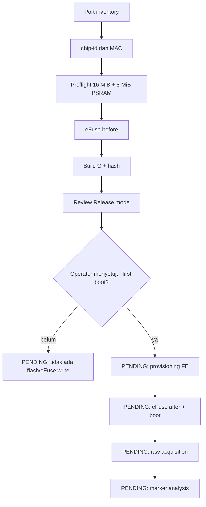

# Panduan screenshot — SKENARIO_3 / C_FLASH_ENCRYPTION

> **ARSIP CHECKLIST AWAL.** Label `PENDING_CAPTURE` dalam file ini adalah status perencanaan lama, bukan status hasil Skenario 3. Lihat [status visual terkini](README.md) dan [laporan final](../../../SKENARIO_3.md).

> PEMBARUAN: seluruh 22 screenshot operator kini tersedia dalam [dossier terverifikasi](review_20261026/README.md), lengkap dengan gambar, nama asli/salinan, narasi setiap langkah, SHA-256 dan [timeline](review_20261026/TIMELINE.md). Panduan di bawah merupakan checklist awal; status PENDING dan keterangan belum provisioning di dalamnya bersifat historis. State terbaru adalah insiden provisioning parsial V2 tanggal 26 Oktober, dengan perubahan eFuse teramati. C11/C12 tetap belum dijalankan.

Dokumen ini adalah caption guide untuk tim naskah. Setiap gambar harus menjelaskan tujuan command, output, konsekuensi perangkat, dan status evidence. Tidak ada gambar yang boleh dianggap sebagai hasil observasi apabila command belum benar-benar dijalankan.

## Status visual saat ini

Board03 sudah memiliki evidence terminal untuk fase preflight dan build. Screenshot provisioning, boot setelah Flash Encryption, acquisition, dan analisis belum tersedia karena operator belum melewati destructive gate.



## Identitas board

Board03 adalah `COM9`, MAC `e0:72:a1:d5:4d:fc`. Board02 Skenario 2 adalah `COM7`, MAC `44:1b:f6:8c:ab:cc`. Jangan memakai screenshot COM7 untuk Skenario 3.

## Checklist screenshot

| ID | Nama file | Fase | Isi yang harus terlihat | Status |
|---|---|---|---|---|
| C01 | `C01_port_inventory_board03_COM9.png` | Identitas | `serial.tools.list_ports -v` | `PENDING_CAPTURE` |
| C02 | `C02_chip_id_board03_MAC.png` | Identitas | `esptool chip-id` dan MAC | `PENDING_CAPTURE` |
| C03 | `C03_preflight_board03_N16R8.png` | Preflight | flash/PSRAM validation | `PENDING_CAPTURE` |
| C04 | `C04_efuse_before_board03.png` | eFuse before | Secure Boot/crypt counter/download | `PENDING_CAPTURE` |
| C05 | `C05_build_start_C.png` | Build | PlatformIO environment C | `PENDING_CAPTURE` |
| C06 | `C06_build_success_C_hashes.png` | Build | completion dan artifact hashes | `PENDING_CAPTURE` |
| C07 | `C07_provisioning_plan_release.png` | Gate | plan dan mode Release | `PENDING_CAPTURE` |
| C08 | `C08_flash_or_first_boot_C.png` | Device change | flash berhasil; first boot incident | `OBSERVED_INCIDENT` |
| C09 | `C09_efuse_after_flash_encryption.png` | eFuse after | FE state observed | `PENDING_CAPTURE` |
| C10 | `C10_serial_boot_C.png` | Runtime | reboot loop dan FE check error | `OBSERVED_INCIDENT` |
| C11 | `C11_acquisition_C.png` | Acquisition | status, size, stdout/stderr | `PENDING_CAPTURE` |
| C12 | `C12_analysis_C_markers.png` | Analysis | SHA-256 dan marker result | `PENDING_CAPTURE` |

`PENDING_CAPTURE` berarti screenshot belum diambil; jangan mengarang gambar atau hasilnya. C08/C10 sudah memiliki output nyata, tetapi screenshot operator tetap perlu disimpan.

## Fase 1 — identitas dan preflight

### C01 — port inventory

**Tujuan:** memastikan COM9 adalah USB-serial board baru. Bluetooth COM3/COM4/COM6/COM8 bukan target.

```cmd
python -m serial.tools.list_ports -v
```

Tidak mengubah eFuse.

### C02 — chip-id dan MAC

```cmd
python -m esptool --chip esp32s3 --port COM9 chip-id
```

**Observed:** ESP32-S3 v0.2, MAC `e0:72:a1:d5:4d:fc`, PSRAM 8 MB. Command read-only, meskipun dapat melakukan reset melalui RTS.

### C03 — hardware preflight

```cmd
python scripts/preflight.py --run <RUN> --port COM9 --board-marking "same-class-N16R8-marking-not-recorded" --wiring "USB-C CH343 COM9; external 3.3V USB-to-TTL not used"
```

Hasil: flash 16 MiB dan PSRAM 8 MiB tervalidasi. Simpan `preflight.json`, raw chip info, dan raw flash ID.

### C04 — eFuse before

```cmd
python scripts/capture_efuse.py --run <RUN> --port COM9 --phase before
```

Field yang diamati:

```text
SECURE_BOOT_EN = false
SPI_BOOT_CRYPT_CNT = 0 / Disable
ENABLE_SECURITY_DOWNLOAD = false
```

Snapshot ini adalah kontrol sebelum perubahan dan tidak boleh ditimpa.

## Fase 2 — build C

### C05/C06 — build dan hash

```cmd
python scripts/build_evidence.py --run <RUN> --scenario C_FLASH_ENCRYPTION
```

Resolved sdkconfig harus memuat:

```text
CONFIG_SECURE_FLASH_ENCRYPTION_MODE_RELEASE=y
# CONFIG_SECURE_BOOT is not set
CONFIG_NVS_SEC_KEY_PROTECT_USING_FLASH_ENC=y
```

**Peringatan:** Release mode dapat membuat first boot memulai provisioning. Build success tidak sama dengan Flash Encryption sudah aktif.

## Fase 3 — provisioning gate

### C07 — provisioning plan

```cmd
python scripts/provisioning_plan.py --run <RUN>
```

Screenshot harus menunjukkan intended change `Flash Encryption key and enablement`. Planner tidak menulis eFuse.

Operator wajib berhenti setelah C07 untuk review mode Release, board MAC, eFuse before, build hash, dan konsekuensi irreversible.

## Fase 4 — first boot dan incident yang teramati

C08–C12 hanya boleh diberi caption setelah command benar-benar dijalankan dan artefaknya tersimpan. Pada run saat ini, C08 dan C10 menghasilkan incident, bukan boot sukses.

### C08 — flash berhasil, first boot gagal

`Hash of data verified` membuktikan image berhasil ditulis. Setelah reset, board tidak mencapai aplikasi normal; jangan menyebut langkah ini sebagai provisioning Flash Encryption berhasil.

Output incident:

```text
E (338) flash_encrypt: Flash encryption eFuse bit was not enabled in bootloader but CONFIG_SECURE_FLASH_ENC_ENABLED is on
abort() was called...
Rebooting...
```

### C09 — eFuse after

```cmd
python scripts/capture_efuse.py --run <RUN> --port COM9 --phase after
```

Interpretasi harus berasal dari `efuse_after.json`. Secure Boot harus tetap `false`; Flash Encryption harus dibuktikan melalui crypt counter/configuration yang observed.

### C10 — serial boot incident

```cmd
python scripts/capture_serial.py --run <RUN> --port COM9 --seconds 35
```

`runtime_status.json` mencatat `boot_confirmed=false`, tanpa `SECRET_LOG_EXPOSURE`, dan serial log berisi reboot loop. Pemeriksaan read-only sesudahnya tetap menunjukkan `SPI_BOOT_CRYPT_CNT=0`, `SECURE_BOOT_EN=False`, dan `ENABLE_SECURITY_DOWNLOAD=False`. Ini adalah configuration/provisioning incident, bukan bukti encryption.

### C11 — acquisition

```cmd
python scripts/acquire_flash.py --run <RUN> --port COM9 --baud 460800
```

Screenshot harus memperlihatkan command, offset, requested size, status, exit code, dan apakah dump penuh atau partial. Timeout/rejection adalah evidence acquisition failure, bukan otomatis bukti encryption.

### C12 — analysis

```cmd
python scripts/analyze_dump.py --run <RUN>
python scripts/compare_results.py
```

Gunakan exact marker scan dari `analysis.json`. Jika acquisition belum ada, gunakan `null`/`NOT_RUN`, bukan `false`.

## Membedakan hasil dan incident

| Kondisi | Arti | Kesimpulan yang sah |
|---|---|---|
| Build gagal | host/config/compiler error | bukan hasil security |
| Flash/first boot gagal | provisioning atau image mismatch | catat failure; jangan sebut dump terenkripsi |
| Raw read berhasil, marker hilang | perlu dikaitkan dengan eFuse dan struktur dump | kandidat evidence confidentiality |
| Raw read timeout/rejected | interface/acquisition failure atau restriction | belum cukup untuk menyimpulkan encryption |

## Aturan caption

1. Selalu tulis board ID dan COM port.
2. Bedakan `before`, `plan`, `after`, dan `observed result`.
3. Jangan menyebut build success sebagai eFuse success.
4. Jangan menyebut entropy tinggi sebagai proof encryption.
5. Jangan mengisi marker `false` bila acquisition belum dijalankan.
6. C01–C07 adalah pre-provisioning evidence; C08/C10 adalah incident evidence; C09 dan C11–C12 masih pending.
