# Dokumentasi visual Skenario 3 — pembacaan per langkah

> **Cakupan historis: screenshot C01–C22, sebelum run valid.** Status `PENDING_CAPTURE` atau “belum dilakukan” di bawah hanya berlaku pada saat gambar tersebut dibuat. Hasil akhir Skenario 3, termasuk eFuse `0x7`, dump 16 MiB, dan scan marker, ada di [laporan final](../../../../SKENARIO_3.md) dan didukung log/JSON/BIN pada run `044fc73049da`. Tidak ada screenshot operator untuk tahap akhir itu.

Status **pada akhir cakupan gambar**: FIRST_BOOT_PARTIAL_PROVISIONING_INCIDENT. Dokumentasi retrospektif dari screenshot operator dan evidence lokal. Status skenario saat ini adalah `VALID_C_RUN` pada run `044fc73049da`. Command di bawah adalah rekonstruksi kegiatan yang telah dilakukan, bukan instruksi untuk mengulang provisioning.

Sumber gambar asli tetap di folder operator. Salinan tidak diubah pikselnya; nama deskriptif dipakai untuk mencegah salah caption. Semua 22 gambar memiliki SHA-256 pada screenshot_manifest.json. Waktu file bukan waktu eksekusi command.

Pada waktu 22 screenshot ini dibuat, C11/C12 belum dilakukan. Akuisisi dan analisis kemudian selesai pada run valid `044fc73049da`; lihat laporan final. C13–C19 adalah sisipan diagnosis setelah insiden, bukan pengganti acquisition/analisis. Nomor mengikuti percakapan, bukan nomor try. C15 tercakup dalam file asli c14.1.

## Peta gambar

| Asli | Salinan | Konteks |
|---|---|---|
| c1.png | [C01_port_inventory.png](C01_port_inventory.png) | Inventaris port |
| c2.png | [C02_chip_identity.png](C02_chip_identity.png) | Identitas chip |
| c3.png | [C03_preflight_json.png](C03_preflight_json.png) | Validasi N16R8 |
| c4.1 - running summary.png | [C04a_efuse_summary.png](C04a_efuse_summary.png) | Pembacaan eFuse awal |
| c4.2 - summary secure boot confirm disabled.png | [C04b_security_fuses_before.png](C04b_security_fuses_before.png) | State keamanan awal |
| c5.png | [C05_security_fuses_repeated.png](C05_security_fuses_repeated.png) | Cuplikan eFuse berulang |
| c6.png | [C06_build_manifest_initial.png](C06_build_manifest_initial.png) | Manifest build awal |
| c7.png | [C07_release_plan.png](C07_release_plan.png) | Rencana provisioning |
| c8.png | [C08_initial_flash_verified.png](C08_initial_flash_verified.png) | Flash awal |
| c9.png | [C09_serial_capture_initial.png](C09_serial_capture_initial.png) | Capture serial awal |
| c9.2 - efuse after flash FE.png | [C09b_efuse_diff_empty_initial.png](C09b_efuse_diff_empty_initial.png) | Diff insiden pertama |
| c10.png | [C10_initial_incident_note.png](C10_initial_incident_note.png) | Catatan insiden pertama |
| c13.png | [C13_run_path_typo.png](C13_run_path_typo.png) | Run diagnosis dan kesalahan path |
| c14.png | [C14_gate_failed.png](C14_gate_failed.png) | Koreksi path dan gate gagal |
| c14.1 - dokumentasi incident.png | [C15_mismatch_evidence.png](C15_mismatch_evidence.png) | Bukti mismatch C15 |
| c16.png | [C16_new_run.png](C16_new_run.png) | Run perbaikan V2 |
| c17.png | [C17_clean_build.png](C17_clean_build.png) | Membersihkan artefak kompilasi |
| c18.png | [C18_archived_build.png](C18_archived_build.png) | Build dan arsip |
| c19.png | [C19_gate_pass.png](C19_gate_pass.png) | Gate konfigurasi PASS |
| c20.png | [C20_efuse_before_v2.png](C20_efuse_before_v2.png) | Snapshot before V2 |
| c21.png | [C21_flash_v2_verified.png](C21_flash_v2_verified.png) | Flash V2 |
| c22.png | [C22_serial_capture_v2.png](C22_serial_capture_v2.png) | Capture first boot V2 |

## C01 — Inventaris port

Sumber: `c1.png`. Command/tampilan: `serial.tools.list_ports -v`.

COM9 adalah CH343; port Bluetooth bukan target. Inventaris port belum membuktikan identitas MCU.

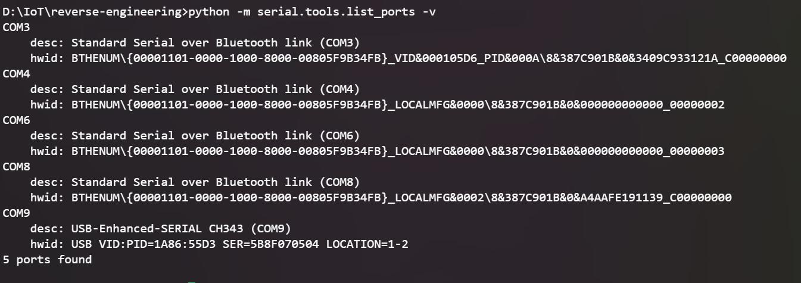

## C02 — Identitas chip

Sumber: `c2.png`. Command/tampilan: `esptool --chip esp32s3 --port COM9 chip-id`.

ESP32-S3 v0.2, MAC e0:72:a1:d5:4d:fc, PSRAM 8 MB. Peringatan tidak adanya chip ID menjelaskan penggunaan MAC. Command juga menampilkan hard reset via RTS.

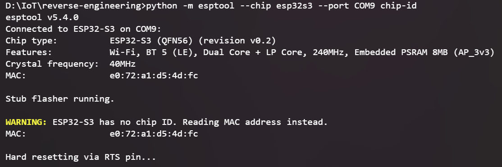

## C03 — Validasi N16R8

Sumber: `c3.png`. Command/tampilan: `type preflight.json`.

JSON run 1d34048d0b2e mencatat 16777216 byte flash dan PSRAM 8 MB. Marking PCB masih belum dicatat; kapasitas berasal dari deteksi tooling.

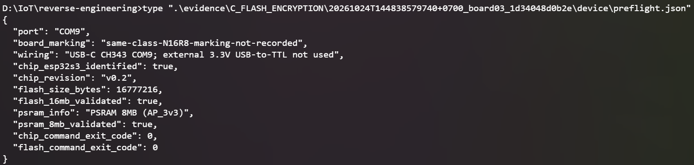

## C04a — Pembacaan eFuse awal

Sumber: `c4.1 - running summary.png`. Command/tampilan: `espefuse --chip esp32s3 --port COM9 summary`.

Summary membaca konfigurasi silikon. WR_DIS dan RD_DIS bernilai 0 pada gambar. Membaca summary tidak memprogram eFuse.

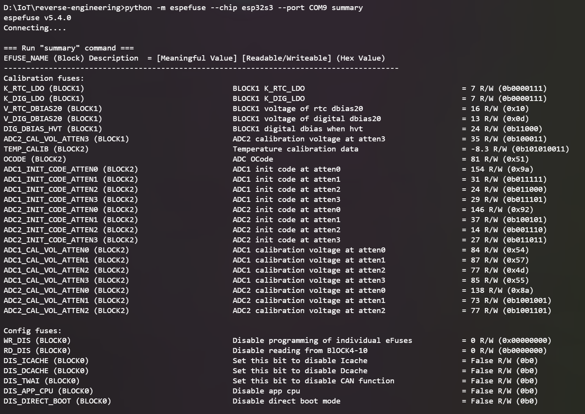

## C04b — State keamanan awal

Sumber: `c4.2 - summary secure boot confirm disabled.png`. Command/tampilan: `espefuse summary (lanjutan)`.

Counter 000, Secure Boot false, tujuan key USER, download masih diizinkan. Ini kontrol before.

## C05 — Cuplikan eFuse berulang

Sumber: `c5.png`. Command/tampilan: `summary (cuplikan)`.

Isi gambar sama dengan C04b; bukan bukti build atau percobaan tambahan. Duplikasi diperiksa melalui SHA-256.

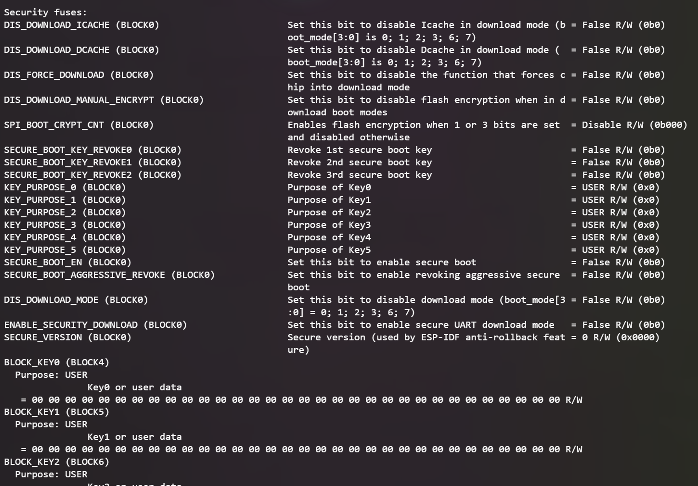

## C06 — Manifest build awal

Sumber: `c6.png`. Command/tampilan: `type build_manifest.json`.

Manifest mengikat commit, ukuran, hash dan artefak. Bootloader awal 21120 byte; kompilasi berhasil belum berarti konfigurasi perangkat konsisten.

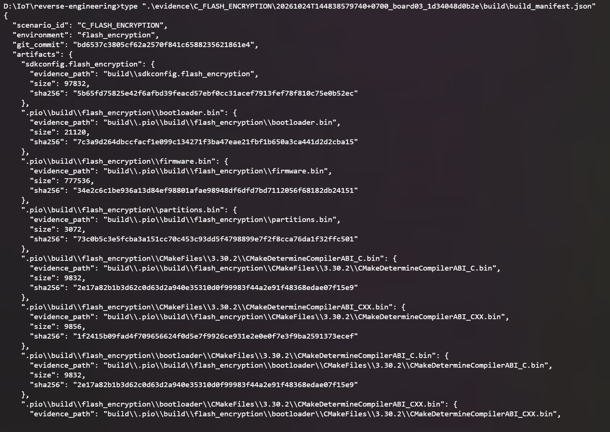

## C07 — Rencana provisioning

Sumber: `c7.png`. Command/tampilan: `type provisioning_plan.json`.

Release direncanakan, Secure Boot false. execution NOT_IMPLEMENTED hanya berarti planner tidak membakar eFuse. Bootloader yang dijalankan kemudian tetap dapat memprogram eFuse. Rencana ini terlalu umum untuk merinci seluruh proteksi.

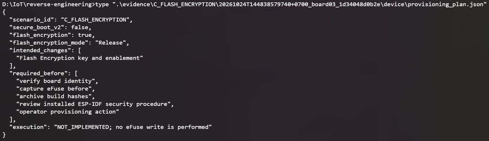

## C08 — Flash awal

Sumber: `c8.png`. Command/tampilan: `esptool write-flash (output)`.

Bootloader 21120 byte, tabel 3072 byte, aplikasi 777536 byte ditulis dan diverifikasi. Durasi transfer 1.4/0.0/44.7 detik; bukan durasi keseluruhan. Staying in bootloader berarti reset normal belum dilakukan oleh akhir command.

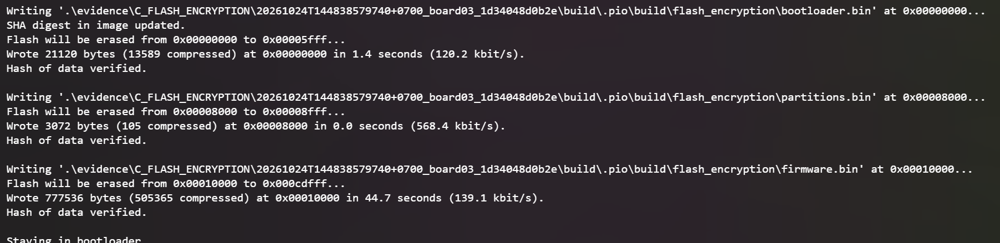

## C09 — Capture serial awal

Sumber: `c9.png`. Command/tampilan: `capture_serial.py --seconds 35`.

Gambar hanya menunjukkan command dan lokasi output run 1d34048d0b2e. Status boot harus dibaca dari file runtime.

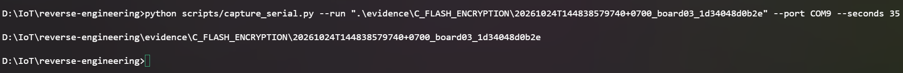

## C09b — Diff insiden pertama

Sumber: `c9.2 - efuse after flash FE.png`. Command/tampilan: `type efuse_diff.json`.

differences kosong berlaku untuk insiden pertama tanggal 24 Oktober. Jangan gunakan gambar ini untuk menyatakan eFuse tidak berubah pada insiden 26 Oktober.

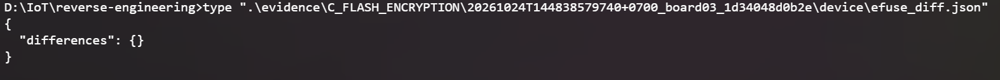

## C10 — Catatan insiden pertama

Sumber: `c10.png`. Command/tampilan: `membuka catatan incident`.

Gambar adalah narasi turunan, bukan terminal mentah. Error pemeriksaan FE menyebabkan abort karena aplikasi meminta FE tetapi bootloader tidak mengaktifkannya.

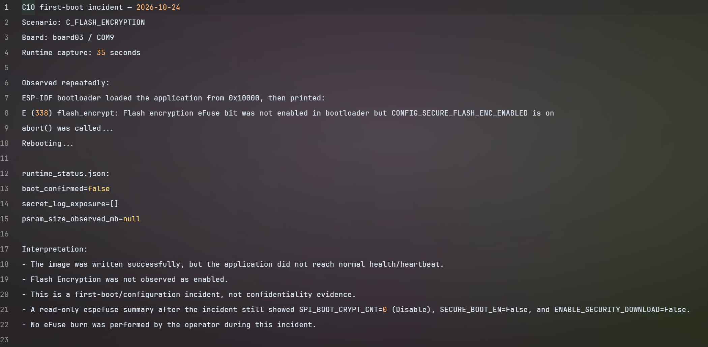

## C13 — Run diagnosis dan kesalahan path

Sumber: `c13.png`. Command/tampilan: `capture_versions.py; set RUN`.

Run aktual berawalan 20261026T152246530539; variabel pada gambar memakai timestamp contoh 170000000000. Kesalahan path memicu FileNotFoundError yang dilaporkan operator; gambar ini tidak memuat traceback.

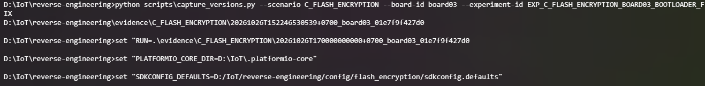

## C14 — Koreksi path dan gate gagal

Sumber: `c14.png`. Command/tampilan: `build_evidence.py; verify_build_security_config.py`.

RUN_VALID membuktikan manifest ditemukan. Pemeriksa menemukan aplikasi true dan bootloader false. STOP mencegah penggunaan build yang tidak konsisten.

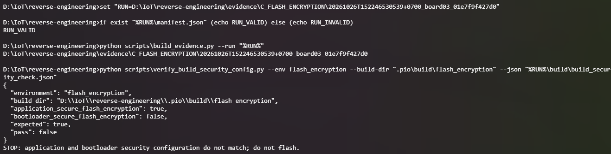

## C15 — Bukti mismatch C15

Sumber: `c14.1 - dokumentasi incident.png`. Command/tampilan: `findstr; type; verify_build_security_config.py`.

Flag ada pada header aplikasi, pencarian header bootloader kosong. Gambar bernama c14.1 ini memuat dokumentasi C15. Pengulangan command bukan try perangkat baru.

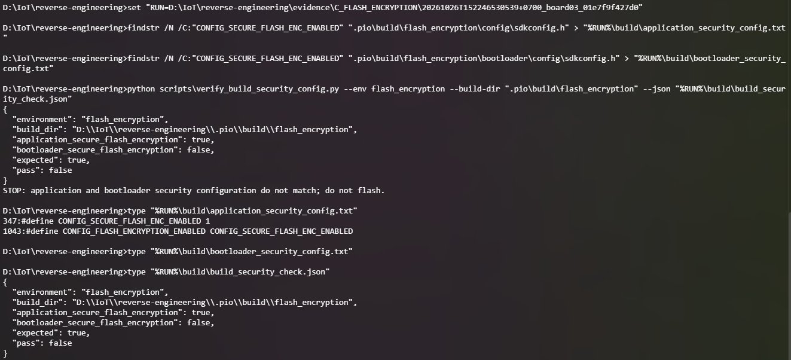

## C16 — Run perbaikan V2

Sumber: `c16.png`. Command/tampilan: `capture_versions.py; set RUN`.

Run baru 905c84ce2642 menjaga pemisahan evidence dari gate gagal. Nama folder lengkap berbeda dari field run_id yang hanya suffix UUID.

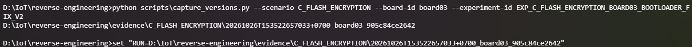

## C17 — Membersihkan artefak kompilasi

Sumber: `c17.png`. Command/tampilan: `platformio run -e flash_encryption -t clean`.

Clean berhasil 1.871 detik. Ini menghapus cache build host, bukan menghapus flash ESP32.

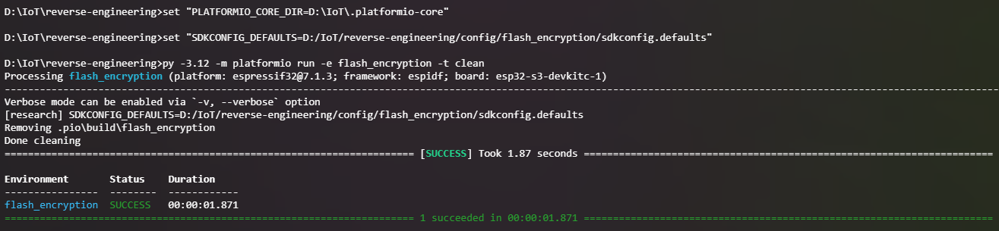

## C18 — Build dan arsip

Sumber: `c18.png`. Command/tampilan: `build_evidence.py --run`.

Path saja tidak membuktikan sukses; periksa build.log, manifest, dan exit code command yang diarsipkan.

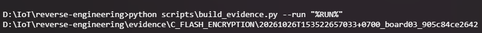

## C19 — Gate konfigurasi PASS

Sumber: `c19.png`. Command/tampilan: `verify_build_security_config.py; findstr`.

Kedua header memuat flag FE. PASS hanya memeriksa flag tersebut, tidak memvalidasi seluruh provisioning, JTAG, NVS, kelistrikan, atau ketahanan first boot.

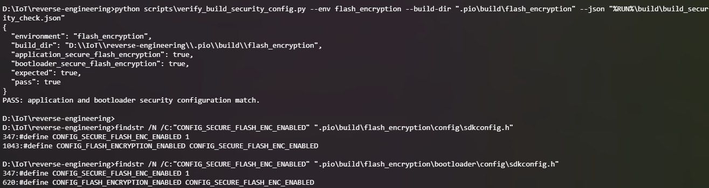

## C20 — Snapshot before V2

Sumber: `c20.png`. Command/tampilan: `capture_efuse.py --phase before`.

Lokasi output mengarah ke run V2. Nilai eFuse dibuktikan melalui JSON/raw pada run itu, bukan oleh path yang tercetak.

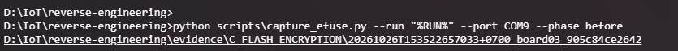

## C21 — Flash V2

Sumber: `c21.png`. Command/tampilan: `esptool write-flash (output)`.

Bootloader 32240 byte, tabel 3072 byte, aplikasi 777536 byte diverifikasi. Durasi transfer 2.0/0.0/44.7 detik. Keberhasilan tulis tidak membuktikan provisioning selesai.

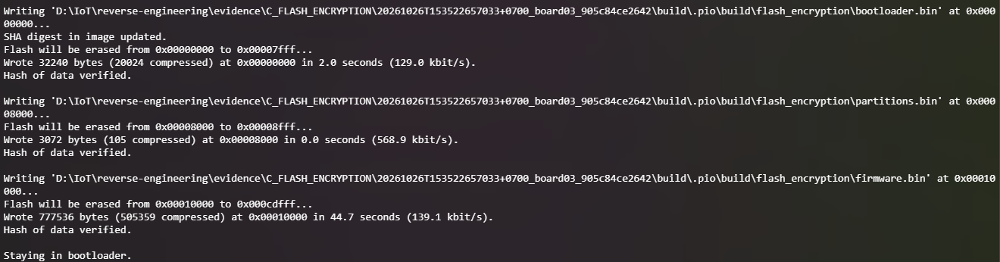

## C22 — Capture first boot V2

Sumber: `c22.png`. Command/tampilan: `capture_serial.py --seconds 35`.

Gambar hanya menunjukkan capture dan folder. Log mentah menunjukkan provisioning parsial dan boot gagal; jangan beri caption boot sukses.

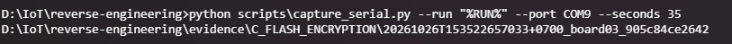

## Insiden terbaru: apa yang benar-benar terekam

Pada run 905c84ce2642, log pertama kali menunjukkan bootloader dan aplikasi dikenali. Pada 254 ms bootloader mulai membuat key; pada 279–301 ms terdapat BURN BLOCK4/BLOCK0 dan commit. Pada 648 ms bootloader melaporkan dirinya selesai dienkripsi; pada 690 ms tabel partisi selesai dienkripsi. Pada 839 ms dimulai enkripsi aplikasi di 0x10000 dengan panjang 0xbdd40. Berikutnya muncul ROM POWERON dan invalid header 0xb389d375, tanpa pesan penyelesaian aplikasi atau aktivasi counter.

Angka dalam log adalah waktu relatif sejak boot, bukan timestamp host dan tidak boleh digunakan untuk menentukan lama jeda hingga reset. Snapshot after membuktikan key purpose XTS_AES_128_KEY, proteksi key dan JTAG berubah, sementara SPI_BOOT_CRYPT_CNT tetap 0. Penyebab fisik reset belum terbukti. Gangguan daya, reset eksternal, dan transisi kontrol serial masih hipotesis.

Koreksi arahan sebelumnya: PASS satu flag belum cukup untuk menyatakan aman provisioning. Tidak adanya command burn manual juga tidak berarti tidak ada pembakaran eFuse: bootloader melakukan pembakaran saat first boot. Recovery baseline tanggal 24 Oktober tidak boleh diterapkan begitu saja pada state tanggal 26 Oktober.

Tidak tersedia screenshot terminal khusus eFuse after V2 dalam kiriman ini. Gunakan [snapshot after](../../../../evidence/C_FLASH_ENCRYPTION/20261026T153522657033+0700_board03_905c84ce2642/device/efuse_after.json) dan [serial mentah](../../../../evidence/C_FLASH_ENCRYPTION/20261026T153522657033+0700_board03_905c84ce2642/runtime/serial_boot.log); jangan membuat gambar seolah-olah berasal dari terminal operator.

## Alur aktual

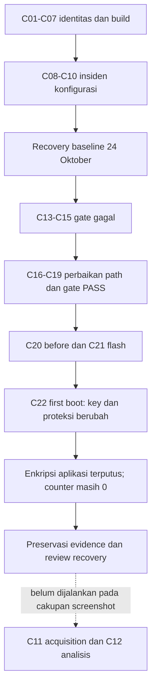

## Batas kesimpulan

Pada akhir cakupan screenshot C22, boot gagal dan provisioning parsial teramati; pengujian confidentiality belum dilakukan saat itu. Tahap tersebut kemudian diselesaikan dalam run valid yang didokumentasikan di laporan final. Dossier ini tetap mempertahankan pembacaan historis gambar dan tidak menyajikan screenshot baru seolah-olah berasal dari tahap akhir.

Rujukan mekanisme: [Espressif Flash Encryption](https://docs.espressif.com/projects/esp-idf/en/latest/esp32s3/security/flash-encryption.html). Dokumentasi menjelaskan enkripsi in-place sebelum counter menandai aktivasi; ini konsisten dengan urutan yang terekam, tetapi tidak membuktikan penyebab reset.
