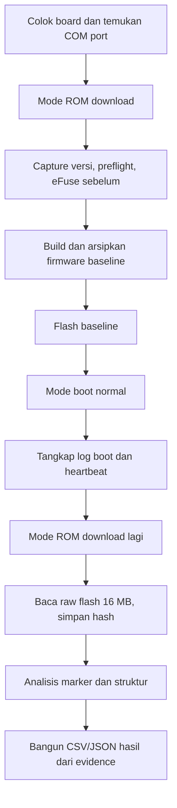
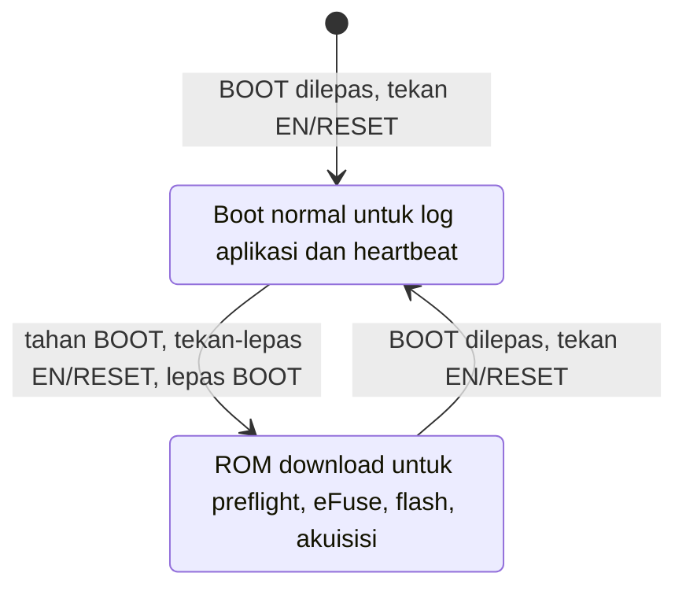

# Tutorial A_BASELINE: dari board kosong sampai data flash

Tutorial ini untuk **satu ESP32-S3 milik/yang diizinkan untuk riset**, pada Windows PowerShell, dari direktori `D:\IoT\reverse-engineering`. Hasil perangkat belum ada sebelum langkah-langkah ini dijalankan. Gunakan hanya firmware baseline dengan marker sintetis dari `seed.md`; jangan menjalankan konfigurasi B–D atau membakar eFuse pada tahap ini.

## Peta proses





Pada ESP32-S3, tombol **BOOT** biasanya menarik GPIO0 ke rendah. GPIO0 yang rendah saat reset memilih ROM download; tanpa itu chip mencoba menjalankan firmware di flash. Label tombol dapat berbeda pada PCB lain, jadi cocokkan dengan tulisan pada board. Beberapa board masuk ROM download otomatis melalui jalur DTR/RTS; urutan tombol di atas adalah cara manual yang bisa diamati. [Referensi boot mode Espressif](https://docs.espressif.com/projects/esptool/en/latest/esp32s3/advanced-topics/boot-mode-selection.html).

## 1. Siapkan port dan catatan board

1. Colok USB-C ke konektor **USB-to-UART** jika board memilikinya. Jika memakai adapter USB-to-TTL eksternal, gunakan logika 3,3 V, sambungkan TX adapter ke RX UART0 board, RX adapter ke TX UART0 board, dan GND ke GND. Verifikasi nama pin dari PCB/skema board; jangan menebak nomor GPIO. Tentukan satu sumber daya board yang jelas.
2. Buka PowerShell dan jalankan:

   ```powershell
   Set-Location 'D:\IoT\reverse-engineering'
   python -m serial.tools.list_ports -v
   ```

3. Catat COM port yang muncul saat board dicolok, misalnya `COM7`. Jika ada beberapa port, cabut-colok board dan bandingkan daftar. Dalam contoh berikut, ganti `COM7` dengan port aktual. Catat pula tulisan modul/PCB dan koneksi yang benar-benar digunakan.

   ```powershell
   $port = 'COM7'
   $boardId = 'board01'
   $marking = 'isi tulisan modul atau PCB yang terlihat'
   $wiring = 'isi konektor atau UART0, level 3.3 V, GND, dan sumber daya aktual'
   ```

Tutup VS Code Serial Monitor, PuTTY, atau terminal lain sebelum skrip memakai COM port. Hanya satu program dapat membukanya pada satu waktu. Board manifest PlatformIO yang dipakai proyek berawal dari varian N8; kapasitas 16 MB **harus dibuktikan oleh preflight**, bukan dari nama manifest.

## 2. Masuk ROM download dan buat satu run evidence

Dengan board menyala: **tahan BOOT → tekan dan lepaskan EN/RESET → lepaskan BOOT**. Pada board yang menyediakan keluaran ROM UART, pesan reset dapat menyebut `DOWNLOAD_BOOT` atau `DOWNLOAD(USB/UART0)`. Jika tidak terlihat, biarkan skrip preflight menguji koneksi; `esptool` juga dapat mengatur mode ini otomatis pada board dengan rangkaian reset yang sesuai.

```powershell
python scripts/capture_versions.py --scenario A_BASELINE --board-id $boardId
```

Skrip mencetak path evidence baru, misalnya `D:\IoT\reverse-engineering\evidence\A_BASELINE\20260926T..._board01_...`. **Salin seluruh path yang benar-benar dicetak** ke variabel berikut:

```powershell
$run = 'D:\IoT\reverse-engineering\evidence\A_BASELINE\<nama-direktori-yang-dicetak>'
Test-Path -LiteralPath "$run\manifest.json"
```

`Test-Path` harus menghasilkan `True`. Setiap percobaan fisik memakai direktori run baru; jangan memakai ulang direktori lama setelah percobaan gagal.

## 3. Preflight dan eFuse sebelum flashing

```powershell
python scripts/preflight.py --run $run --port $port --board-marking $marking --wiring $wiring
python scripts/capture_efuse.py --run $run --port $port --phase before
```

Periksa hasilnya:

```powershell
Get-Content -LiteralPath "$run\device\preflight.json"
Get-Content -LiteralPath "$run\device\efuse_before.json"
```

`chip_esp32s3_identified` dan `flash_16mb_validated` harus `true` sebelum flashing. `psram_8mb_validated` dapat tetap `null` jika port ROM tidak memberi bukti kapasitas PSRAM; catat marking fisik dan, bila tersedia, informasi boot/runtime. eFuse yang tidak dapat dibaca atau tidak terparse harus tetap dilaporkan sebagai kegagalan, bukan dianggap OFF.

Jika board tanpa auto-reset keluar dari ROM di antara tahap, ulangi urutan BOOT/EN sebelum skrip berikutnya. Preflight memakai `--after no-reset` pada `esptool` yang terpasang supaya dua pembacaan di dalamnya tidak sengaja me-reset board ke aplikasi.

## 4. Build dan flash baseline

```powershell
python scripts/build_evidence.py --run $run
python scripts/flash_baseline.py --run $run --port $port
```

`build_evidence.py` mengarsipkan log, `sdkconfig` final, BIN/ELF dan hash. `flash_baseline.py` hanya mengizinkan `A_BASELINE` setelah preflight mendeteksi 16 MB dan build berhasil. Bila upload tidak bisa masuk download mode otomatis, ulangi urutan BOOT/EN lalu lakukan **percobaan baru dalam run baru**; skrip sengaja menolak menimpa command evidence yang sudah ada.

## 5. Boot normal dan tangkap log

Lepaskan BOOT sepenuhnya, lalu tekan **EN/RESET** sekali. Jalankan perintah berikut; **sesaat setelah menekan Enter, tekan EN/RESET sekali lagi** supaya pesan boot tertangkap dari awal:

```powershell
python scripts/capture_serial.py --run $run --port $port --seconds 35
Get-Content -LiteralPath "$run\runtime\runtime_status.json"
```

`boot_confirmed` harus `true`: skrip mencari banner aplikasi dan heartbeat. Periksa juga `serial_boot.log` dan `serial_runtime.log`. Firmware memakai SSID/password sintetis; kegagalan Wi-Fi tersambung ke jaringan nyata adalah hal yang wajar. Nilai secret tidak boleh muncul di log; jika muncul, skrip mencatat `SECRET_LOG_EXPOSURE`.

Jika `boot_confirmed` bernilai `false`, cek apakah port yang dipakai memang jalur konsol UART0 dan apakah log dimulai sebelum reset. Port USB native dan USB-to-UART dapat muncul sebagai COM yang berbeda. Ulangi sebagai run baru agar evidence lama tetap utuh.

## 6. Kembali ke ROM dan akuisisi flash

Setelah penangkapan log selesai dan COM port bebas, ulangi: **tahan BOOT → tekan dan lepaskan EN/RESET → lepaskan BOOT**. Lalu jalankan:

```powershell
python scripts/acquire_flash.py --run $run --port $port
Get-Content -LiteralPath "$run\acquisition\acquisition.json"
```

Untuk flash terdeteksi 16 MB, skrip meminta offset `0x0` dan ukuran `0x1000000` byte. Pembacaan dapat memakan waktu. `status` harus `SUCCESS`, `actual_size` harus `16777216`, dan SHA-256 harus ada. Jika pembacaan gagal atau hanya sebagian, `stdout.log`, `stderr.log`, metadata, dan dump parsial (jika ada) tetap menjadi evidence. Jangan menghapus atau mengedit dump mentah.

Kecepatan serial bawaan akuisisi adalah `460800` baud dan disimpan di metadata. Jika sambungan CH343 tidak stabil, buat run baru dan gunakan `--baud 115200`; jangan mengulang pada direktori evidence yang sama.

## 7. Analisis dan agregasi

```powershell
python scripts/analyze_dump.py --run $run
python scripts/compare_results.py
Get-Content -LiteralPath "$run\analysis\analysis.txt"
Get-Content -LiteralPath 'results\experiment_summary.csv'
```

Periksa `analysis.json` untuk ukuran, SHA-256, marker yang ditemukan beserta jumlah dan offset tepatnya, serta status parsing tabel partisi dan identifikasi aplikasi. Kolom agregasi yang belum diobservasi tetap kosong/null. Entropi adalah bukti pendukung, bukan bukti tunggal enkripsi.

## Jika suatu langkah gagal

| Gejala | Pemeriksaan berikutnya |
|---|---|
| COM port tidak muncul | Coba kabel data lain, lihat Device Manager/daftar port, pastikan board mendapat daya. |
| Port sibuk | Tutup Serial Monitor/terminal lain sebelum menjalankan skrip. |
| `esptool` tidak terhubung | Pastikan COM tepat; ulangi urutan BOOT/EN dan cek jalur USB-to-UART atau wiring UART0. |
| Flash terdeteksi bukan 16 MB | Hentikan flashing/akuisisi baseline dan catat hasil preflight; verifikasi modul fisik. |
| Build berhasil tetapi log kosong | Pakai port konsol yang benar, mulai `capture_serial.py` lalu tekan EN/RESET. |
| Flash read gagal/parsial | Simpan run tersebut; buat run baru bila akan mencoba lagi. Jangan mengubah hasil menjadi sukses secara manual. |

Sumber tombol dan mode: [Espressif ESP32-S3 Boot Mode Selection](https://docs.espressif.com/projects/esptool/en/latest/esp32s3/advanced-topics/boot-mode-selection.html) dan [ESP32-S3-DevKitC-1 User Guide](https://docs.espressif.com/projects/esp-dev-kits/en/latest/esp32s3/esp32-s3-devkitc-1/user_guide_v1.1.html). Board milikmu mungkin memiliki tata letak atau label berbeda; cocokkan dengan PCB/skema aktual.
